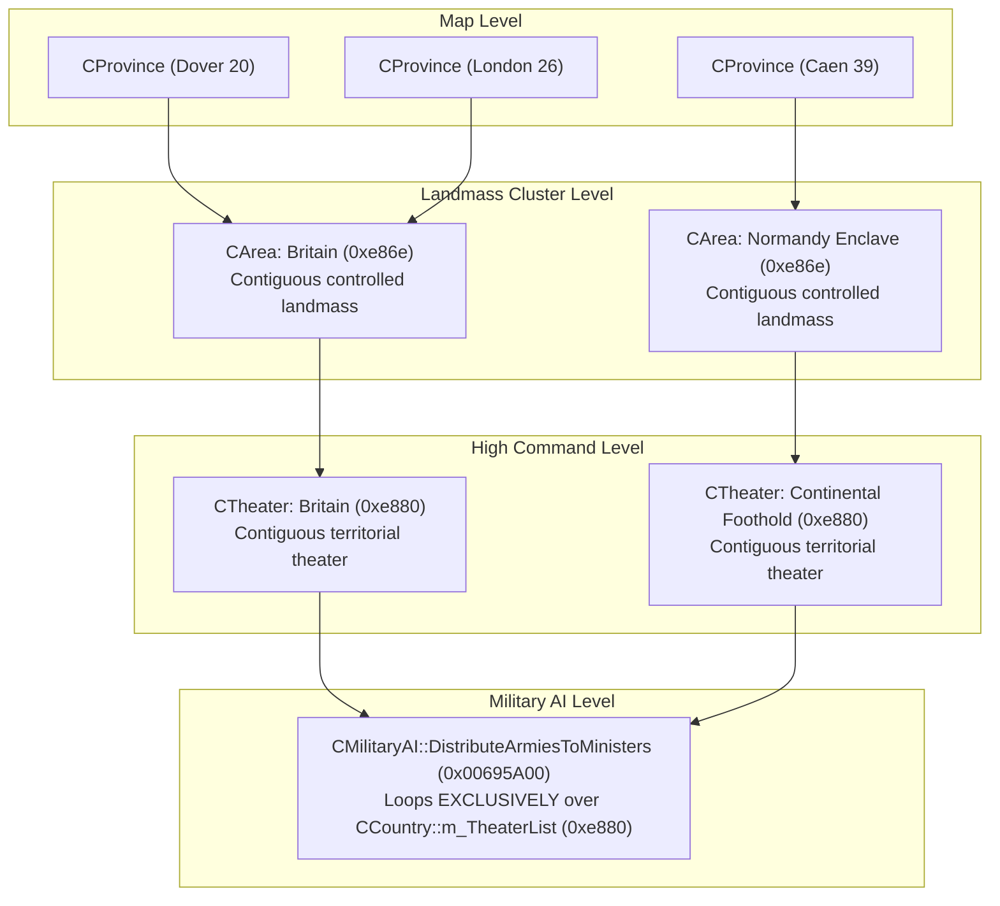

# Darkest Hour Garrison AI Architecture & Division Quotas (Retail Engine)

**Engine**: Darkest Hour / Europa Engine (v1.05.2, 32-bit x86 PE)  
**Binary Executable**: `Darkest Hour.exe` (Vanilla Checksum: `TENE`)  
**Primary Routine**: `CGarrisonAI::UpdateGarrisons` (`FUN_0068ba50` at virtual address `0x0068BA50`)  
**Scope**: Authoritative reference for the unmodified retail engine's Garrison AI architecture, mathematical formulas, threat scaling, homeland defense collapse checks, area division quotas, province allocation, and retail architectural limitations.

---

## 1. Overview & Architecture

> [!IMPORTANT]
> ### Fundamental Engine Distinction: Runtime `CArea*` vs. `Province.csv` Map "Area"
> In Darkest Hour, the term **"Area"** refers to two distinct, unrelated concepts:
>
> 1. **`Province.csv` Map "Area" (Static Geographic Label)**:
>    - Defined in the 3rd column of `Province.csv` (e.g., `Paris`, `Normandy`, `Brittany`, `Ruhr`).
>    - Stored in `CProvince::m_szMapArea` (`[prov + 0x1A]`) as a text string.
>    - **Used strictly for**: Regional weather zones, regional air mapmode overlays, and localized text groupings.
>    - **Zero AI Relevance**: Garrison AI, AI military evaluations, transport ministers, and strategic scripts **never** inspect or use this column.
>
> 2. **Engine Runtime `CArea*` (Contiguous Controlled Landmass Cluster)**:
>    - A dynamic C++ heap object (`sizeof = 0x74`) created during map initialization and recalculated on territory ownership changes via recursive flood-fill (`FUN_004c94f1`).
>    - Stored in `CProvince::m_pArea` (`[prov + 0x482]`) as a pointer to the cluster object.
>    - Encompasses **every contiguous, land-connected province controlled by the same country on that landmass**.
>    - For example, in Metropolitan France, all connected French-controlled provinces form **a single runtime `CArea*`**. Even though `Province.csv` categorizes them into different static "Areas" (Paris, Brittany, Normandy), at runtime they form **one unified `CArea*`** containing Paris (56), Le Havre (41), Cherbourg (42), and all other connected French provinces and coastal ports.
>    - **Garrison AI operates exclusively on runtime `CArea*` clusters**. When script commands specify `area_multiplier = { 56 = 8 }`, province `56` is a lookup seed used by the engine to resolve its containing contiguous cluster (`56->m_pArea`), scaling the garrison target for that entire contiguous landmass.

### 1.1 Architectural Comparison Matrix

| Attribute | `Province.csv` Map "Area" | Engine Runtime `CArea*` |
|---|---|---|
| **Defined In** | `map/Map_X/province.csv` (Column 3) | Dynamically initialized in C++ engine memory |
| **Data Structure** | `CString` at `[CProvince + 0x1A]` | Pointer `CArea*` at `[CProvince + 0x482]` (`sizeof = 0x74`) |
| **Grouping Criteria** | Static geographical/historical region | Contiguous land connection of same-controller provinces |
| **Creation Mechanism** | Parsed from CSV text at startup | Recursive flood-fill algorithm (`FUN_004c94f1`) |
| **Scope in France** | "Paris" consists of ~3 provinces (54, 55, 56), no ports | French mainland forms a single contiguous cluster with all ports (40, 41, 42, etc.) |
| **Engine Usage** | Weather patterns, air mapmode, text | **Garrison AI (`UpdateGarrisons`)**, front detection, transport dispatch |
| **Script Interaction** | None | Targeted via `area_multiplier = { <prov_id> = <mult> }` (prov ID serves as cluster lookup seed) |

### 1.2 The Engine's Recursive Flood-Fill Construction (`FUN_004c94f1`)

When building or updating `CArea*` objects, the engine executes a recursive flood-fill across adjacent provinces:

```c
void __thiscall CArea::AddProvinceRecursive(CArea *this, CProvince *pSeed)
{
    CCountry *pController = pSeed->m_pController; // [pSeed + 0x3d8]
    this->AddProvince(pSeed);                     // Adds to linked list [this + 0x2c]
    pSeed->m_pArea = this;                        // [pSeed + 0x482] = this

    for (int i = 0; i < pSeed->m_nNeighbors; i++) {
        CProvince *pNeighbor = pSeed->GetNeighbor(i);
        // Skip if neighbor controlled by different country or already assigned to a CArea
        if (pNeighbor->m_pController != pController || pNeighbor->m_pArea != NULL)
            continue;

        // Skip water bodies or impassable connections
        if (IsLandConnection(pSeed, pNeighbor)) {
            this->AddProvinceRecursive(pNeighbor); // Recurse
        }
    }
}
```

Because of this recursive grouping:
1. Every land province belonging to a contiguous territory shares the exact same `CArea*` instance.
2. Even if a territory spans dozens of different `Province.csv` "Areas" (e.g., Paris, Normandy, Brittany, or Muntenia, Moldavia, Transylvania in Romania), they merge into **one** `CArea*` per controlling country.
3. If a country controls an overseas enclave or island separated by sea from its mainland (e.g., Caen/39 controlled by UK while Dover/20 is controlled by UK across the English Channel), that enclave forms a **separate, distinct `CArea*`** because land connectivity is broken.

### 1.3 Garrison Evaluation Workflow

Garrison evaluation, area division quotas, and reinforcement dispatch are managed by `CGarrisonAI::UpdateGarrisons` (`0x0068BA50`).

In the retail engine, the function iterates over all runtime `CArea*` clusters belonging to the nation (`[country + 0xE86E]`), determines division requirements (`nAreaNeed`) and current deficits (`nAreaLack`) for each area, sorts needy areas into a descending priority queue (`[ebp - 0x104]`), collects surplus units from over-garrisoned areas into `[ebp - 0x6C]`, and dispatches those surplus units overland or via naval transport.

### 1.4 Runtime Logging

The engine logs area evaluations at `0x0068CB72` using the internal debug format string at `0x00867E08`:

```text
"Garrison AI: %s: Area %s (%d); nAreaNeed = %d, nDivisions = %d, nAreaLack = %d"
```

Where:
- **`nAreaNeed`** (`[area + 0x5A]`): Total divisions desired for the area.
- **`nDivisions`** (`[area + 0x5E]`): Current friendly divisions assigned to `CGarrisonAI` that are stationed inside the area.
- **`nAreaLack`** (`[area + 0x56]`): Net division deficit (`nAreaNeed - nDivisions`), used to sort the AI priority queue (`[ebp - 0x104]`) descending.

### 1.5 Summary of Key Engine Identifiers & Offsets

- **Core Function**: `CGarrisonAI::UpdateGarrisons` (`0x0068BA50`)
- **Area Structure Fields (`CArea`, `sizeof = 0x74`)**:
  - `[area + 0x2C]`: `m_pProvinces` linked list (`CProvince*`)
  - `[area + 0x52]`: `m_nEnemyBorders`
  - `[area + 0x56]`: `nAreaLack` (division deficit sorting priority queue `[ebp - 0x104]` descending)
  - `[area + 0x5A]`: `nAreaNeed` (desired total divisions)
  - `[area + 0x5E]`: `nDivisions` (current stationed friendly divisions in `CGarrisonAI`)
  - `[area + 0x6C]`: `m_pTheater` / `m_pFront` parent pointer
- **Province Structure Fields (`CProvince`, `sizeof = 0x4B2` / `1202` bytes)**:
  - `[prov + 0x012]`: `m_nId` (Province ID)
  - `[prov + 0x01A]`: `m_szMapArea` (Static `Province.csv` label)
  - `[prov + 0x3D8]`: `m_pController` (`CCountry*`)
  - `[prov + 0x482]`: `m_pArea` (`CArea*`)
  - `[prov + 0x48A]`: `m_fGarrisonPriority` (float, computed by `FUN_0068b4f0`)
- **AI Tokens & Offsets (`CGarrisonAI` at `CAI + 0x2E0`)**:
  - `+0x2E`: `province_priorities` linked list (`[CAI + 0x336]`)
  - `+0x44`: `country_priorities` linked list (`[CAI + 0x324]`)
  - `+0x64` (Token `0x468`): `war_zone_odds` (default `2.0`)
  - `+0x68` (Token `0x465`): `home_multiplier` (default `0.5`)
  - `+0x6C` (Token `0x466`): `overseas_multiplier` (default `0.3333`)
  - `+0x70` (Token `0x467`): `home_peace_cap`
  - `+0x78` (Token `0x469`): `area_multiplier` list (`[CAI + 0x358]`)
  - `+0x94`: `CGarrisonAI::m_ArmyList` (linked list of `CArmy*` currently controlled by `CGarrisonAI`)

### 1.6 Strategic Spatial Hierarchy: `CProvince` vs. `CArea` vs. `CTheater`

Understanding how Darkest Hour organizes map provinces into military command structures is essential for understanding both Garrison AI and army distribution:



#### Detailed Definitions & Offsets:
1. **`CProvince` (Map Node)**:
   - Contains raw location coordinates, terrain, port level, current controller (`m_pController` at `+0x3D8`), and its containing area pointer (`m_pArea` at `+0x482`).
2. **`CArea` (Contiguous Controlled Landmass Cluster, `sizeof = 0x74`)**:
   - Stored in `pCountry->m_AreaList` (`+0xE86E`).
   - Dynamically maintained by `FUN_004cb55a` whenever province controllers change.
   - Encompasses all contiguous, land-connected provinces controlled by the same country on that landmass.
   - Pointer to its assigned theater is stored at `[CArea + 0x6C]`.
3. **`CTheater` / `CFrontAI` (Contiguous Military Theater)**:
   - Stored in `pCountry->m_TheaterList` (`+0xE880`).
   - Constructed during map startup and boundary shifts by `FUN_004cc623` and `FUN_004cc8fb`.
   - The engine iterates `pCountry->m_AreaList` and flood-fills adjacent connected areas into a unified `CTheater`.
   - **Retail Rule**: `CTheater` objects are only generated for a country's **own controlled territories**. Allied nations (such as France for the UK) are never in the country's `m_TheaterList`.

#### The Military AI Minister Loop (`0x00695A00`) & Inter-Area Handover (`0x0068DF74`):
In `CMilitaryAI::DistributeArmiesToMinisters` (`0x00695A00`):
- The engine loops through `pCountry->m_TheaterList` (`+0xE880`).
- For each theater, it scans `m_pMilitaryAI->m_ArmyList` (`+0x20C`).
- At `0x00695E01`, it tests `cmp [pArmy->pLocation->m_pArea], [pTheater->m_pArea]`. If they do not match, the army is skipped.
- **The Army Handover Mechanism (`FUN_006aa000`)**:
  - Armies track their controlling minister in `m_pAIController` (`[pArmy + 0x1F4]`).
  - When unassigned, `m_pAIController == m_pMilitaryAI`.
  - When an army is registered with `CGarrisonAI` (`0x0068EE00`), `FUN_006aa000` unregisters it from the old controller (`call [old_ctrl + 0x1AC]`), sets `m_pAIController = CGarrisonAI`, and appends it to `CGarrisonAI::m_ArmyList` (`+0x94`).
  - When `CGarrisonAI::UpdateGarrisons` counts divisions present in an area (`0x0068BC91` - `0x0068BD00`), it iterates `CGarrisonAI::m_ArmyList` (`[ebx + 0x94]`) and checks whether each unit's current province `[pUnit + 0x220]` belongs to the area (`[pProv + 0x482] == pArea`).
  - When `CGarrisonAI::UpdateGarrisons` dispatches a surplus unit overland to another area in Phase 4 (`0x0068DE12` - `0x0068DF88`), retail instruction `0x0068DF74` reads the destination area's theater pointer (`[pDestArea + 0x6C]`) and calls `pDestTheatre->AddUnit(pUnit)`, which removes the marching unit from `CGarrisonAI::m_ArmyList` for the duration of its march until `DistributeArmiesToMinisters` re-evaluates it upon arrival.

---

## 2. Step 1: Base Province Counting ($C$)

For each area $A$, the engine iterates through all member provinces $p \in P_A$:

1. **Controller Check** (`[p + 0x3D8]`):
   - **If controlled by the nation**:
     - The engine checks terrain movement speed rating via `FUN_004e9500`:
       `*(float *)(*(int *)(p + 0x1DA) + 0x14) != 0.0`
     - Passable land province: **$+1$ to $C$**.
     - Impassable terrain / Terra Incognita / water (`movement == 0.0`): **$+0$ to $C$**.
   - **If not controlled by the nation** (enemy-occupied or allied province inside the area):
     - **$+2$ to $C$** (contested or unowned provinces count double to increase defensive/offensive weight).

2. **Core / National Status Check** (`FUN_004e8ab0(p)`):
   - If any member province is a national/core province of the country, the area is flagged: `has_core_provinces = true`.

$$C = \sum_{p \in P_A, \text{controlled}, \text{passable}} 1 + \sum_{p \in P_A, \text{uncontrolled}} 2$$

---

## 3. Step 2: Emergency Homeland Collapse Check

If the nation is at war (`IsAtWar()` / `FUN_0044beb0() != 0`), the engine evaluates national core territory loss (`FUN_00468560`):
$$\text{CoreLossRatio} = 1.0 - \frac{\text{ControlledCores}}{\text{TotalCores}}$$

If the national Capital province is captured or enemy-occupied, $+0.10$ is added to this ratio.

**Emergency Trigger** (`0x0068C5AF` - `0x0068C5CB`):
$$\text{CoreLossRatio} > 0.10 \quad \text{OR} \quad \text{CapitalLost} \quad \text{OR} \quad \text{HomeAreaDivisions} < 1$$

When this trigger fires, for any area that:
1. Has no core provinces (`has_core_provinces == false`), OR
2. Is not the Capital Area and does not directly border an enemy (`is_front_area == false`)

The garrison requirement is set to **ZERO** ($C = 0$). All overseas and rear colonial garrisons are abandoned so all forces can be recalled to defend the homeland.

---

## 4. Step 3: Area Type Multipliers & Geometry Modifiers

If the area requirement was not zeroed out by the emergency check, the engine applies base multipliers:

### A. Capital (Home) Area
If the area contains the national capital:
1. **Multiplication**:
   $$C = \text{round}(C \times \text{home\_multiplier}) \quad (\text{token ID } 0x465, \text{default } 0.5)$$
   $$\text{if } C < 1, \quad C = 1$$
2. **Peacetime Cap**:
   If the nation is at peace (`!IsAtWar()`):
   $$\text{if } C > \text{home\_peace\_cap}, \quad C = \text{home\_peace\_cap} \quad (\text{token ID } 0x467)$$
   *(During wartime, `home_peace_cap` is completely bypassed).*

### B. Overseas / Non-Home Areas
1. **Base Multiplier Selection ($M$) & Duplicate Area Precedence ("First-In-List Wins")**:
   - If any province in the area is specified in `area_multiplier = { <prov_id> = <val> }` (token ID `0x469`): $M = \text{val}$.
   - Otherwise: $M = \text{overseas\_multiplier}$ (token ID `0x466`, default `0.3333`).
   - **Multiple Provinces in the Same `CArea*` (First Entry Wins)**:
     - When the AI parser (`FUN_006bd060`, `case 0x469` at `0x006BD9B0`) reads `area_multiplier = { ... }`, it appends each `<prov_id> = <val>` pair to the tail of `CAI::m_AreaMultiplierList` (`[CAI + 0x358]`) in exact top-to-bottom script order. (Because `CArea*` objects do not exist standalone when parsing `.ai` files, the parser only warns on duplicate *province IDs*, retaining all distinct province IDs in the list).
     - When `CGarrisonAI::UpdateGarrisons` looks up the multiplier for a `CArea*` (`0x0068C62E` - `0x0068C67D`), it walks `m_AreaMultiplierList` from the head and calls `CArea::ContainsProvince` (`vtable + 0x24`) on each entry, breaking out of the loop on the **very first match** (`0x0068C66A: jne 0x0068C675`).
     - **Result**: If multiple province IDs belonging to the same contiguous `CArea*` appear in `area_multiplier` with different values, **the first entry in the list is applied and all subsequent entries for that same area are ignored**.
2. **Peacetime Overseas Zero-Wipe (`0x0068C742`)**:
   - At `0x0068C742`, if the country is at peace (`!IsAtWar()`), the area is not the capital area, and the area does not satisfy the coastal/border flags set at `0x0068C5B6`, the engine zeroes the requirement (`mov dword ptr [ebp - 0x2C], 0`).
3. **Wartime Enemy Border Override (`0x0068C816`)**:
   - During the area header scan (`0x0068C0B0` - `0x0068C170`), the engine checks whether the area contains active front-line provinces (`[ebp - 0x11]`) or matches an active `CFrontAI` theater bordering an enemy (`[ebp - 0x1E]` / `[ebp - 0xE3]`).
   - At `0x0068C816`, if `[ebp - 0xE3] == 0` and the area is marked as an active front (`is_front_area == true`), the engine forces the multiplier to $M = 1.0$, overriding `area_multiplier` and `overseas_multiplier`.
4. **Small Island Exception**:
   - If the area is a single-province island (`FUN_004e4b60`) with naval distance $< 40.0$ and no explicit `area_multiplier`: $M = 0.0$.
5. **Multiplication**:
   $$C = \text{round}(C \times M)$$
   $$\text{if } C < 1 \text{ and } M > 0.01, \quad C = 1$$
6. **No-Port Pocket Bordering Enemy**:
   - If the area has NO naval base/port (`FUN_004ca453 == 1`) AND borders an enemy:
     $$C = 0 \quad \text{(isolated pocket cannot be supplied or reinforced)}$$
7. **Contiguous Rear Behind Active Front (`0x0068C7D3` -- The $\frac{1}{3}$ Factor)**:
   - If at war, active land front areas exist, and this area has a contiguous overland land path (`FUN_004a4010`) to an active front area with divisions, the engine divides $C$ by 3 via integer multiplication (`imul eax, 0x55555556`) and clamps to a minimum of 1 (`0x0068C7E5`):
     $$C = \max\left(1,\ \left\lfloor \frac{C}{3} \right\rfloor\right)$$

---

## 5. Step 4: Wartime Threat Scaling & The Invisible Factor

Initially:
$$\text{nAreaNeed} = C$$
$$\text{nAreaLack} = C - \text{nCurrentDivisions}$$

When at war and land front areas exist (`0 < count_front_areas`):

### A. Front Areas (`is_front_area == true`)
1. **Border Threat Calculation**:
   The engine scans all enemy provinces bordering our provinces in this area and sums all enemy divisions stationed directly along our border ($\text{EnemyBorderDivisions}$).
   $$\text{BorderDeficit} = 2 \times \text{EnemyBorderDivisions} - \text{nCurrentDivisions}$$
   $$\text{nAreaLack} = \max(\text{nAreaLack},\ \text{BorderDeficit})$$
   *(The AI demands at least $2.0\times$ the enemy force directly on the border).*
2. **War Zone Odds Scaling**:
   If the national Capital Area is NOT directly on an enemy front (homeland safe):
   $$\text{nAreaLack} = \text{round}(\text{nAreaLack} \times \text{war\_zone\_odds}) \quad (\text{token ID } 0x468, \text{default } 2.0)$$
3. **Adjacent Area Floor**:
   If the country is actively targeting this front:
   $$\text{nAreaLack} = \max\left(\text{nAreaLack},\ \left\lfloor \frac{\text{EnemyDivisionsInAdjacentArea}}{2} \right\rfloor\right)$$

### B. Rear Areas (`is_front_area == false`) -- The Invisible Factor ($\div 2$)
At `0x0068CAF0` - `0x0068CB26`, if the area is NOT an active front (`[ebp - 0x11] == 0 && [ebp - 0x1E] == 0`) and either:
- `[ebp - 0x4E] != 0` (`local_52`: the country has at least one active domestic `CFrontAI` land front), OR
- `[ebp - 0xE0] != 0` (`local_e4`: `CGarrisonAI::FindAlliedFrontNeedingTroops` @ `0x00695520` returned a non-null allied front needing expeditionary support),

then the retail engine cuts the area's required garrison in **half** using an integer right shift (`0x0068CB0F: sar eax, 1`):

$$\mathbf{nAreaNeed = \left\lfloor \frac{C}{2} \right\rfloor}$$
$$\mathbf{nAreaLack = nAreaNeed - nCurrentDivisions}$$

> [!NOTE]
> **Retail Maritime / Island Nation Quirk**: Because `[ebp - 0x4E]` (`local_52`) is only set when a country's own controlled territory contains an active `CFrontAI` land front bordering an enemy, and `[ebp - 0xE0]` (`FindAlliedFrontNeedingTroops`) skips all human-controlled allies (`0x00695593`), an island nation at war (e.g. UK when France is human-controlled or after the Fall of France before colonial land contact) can have both `[ebp - 0x4E] == 0` and `[ebp - 0xE0] == 0`, preventing the wartime $\div 2$ halving from firing in the retail binary.

---

## 6. Step 5: Intra-Area Redistribution, Surplus Collection & Inter-Area Dispatch

1. **Priority Queue Insertion (`0x0068CB83`)**:
   - Areas with a net deficit (`nAreaLack > 0`) are inserted into a priority linked list (`[ebp - 0x104]`) sorted descending by `nAreaLack` (`[area + 0x56]`).
2. **Phase 3 -- Intra-Area Province Allocation & Surplus Collection (`0x0068D100` - `0x0068D8A0`)**:
   - Within each evaluated area, the engine matches up to `nAreaNeed` stationed units in `CGarrisonAI::m_ArmyList` (`[ebx + 0x94]`) to priority provinces within that area.
   - Any remaining stationed units in the area beyond `nAreaNeed` (`nDivisions > nAreaNeed`) are pushed into the temporary surplus list `[ebp - 0x6C]` (`local_70`).
3. **Phase 4 -- Inter-Area Reinforcement Dispatch (`0x0068D8C1` - `0x0068E291`)**:
   - The engine iterates through the needy areas in `[ebp - 0x104]` (largest `nAreaLack` first) and pairs them with surplus units from `[ebp - 0x6C]`.
   - For each needy area, it scans member provinces controlled by the country (`0x0068DA09`) to select the highest-priority destination province (`[ebp - 0x38]`) and best naval port (`[ebp - 0x28]`).
   - If an overland path exists (`0x0068DE12` `FindPath`), the engine orders the surplus unit to march overland to `[ebp - 0x38]` and transfers the unit from `CGarrisonAI` to the destination area's `CTheaterAI` (`0x0068DF74: call pDestTheatre->AddUnit`).
   - If no overland path exists across water (`0x0068DE22: je 0x0068DF9C`), the engine invokes `CAITransportMinister::DispatchTransport` (`0x0068DF83`) to ship the surplus unit to port `[ebp - 0x28]`. (In retail, if `DispatchTransport` fails for one candidate army at `0x0068DFCA`, `jne 0x0068DB11` aborts the remaining candidate armies for that shortage area).
   - Once all domestic needy areas in `[ebp - 0x104]` are processed (`0x0068DB16`), if an allied war front needing expeditionary forces exists (`[ebp - 0xE0] != NULL`), remaining surplus units in `[ebp - 0x6C]` are shipped there (`0x0068DB2F` - `0x0068E28A`). Otherwise (`[ebp - 0xE0] == NULL`), Phase 4 exits and any remaining surplus units stay in their current provinces.

---

## 7. Step 6: Province-Level Priority Calculation (`FUN_0068b4f0`)

Within each area, divisions are distributed among constituent provinces using priority weights calculated in `FUN_0068b4f0` (`0x0068B4F0`, stored in `[prov + 0x48A]`):

- **Key Point Priority**: `IC * key_point_prio_mult`
- **Beach / Coastal Priority**: `beach` flag weight
- **Capital Province**: High fixed weight for national capital
- **Custom Province Priority (`0x0068B820`)**: Explicit overrides from `province_priorities = { <prov_id> = <prio> }` (`[CAI + 0x336]`)
- **Country Border Priority (`0x0068B89E`)**: Scans adjacent provinces; if a neighbor is controlled by a non-allied country listed in `country_priorities` (`[CAI + 0x324]`), adds that country's threat weight.
- **Anti-Partisan Zero-Wipe (`0x0068B978`)**: If a province is an interior non-coastal, non-capital province with zero revolt risk and no domestic border flags, the retail engine zeroes its calculated priority (`0.0`).

Each province receives a share of divisions proportional to its weight fraction:
$$\text{Share}_p = \frac{\text{Priority}_p}{\sum_{k \in P_A} \text{Priority}_k}$$

---

## 8. Summary Formula Matrix (Retail Engine)

| Scenario | Capital / Home Area Formula | Overseas / Rear Area Formula | Front Area (Borders Enemy) Formula |
|---|---|---|---|
| **Peacetime** | $\min(\text{peace\_cap}, \text{round}(P \times \text{home\_mult}))$ | $\text{round}(P \times \text{area\_mult})$ (if coastal/border flag set; else $0$) | N/A (No enemy at war) |
| **Wartime (Rear)** | $\left\lfloor \frac{\text{round}(P \times \text{home\_mult})}{2} \right\rfloor$ | $\left\lfloor \frac{\text{round}(P \times \text{area\_mult})}{2} \right\rfloor$ | N/A |
| **Wartime (Rear behind land front)** | N/A (Capital is base) | $\left\lfloor \frac{\max(1, \lfloor \text{round}(P \times \text{area\_mult}) / 3 \rfloor)}{2} \right\rfloor$ | N/A |
| **Wartime (Front Area)** | Defends against border threat | Defends against border threat | $\max(P, 2 \times \text{EnemyBorder}) \times \text{war\_zone\_odds}$ |
| **Homeland Emergency (>10% cores lost)** | Defend at all costs | $\mathbf{0}$ (Colonies abandoned) | Defend front line |

---

## 9. Retail Engine Limitations on Allied Territory & Related Subsystems

In the unmodified retail Darkest Hour binary, script parameters in `garrison = { ... }` (including `area_multiplier`, `province_priorities`, and `country_priorities`) only function on provinces directly controlled by the AI country itself. Attempting to script an AI country to garrison allied or military-access territory fails in the retail engine due to seven structural mechanisms:

1. **Domestic-Only Area List Iteration (`Country + 0xE86E`)**:
   - `CGarrisonAI::UpdateGarrisons` (`0x0068BA50`) iterates strictly over the country's own `m_AreaList` (`[pCountry + 0xE86E]`).
   - Allied regions where the country controls no provinces belong to the ally's `m_AreaList` and are never visited during `UpdateGarrisons`.

2. **Non-Controlled Province Filter (`0x0068C18E` & `0x0068DA09`)**:
   - During both Phase 1 province priority evaluation (`0x0068C18E`) and Phase 4 destination province/port selection (`0x0068DA09`), the engine checks `pProvince->m_pController == this->m_pCountry` and skips any province controlled by another nation.

3. **Interior Priority Wipe (`0x0068B978`) & Border Threat Filter (`0x0068B89E`)**:
   - Inside `FUN_0068b4f0`, interior provinces with zero partisan revolt risk have their priority wiped to `0.0` at `0x0068B978`, and `country_priorities` border threat (`0x0068B89E`) is only evaluated on domestically controlled border provinces.

4. **Peacetime Overseas Need Wipe (`0x0068C742`) & Unconditional Peacetime Repatriation (`0x006939F0`)**:
   - At `0x0068C742`, peacetime non-homeland area requirements are wiped to `0`.
   - Hourly in `CAIUnitMinister::ManageExpeditionaryForces` (`0x006939F0`), Stage 2 (`0x00693CBD`) treats any division stationed on foreign soil during peacetime as stranded and orders it to march overland (`0x006A9D50` / `0x0045FED0`) or board naval transports (`0x006AAFF0`) back to domestic territory.

5. **Domestic-Only Theater Army Distribution (`0x00695A00`)**:
   - `CMilitaryAI::DistributeArmiesToMinisters` (`0x00695A00`) only loops over domestic theaters in `pCountry->m_TheaterList` (`+0xE880`). Any army that lands in an allied port where the owner holds no sovereign territory is skipped at `0x00695E01` and remains unassigned (`m_pAIController == CMilitaryAI`), invisible to `CGarrisonAI`.

6. **Pre-Departure Allied Transport Threat Cancellation (`0x0069F815`)**:
   - In `CInvasionAI::Update` / `CAITransportMinister::Update` (`0x0069F815`), the engine checks `CCountry::IsAlliedWith(dest)` (`0x0044B300`). While non-allies (`IsAlliedWith == 0`) skip threat evaluation (`je 0x0069F871`), allied destinations fall through to `CalculateAreaThreat` (`0x00695380`). In peacetime (or low-threat rear areas), `threat + army_strength <= 0`, causing `0x0069F84A` (`RemoveArmyFromMission`) to cancel the transport mission every day.

7. **`CInvasionAI` Missing `vfn_198` Vtable Override (`0x007F56AC`)**:
   - When an army or fleet is destroyed in combat, `CArmy::~CArmy()` invokes `minister->vfn_198(pArmy)` (`vtable + 0x198`).
   - Base class `CMinisterAI::vfn_198` (`0x006709A0`) removes units from list offset `+0x28`, whereas `CInvasionAI` stores invasion armies at `+0xB0` (`m_ArmyList`) and transport fleets at `+0xC4` (`m_TransportList`). Because `CInvasionAI`'s vtable (`0x007F5514`) did not override `vfn_198` (`0x007F56AC`), destroyed units assigned to `CInvasionAI` can leave dangling pointers in `+0xB0` / `+0xC4`.

---

## 10. Custom Engine Modifications

For the binary modifications that extend the Garrison AI to support allied and military-access territory, configurable multipliers, en-route overland unit tracking, and surplus repatriation, see:
- **[Patch 2: Garrison AI Overseas Dispatch](../plans/plan_garrison_overseas_dispatch.md)**
- **[Patch 11: Allied Territory Garrison AI Architecture & Implementation](../plans/plan_allied_garrison_ai.md)**
