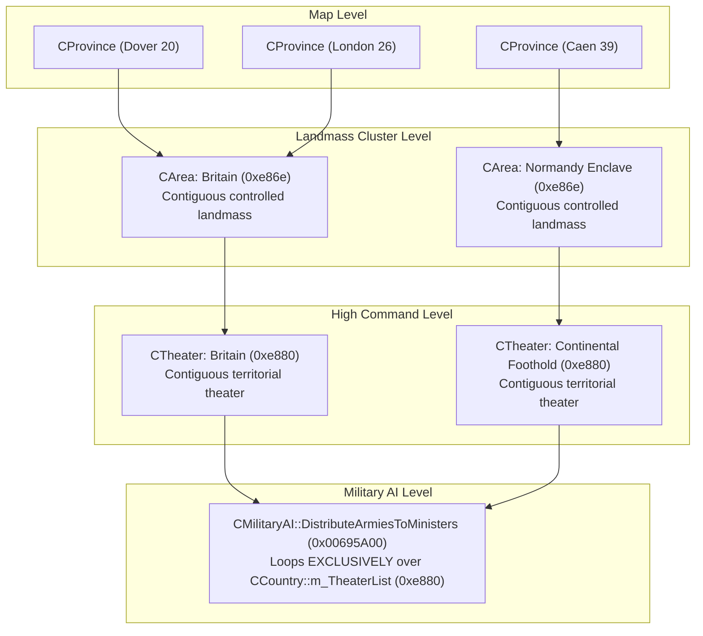

# Darkest Hour Garrison AI Architecture & Division Quotas

**Engine**: Darkest Hour / Europa Engine (v1.05.2, 32-bit x86 PE)  
**Binary Executable**: `Darkest Hour.exe`  
**Primary Routine**: `CGarrisonAI::UpdateGarrisons` (`FUN_0068ba50` at virtual address `0x0068BA50`)  
**Scope**: In-depth mathematical formulas, threat scaling, homeland defense collapse checks, area division quotas, and province allocation.

---

## 1. Overview & Architecture

> [!CRITICAL]
> ### FUNDAMENTAL ENGINE DISTINCTION: Runtime `CArea*` vs. `Province.csv` Map "Area"
> In Darkest Hour, the term **"Area"** is used for two entirely distinct, unrelated concepts:
>
> 1. **`Province.csv` Map "Area" (Static Geographic Label)**:
>    - Defined in the 3rd column of `Province.csv` (e.g., `Paris`, `Normandy`, `Brittany`, `Ruhr`).
>    - Stored in `CProvince::m_szMapArea` (`[prov + 0x1A]`) as an arbitrary text string.
>    - **Used strictly for**: Regional weather zones, regional air mapmode overlays, and localized text groupings.
>    - **Zero AI Relevance**: Garrison AI, AI military evaluations, transport ministers, and strategic scripts **NEVER** inspect or use this column or concept.
>
> 2. **Engine Runtime `CArea*` (Contiguous Controlled Landmass Cluster)**:
>    - A dynamic C++ heap object (`sizeof = 0x74`) created during map initialization and recalculated on territory ownership changes via recursive flood-fill (`FUN_004c94f1`).
>    - Stored in `CProvince::m_pArea` (`[prov + 0x482]`) as a pointer to the cluster object.
>    - Encompasses **every contiguous, land-connected province controlled by the same country on that landmass**.
>    - For example, in Metropolitan France, all connected French-controlled provinces form **a single runtime `CArea*`**. It does NOT matter that `Province.csv` categorizes them into different "Areas" (Paris, Brittany, Normandy); at runtime, they form **ONE unified `CArea*`** containing Paris (56), Le Havre (41), Cherbourg (42), and all other connected French provinces and coastal ports.
>    - **Garrison AI operates EXCLUSIVELY on runtime `CArea*` clusters**. When script commands specify `area_multiplier = { 56 = 8 }`, province `56` is merely a probe / coordinate used by the engine to look up its containing contiguous cluster (`56->m_pArea`), scaling the garrison target for that **entire contiguous landmass**.

### 1.1 Architectural Comparison Matrix

| Attribute | `Province.csv` Map "Area" | Engine Runtime `CArea*` |
|---|---|---|
| **Defined In** | `map/Map_X/province.csv` (Column 3) | Dynamically initialized in C++ engine memory |
| **Data Structure** | `CString` at `[CProvince + 0x1A]` | Pointer `CArea*` at `[CProvince + 0x482]` (`sizeof = 0x74`) |
| **Grouping Criteria** | Static geographical/historical region | Contiguous land connection of same-controller provinces |
| **Creation Mechanism**| Parsed from CSV text at startup | Recursive flood-fill algorithm (`FUN_004c94f1`) |
| **Scope in France** | "Paris" consists of ~3 provinces (54, 55, 56), NO ports | French mainland forms a single contiguous cluster with all ports (40, 41, 42, etc.) |
| **Engine Usage** | Weather patterns, air mapmode, text | **Garrison AI (`UpdateGarrisons`)**, front detection, transport dispatch |
| **Script Interaction**| None | Targeted via `area_multiplier = { <prov_id> = <mult> }` (prov ID serves as cluster lookup seed) |

### 1.2 The Engine's Recursive Flood-Fill Construction (`FUN_004c94f1`)
When building or updating `CArea*` objects, the engine executes a recursive flood-fill across adjacent provinces:
```c
void __thiscall CArea::AddProvinceRecursive(CArea *this, CProvince *pSeed)
{
    CCountry *pController = pSeed->m_pController; // [pSeed + 0x3d8]
    this->AddProvince(pSeed);                     // Adds to linked list [this + 0x2c]
    pSeed->m_pArea = this;                        // [pSeed + 0x482] = this

    for (int i = 0; i < pSeed->m_nNeighbors; i++) {
        CProvince *pNeighbor = pSeed->GetNeighbor(i);
        // Skip if neighbor controlled by different country or already assigned to a CArea
        if (pNeighbor->m_pController != pController || pNeighbor->m_pArea != NULL)
            continue;

        // Skip water bodies or impassable connections
        if (IsLandConnection(pSeed, pNeighbor)) {
            this->AddProvinceRecursive(pNeighbor); // Recurse
        }
    }
}
```
Because of this recursive grouping:
1. Every land province belonging to a contiguous territory shares the exact same `CArea*` instance.
2. Even if a territory spans dozens of different `Province.csv` "Areas" (e.g. Paris, Normandy, Brittany), they all merge into **ONE** `CArea*`.
3. If a country controls an overseas enclave or island separated by sea from its mainland (e.g. Caen/39 controlled by UK while Dover/20 is controlled by UK across the English Channel), that enclave forms a **separate, distinct `CArea*`** because land connectivity is broken.

### 1.3 Garrison Evaluation Workflow
Garrison evaluation, area division quotas, and reinforcement dispatch are managed by `CGarrisonAI::UpdateGarrisons` (`0x0068BA50`).

The function iterates over all runtime `CArea*` clusters belonging to the nation (`[country + 0xE86E]`), determines division requirements and current deficits for each area, sorts them into a priority dispatch queue, and routes available surplus forces accordingly.

### 1.4 Runtime Logging
The engine logs area evaluations at `0x0068CB72` using the internal debug format string at `0x00867E08`:
```text
"Garrison AI: %s: Area %s (%d); nAreaNeed = %d, nDivisions = %d, nAreaLack = %d"
```

Where:
- **`nAreaNeed`** (`[area + 0x5A]`): Total divisions desired for the area.
- **`nDivisions`** (`[area + 0x5E]`): Current friendly divisions stationed in or moving into the area.
- **`nAreaLack`** (`[area + 0x56]`): Net division deficit (`nAreaNeed - nDivisions`), used to sort the AI priority queue (`local_108`) descending.

### 1.5 Summary of Key Engine Identifiers & Offsets
- **Core Function**: `CGarrisonAI::UpdateGarrisons` (`0x0068BA50`)
- **Area Structure Fields**:
  - `[area + 0x56]`: `nAreaLack` (division deficit sorting priority queue `local_108` descending)
  - `[area + 0x5A]`: `nAreaNeed` (desired total divisions)
  - `[area + 0x5E]`: `nDivisions` (current stationed + inbound friendly divisions)
- **AI Tokens & Offsets (`local_12c`)**:
  - `0x465`: `home_multiplier` (`[local_12c + 0x68]`, default `0.5`)
  - `0x466`: `overseas_multiplier` (`[local_12c + 0x6C]`, default `0.3333`)
  - `0x467`: `home_peace_cap` (`[local_12c + 0x70]`)
  - `0x468`: `war_zone_odds` (`[local_12c + 0x64]`, default `2.0`)
  - `0x469`: `area_multiplier` list (`[local_12c + 0x78]`)

### 1.6 Strategic Spatial Hierarchy: `CProvince` vs. `CArea` vs. `CTheater`

Understanding how Darkest Hour organizes map provinces into military command structures is essential for understanding both Garrison AI and army distribution:



#### Detailed Definitions & Offsets:
1. **`CProvince` (Map Node)**:
   - Contains raw location coordinates, terrain, port level, current controller (`m_pController` at `+0x3D8`), and its containing area pointer (`m_pArea` at `+0x482`).
2. **`CArea` (Contiguous Controlled Landmass Cluster, `sizeof = 0x70`)**:
   - Stored in `pCountry->m_AreaList` (`+0xE86E`).
   - Dynamically maintained by `FUN_004cb55a` whenever province controllers change.
   - Encompasses all contiguous, land-connected provinces controlled by the same country on that landmass.
   - Pointer to its assigned theater is stored at `[CArea + 0x6C]`.
3. **`CTheater` (Contiguous Military Theater, `sizeof = 0x12`)**:
   - Stored in `pCountry->m_TheaterList` (`+0xE880`).
   - Constructed during map startup and boundary shifts by `FUN_004cc623` and `FUN_004cc8fb`.
   - The engine iterates `pCountry->m_AreaList` and flood-fills adjacent connected areas into a unified `CTheater`.
   - **Crucial Rule**: `CTheater` objects are only generated for a country's **own controlled territories**. Allied nations (such as France for the UK) are NOT in the country's `m_TheaterList`.

#### The Military AI Minister Loop (`0x00695A00`):
In `CMilitaryAI::DistributeArmiesToMinisters`:
- The engine loops through `pCountry->m_TheaterList` (`+0xE880`).
- For each theater, it scans `m_pMilitaryAI->m_ArmyList` (`+0x20C`).
- At `0x00695E01`, it tests `cmp [pArmy->pLocation->m_pArea], [pTheater->m_pArea]`. If they do not match, the army is skipped.
- **The Allied Territory Blind Spot**: Because allied countries are never in `m_TheaterList`, any unit stationed on allied soil (e.g. UK divisions in France, or US divisions in France/Italy) is completely invisible to `DistributeArmiesToMinisters` and never registered with `CGarrisonAI`.
- **The Army Handover Mechanism (`FUN_006aa000`)**:
  - Armies track their controlling minister in `m_pAIController` (`[pArmy + 0x1F4]`).
  - When unassigned, `m_pAIController == m_pMilitaryAI`.
  - When an army is registered with `CGarrisonAI` (`0x0068EE00`), `FUN_006aa000` unregisters it from the old controller (`call [old_ctrl + 0x1AC]`), sets `m_pAIController = CGarrisonAI`, and appends it to `CGarrisonAI::m_ArmyList` (`+0x94`).
  - Repatriation (`0x006939F0`) only evacuates unassigned armies (`m_pAIController == m_pMilitaryAI`). Units registered with `CGarrisonAI` are ignored by repatriation.

---

## 2. Step 1: Base Province Counting (C)

For each area $A$, the engine iterates through all member provinces $p \in P_A$:

1. **Controller Check** (`[p + 0x3D8]`):
   - **If controlled by the nation**:
     - The engine checks terrain movement speed rating via `FUN_004e9500`:
       `*(float *)(*(int *)(p + 0x1DA) + 0x14) != 0.0`
     - Passable land province: **$+1$ to $C$**.
     - Impassable terrain / Terra Incognita / water (`movement == 0.0`): **$+0$ to $C$**.
   - **If not controlled by the nation** (enemy-occupied or allied province inside the area):
     - **$+2$ to $C$** (contested or unowned provinces count double to increase defensive/offensive weight).

2. **Core / National Status Check** (`FUN_004e8ab0(p)`):
   - If any member province is a national/core province of the country, the area is flagged: `has_core_provinces = true`.

$$C = \sum_{p \in P_A, \text{controlled}, \text{passable}} 1 + \sum_{p \in P_A, \text{uncontrolled}} 2$$

---

## 3. Step 2: Emergency Homeland Collapse Check

If the nation is at war (`IsAtWar()` / `FUN_0044beb0() != 0`), the engine evaluates national core territory loss (`FUN_00468560`):
$$\text{CoreLossRatio} = 1.0 - \frac{\text{ControlledCores}}{\text{TotalCores}}$$

If the national Capital province is captured or enemy-occupied, $+0.10$ is added to this ratio.

**Emergency Trigger**:
$$\text{CoreLossRatio} > 0.10 \quad \text{OR} \quad \text{CapitalLost} \quad \text{OR} \quad \text{HomeAreaDivisions} < 1$$

When this trigger fires, for any area that:
1. Has no core provinces (`has_core_provinces == false`), OR
2. Is not the Capital Area and does not directly border an enemy (`is_front_area == false`)

The garrison requirement is set to **ZERO** ($C = 0$). All overseas and rear colonial garrisons are completely abandoned so all forces can be recalled to defend the homeland.

---

## 4. Step 3: Area Type Multipliers & Geometry Modifiers

If the area requirement was not zeroed out by the emergency check, the engine applies base multipliers:

### A. Capital (Home) Area
If the area contains the national capital:
1. **Multiplication**:
   $$C = \text{round}(C \times \text{home\_multiplier}) \quad (\text{token ID } 0x465, \text{default } 0.5)$$
   $$\text{if } C < 1, \quad C = 1$$
2. **Peacetime Cap**:
   If the nation is at peace (`!IsAtWar()`):
   $$\text{if } C > \text{home\_peace\_cap}, \quad C = \text{home\_peace\_cap} \quad (\text{token ID } 0x467)$$
   *(During wartime, `home_peace_cap` is completely bypassed).*

### B. Overseas / Non-Home Areas
1. **Base Multiplier Selection ($M$) & Duplicate Area Precedence ("First-In-List Wins")**:
   - If any province in the area is specified in `area_multiplier = { <prov_id> = <val> }` (token ID `0x469`): $M = \text{val}$.
   - Otherwise: $M = \text{overseas\_multiplier}$ (token ID `0x466`, default `0.3333`).
   - **Multiple Provinces in the Same `CArea*` (First Entry Wins)**:
     - When the AI parser (`FUN_006bd060`, `case 0x469` at `0x006BD9B0`) reads `area_multiplier = { ... }`, it appends each `<prov_id> = <val>` pair to the tail of `CAI::m_AreaMultiplierList` (`[CAI + 0x358]`) in exact top-to-bottom script order. (Because `CArea*` objects do not exist standalone when parsing `.ai` files, the parser only warns on duplicate *province IDs*, retaining all distinct province IDs in the list).
     - When `CGarrisonAI::UpdateGarrisons` looks up the multiplier for a `CArea*` (`0x0068C62E` – `0x0068C67D`), it walks `m_AreaMultiplierList` from the head and calls `CArea::ContainsProvince` (`vtable + 0x24`) on each entry, breaking out of the loop on the **very first match** (`0x0068C66A: jne 0x0068C675`).
     - Likewise, for allied areas in Patch 11, **Cave A** (`0x00DCA320`) walks `m_AreaMultiplierList` from the head, dispatches the `CArea*` on the first matching province entry, records the `CArea*` in `seen_areas` (`0x00DCA4B4`), and skips any subsequent province entries belonging to that same `CArea*`.
     - **Result**: Both in vanilla Darkest Hour and with Patch 11, if multiple province IDs belonging to the same contiguous `CArea*` appear in `area_multiplier` with different values, **the first entry in the list is applied and all subsequent entries for that same area are ignored**.
2. **Wartime Enemy Border Override**:
   - If the area borders an enemy nation at war (`is_front_area == true`):
     $$M = 1.0 \quad \text{(forced to 1.0, overriding area\_multiplier and overseas\_multiplier)}$$
3. **Small Island Exception**:
   - If the area is a single-province island (`FUN_004e4b60`) with naval distance $< 40.0$ and no explicit `area_multiplier`: $M = 0.0$.
4. **Multiplication**:
   $$C = \text{round}(C \times M)$$
   $$\text{if } C < 1 \text{ and } M > 0.01, \quad C = 1$$
5. **No-Port Pocket Bordering Enemy**:
   - If the area has NO naval base/port (`FUN_004ca453 == 1`) AND borders an enemy:
     $$C = 0 \quad \text{(isolated pocket cannot be supplied or reinforced)}$$
6. **Contiguous Rear Behind Active Front (The $\frac{1}{3}$ Factor)**:
   - If at war, active land front areas exist, and this area has a contiguous overland land path (`FUN_004a4010`) to an active front area with divisions:
     $$C = \left\lfloor \frac{C}{3} \right\rfloor, \quad \text{minimum } 1$$
     *(Troops can march overland directly to the front line, so rear areas directly behind a front need only $\frac{1}{3}$ the peacetime garrison).*

---

## 5. Step 4: Wartime Threat Scaling & The Invisible Factor

Initially:
$$\text{nAreaNeed} = C$$
$$\text{nAreaLack} = C - \text{nCurrentDivisions}$$

When at war and land front areas exist (`0 < count_front_areas`):

### A. Front Areas (`is_front_area == true`)
1. **Border Threat Calculation**:
   The engine scans all enemy provinces bordering our provinces in this area and sums all enemy divisions stationed directly along our border ($\text{EnemyBorderDivisions}$).
   $$\text{BorderDeficit} = 2 \times \text{EnemyBorderDivisions} - \text{nCurrentDivisions}$$
   $$\text{nAreaLack} = \max(\text{nAreaLack},\ \text{BorderDeficit})$$
   *(The AI demands at least $2.0\times$ the enemy force directly on the border).*
2. **War Zone Odds Scaling**:
   If the national Capital Area is NOT directly on an enemy front (homeland safe):
   $$\text{nAreaLack} = \text{round}(\text{nAreaLack} \times \text{war\_zone\_odds}) \quad (\text{token ID } 0x468, \text{default } 2.0)$$
3. **Adjacent Area Floor**:
   If the country is actively targeting this front:
   $$\text{nAreaLack} = \max\left(\text{nAreaLack},\ \left\lfloor \frac{\text{EnemyDivisionsInAdjacentArea}}{2} \right\rfloor\right)$$

### B. Rear Areas (`is_front_area == false`) -- The Invisible Factor
If the country (or an allied faction member) has an active land combat border / troop deficit (`local_52 != 0 || local_e4 != 0`):
$$\mathbf{nAreaNeed = \left\lfloor \frac{C}{2} \right\rfloor}$$
$$\mathbf{nAreaLack = \left\lfloor \frac{C}{2} \right\rfloor - nCurrentDivisions}$$

**This is the "invisible factor" in wartime**: The game engine cuts the required garrison of all rear/non-combat areas in **HALF** ($\div 2$) during an active war to release divisions for the front lines.

---

## 6. Step 5: Reinforcement Priority & Troop Dispatch

Areas are inserted into a priority linked list (`local_108`) sorted descending by `nAreaLack` (`[area + 0x56]`).

- Areas with the largest net division deficit receive reinforcement dispatches first.
- Surplus divisions in areas where `nCurrentDivisions > nAreaNeed` are pooled (`local_70` / `local_68`) and reassigned or loaded onto naval transports for overseas areas.

---

## 7. Step 6: Province-Level Allocation Within the Area

Once `nAreaNeed` is determined for the area as a whole, divisions stationed in the area are distributed among constituent provinces using priority weights calculated in `FUN_0068b4f0` (`[prov + 0x48A]`):

- **Key Point Priority**: `IC * key_point_prio_mult`
- **Beach / Coastal Priority**: `beach` flag weight
- **Border Tensions**: Borders with foreign / hostile nations
- **Capital Province**: High fixed weight for national capital
- **Custom Priority**: Overrides from `province_priorities = { <prov_id> = <prio> }`

Each province receives a share of divisions proportional to its weight fraction:
$$\text{Share}_p = \frac{\text{Priority}_p}{\sum_{k \in P_A} \text{Priority}_k}$$

---

## 8. Summary Formula Matrix

| Scenario | Capital / Home Area Formula | Overseas / Rear Area Formula | Front Area (Borders Enemy) Formula |
|---|---|---|---|
| **Peacetime** | $\min(\text{peace\_cap}, \text{round}(P \times \text{home\_mult}))$ | $\text{round}(P \times \text{area\_mult})$ | $N/A$ (No enemy at war) |
| **Wartime (Rear)** | $\left\lfloor \frac{\text{round}(P \times \text{home\_mult})}{2} \right\rfloor$ | $\left\lfloor \frac{\text{round}(P \times \text{area\_mult})}{2} \right\rfloor$ | $N/A$ |
| **Wartime (Rear behind land front)** | $N/A$ (Capital is base) | $\left\lfloor \frac{\lfloor P \times \text{area\_mult} / 3 \rfloor}{2} \right\rfloor$ | $N/A$ |
| **Wartime (Front Area)** | Defends against border threat | Defends against border threat | $\max(P, 2 \times \text{EnemyBorder}) \times \text{war\_zone\_odds}$ |
| **Homeland Emergency (>10% cores lost)** | Defend at all costs | $\mathbf{0}$ (Colonies abandoned) | Defend front line |

---

## 9. Allied Territory Garrison Mechanics & Limitations

### 9.1 Important Engine Distinction: Runtime `CArea*` vs. `Province.csv` Map Areas
> [!IMPORTANT]
> **Static `Province.csv` Area $\neq$ Runtime `CArea*` (See Section 1.0 - 1.2 for Full Architectural Breakdown)**:
> - The `Area` column in `Province.csv` (e.g., `Paris`, `Normandy`, `Brittany`) is purely a **static geographic categorization** used for weather, regional mapmodes, and text grouping. The Garrison AI never reads or references this column.
> - In the C++ game engine, a **`CArea*`** is a dynamic **contiguous land cluster** created at scenario initialization and boundary changes via recursive flood-fill (`FUN_004c94f1`). A single `CArea` encompasses **all connected provinces on a landmass controlled by the same country**.
> - **Concrete Scenario (e.g., `TestSave6.eug`)**:
>   - In `TestSave6.eug`, France controls provinces 56, 40, 41, 42, and 54.
>   - In `Province.csv`, provinces 56 and 54 are labeled `Area = Paris`, province 42 is labeled `Area = Normandy`, and provinces 40 and 41 are labeled `Area = Brittany`.
>   - However, at runtime in memory, `CArea::AddProvinceRecursive` (`FUN_004c94f1`) groups all 5 provinces into **a single contiguous `CArea*`** object because they are contiguous land controlled by `FRA`.
>   - This French cluster contains **3 coastal naval ports** (provinces 40, 41, 42).
> - When `area_multiplier = { 56 = 8 }` is parsed, province `56` acts as a lookup seed: the engine finds province 56, reads its parent contiguous cluster pointer `p->m_pArea` (`[56 + 0x482]`), and scales the garrison requirements for that entire 5-province French land cluster.

### 9.2 The Four Engine Barriers in Vanilla
In vanilla Darkest Hour, script parameters in `garrison = { ... }` (including `area_multiplier`, `province_priorities`, and `country_priorities`) are completely ignored when applied to provinces or borders on allied soil. This failure is caused by four structural barriers in the engine:

1. **Area List Partitioning (`Country + 0xE86E`)**:
   - The engine organizes the world map into contiguous land clusters (`CArea*`) controlled by each country.
   - `CGarrisonAI::UpdateGarrisons` (`0x0068BA50`) iterates strictly over the donor country's own area list (`this->m_pCountry + 0xE86E`).
   - If a country does not control any province in an allied region (e.g. UK in Metropolitan France), that region belongs entirely to the ally's area list and is never visited during the donor's garrison update pass.
   - Consequently, `area_multiplier = { <allied_prov> = <mult> }` is never evaluated because the containing area is never inspected.

2. **Non-Controlled Province Filter (`0x0068C18E`)**:
   - Within each area's province loop, the engine inspects each province:
     ```asm
     0x0068C188: mov eax, dword ptr [edi + 0x3d8] ; eax = p->m_pController
     0x0068C18E: cmp eax, ecx                     ; ecx = donor Country*
     0x0068C190: jne 0x0068C439                   ; skip if p->m_pController != donor
     0x0068C196: push edi
     0x0068C197: mov ecx, ebx
     0x0068C199: call 0x0068B4F0                  ; calculate province priority
     ```
   - Any province where `controller != donor_country` is discarded before priority calculation.
   - As a result, `province_priorities = { 56 = 100 }` (Paris) is completely bypassed.

3. **Border Threat Dependency on Controlled Bases (`0x0068B4F0`)**:
   - Inside the priority evaluator `FUN_0068b4f0` (`0x0068B4F0`), `country_priorities` is evaluated by scanning neighbors of the province being evaluated:
     ```c
     if (neighbor->controller != self && !IsAllied(self, neighbor->controller)) {
         if (country_priorities.contains(neighbor->controller->tag)) {
             priority += country_priorities[neighbor->controller->tag];
         }
     }
     ```
   - Because `FUN_0068b4f0` is only invoked on provinces controlled by the donor nation, borders between an ally and a rival (e.g. France vs. Germany at province 54) are never evaluated by the donor AI.

4. **Peacetime Evacuation & Repatriation**:
   - The wartime expeditionary dispatch routine `FUN_00695520` is explicitly gated behind `IsAtWar()` (`FUN_0044beb0() != 0`).
   - At peace, if donor units are placed on allied soil, the donor's Garrison AI does not assign them to any recognized area need.
   - They are classified as out-of-theater surplus, causing `CAITransportMinister` to order transports to evacuate them back to the homeland capital area.

### 9.3 Data Structures & Memory Context
- `CArea` (`sizeof = 0x74`):
  - `+0x2C`: `m_pProvinces` linked list (`CProvince*`)
  - `+0x52`: `m_nEnemyBorders`
  - `+0x56`: `m_nAreaLack` (temporary net division deficit)
  - `+0x5A`: `m_nAreaNeed` (computed target garrison size)
  - `+0x5E`: `m_nCurrentDivisions` (donor divisions present in area)
  - `+0x6C`: `m_pFront` parent pointer
- `CProvince` (`sizeof = 0x4B2` / `1202` bytes):
  - `+0x012`: `m_nId` (Province ID)
  - `+0x3D8`: `m_pController` (`CCountry*`)
  - `+0x482`: `m_pArea` (`CArea*`)
  - `+0x48A`: `m_fGarrisonPriority` (float, computed by `sub_68B4F0`)
- `CGarrisonAI` (`CAI + 0x2E0`):
  - `+0x2E`: `province_priorities` linked list
  - `+0x44`: `country_priorities` linked list
  - `+0x64`: `war_zone_odds`
  - `+0x68`: `home_multiplier`
  - `+0x6C`: `overseas_multiplier`
  - `+0x70`: `home_peace_cap`
  - `+0x78`: `area_multiplier` linked list

### 9.4 Ruled Out Hypotheses & Verified Non-Issues
> [!NOTE]
> The following hypotheses have been empirically tested and proven **FALSE / IRRELEVANT** to the overseas garrison failure. Do NOT revisit or propose these explanations:
> 1. **Transport Fleet Size & Capacity**:
>    - The engine automatically splits stacks into smaller sub-corps almost immediately after game start.
>    - Increasing the transport fleet size (from 1 to 2, 4, or more) does NOT resolve or change the failure to transport troops.
>    - Decreasing `area_multiplier` to small values (e.g., `2.0`, `1.5`) does NOT trigger movement to Paris or allied territory.
>    - Fleet capacity and division stack splitting are completely ruled out as root causes.
> 2. **Static `Province.csv` Regional Data**:
>    - Garrison AI never interacts with `Province.csv` columns (such as `Area = Paris`).
>    - In `TestSave6.eug`, Province 41 (not 40) is the active coastal naval base.

---

## 10. Patch 11: Allied Territory Garrison AI Architecture & Hook Reference

To overcome the four engine barriers documented in Section 9, **Patch 11** injects a synchronized network of **13 hooks and code caves** in the `.mod` PE section (`0x00DCA300` - `0x00DCAB00`), establishing full allied territory garrisoning during peacetime and wartime.

### 10.1 Master Hook & Cave Register

| Hook # | Virtual Address | File Offset | Length | Target Cave | Function & Role |
|---|---|---|---|---|---|
| **Hook 1** | `0x0068D8B9` | `0x0028D8B9` | 8 bytes | `Cave A` (`0x00DCA320`) | Multi-Area Allied Iterator with stateful resumption & duplicate suppression |
| **Hook 2** | `0x0068C18E` | `0x0028C18E` | 8 bytes | `Cave B` (`0x00DCA500`) | Non-controlled province filter bypass via `IsAlliedOrAccess` |
| **Hook 3** | `0x0068C55A` | `0x0028C55A` | 10 bytes | `Cave C` (`0x00DCA550`) | Allied province counting & area quota calculation |
| **Hook 4** | `0x0068C5B6` | `0x0028C5B6` | 5 bytes | `Cave F` (`0x00DCA650`) | Coastal & border flag calculation for active allied areas |
| **Hook 5** | `0x0068C816` | `0x0028C816` | — | *Reverted to Vanilla* | Reverted to vanilla (`8A 45 E3 84 C0 75 08`); eliminates dead-code Cave G |
| **Hook 6** | `0x0068DA09` | `0x0028DA09` | 8 bytes | `Cave D` (`0x00DCA5A0`) | Phase 4 foreign allied destination province & debarkation port recognition |
| **Engine Fix** | `0x0068DFCA` | `0x0028DFCA` | 6 bytes | In-line patch | Phase 4 Transport Dispatch loop fix (`jne 0x0068DB06` instead of aborting to `0x0068DB11`) |
| **Hook 7** | `0x0068E291` | `0x0028E291` | 6 bytes | `Cave E` (`0x00DCA5D0`) | Area metadata restoration (`orig_56`, `orig_5A`, `orig_5E`) & state cleanup at `UpdateGarrisons` exit |
| **Hook 8** | `0x0069F815` | `0x0029F815` | 12 bytes | `Cave H` (`0x00DCA7E0`) | `CAITransportMinister::Update` transport mission execution to allied ports |
| **Hook 9** | `0x00693A86` | `0x00293A86` | 9 bytes | `Cave I` (`0x00DCA820`) | Peacetime foreign garrison repatriation & evacuation bypass (guarded by active `area_multiplier`) |
| **Hook 10** | `0x0068C742` | `0x0028C742` | 7 bytes | `Cave J` (`0x00DCA690`) | Peacetime overseas area need preservation (bypasses zero-wipe) |
| **Hook 11** | `0x0068B978` | `0x0028B978` | 12 bytes | `Cave L1` (`0x00DCA8F0`) | Interior province priority preservation (bypasses anti-partisan zero-wipe) |
| **Hook 12** | `0x0068B89E` | `0x0028B89E` | 13 bytes | `Cave L2` (`0x00DCA920`) | Dynamic border threat inheritance from `country_priorities` |
| **Hook 13** | `0x00696ECD` | `0x00296ECD` | 16 bytes | `Cave M` (`0x00DCAA00`) | Unassigned Army Distributor Pass to `CGarrisonAI` (preserves `0x00696ED3` exit boundary) |
| **Hook 14** | `0x005177C1` | `0x001177C1` | 21 bytes | `0x00DCA700` | `CUnit::CanFleetUnloadAtProvince` Military Access transport fleet unload authorization |
| **Hook 15** | `0x00522CFB` | `0x00122CFB` | 21 bytes | `0x00DCA700` | `CUnit::CanMoveToProvince` Military Access amphibious disembarkation authorization |
| **Helper** | `0x00DCA700` -> `0x00DCAC00` | `0x00485700` / `0x00485C00` | 213 bytes | `IsAlliedOrAccess_Switchable` | Universal Diplomatic Alliance & Military Access Validator with Mode 0/1/2 switch enforcement |
| **Helper** | `0x00DCAB60` | `0x00485B60` | 128 bytes | `DetermineGarrisonMode` | Evaluates `EnableAlliedGarrison` (`0x00DCAB00`) and `no_foreign_garrison` (`[pCountry+0x120+0x4C]`) |
| **Table**  | `0x00DCA4B4` | `0x004854B4` | 72 bytes | `seen_areas` | 18-entry area de-duplication array (`CArea*`) for Cave A |

---

### 10.2 Subsystem Execution Pipeline

#### 1. Phase 2: Multi-Area Allied Need Calculation
When the domestic area loop in `CGarrisonAI::UpdateGarrisons` terminates (`ESI == NULL`), Hook 1 redirects control to **Cave A** (`0x00DCA320`, split across `0x00DCA320` for Part 1 and `0x00DCAEB0` for the Phase 3 Fallback):
- **Resumption Management (`[0x00DCA30C]`, `[0x00DCA314]`)**: Cave A Part 1 (`0x00DCA320`) tracks iteration through `CAI::m_AreaMultiplierList` (`[pCountry->m_pAI + 0x358]`), while Cave A Part 2 (`0x00DCAEB0`) provides a fallback scan of `CAI::m_CountryPrioritiesList` (`[pCountry->m_pAI + 0x44]`) to discover allied/access areas bordering high-priority target countries even when no explicit `area_multiplier` is set.
- **Multiplier <= 0.0 Filtering**: Checks `cmp dword ptr [ecx + 4], 0; jle next_node`. Any area assigned `<= 0.0` is ignored, enabling clean withdrawal via AI script switches.
- **De-Duplication & "First-In-List Wins" (`seen_areas` array @ `0x00DCA4B4`)**: Checks each area against previously recorded entries (`[0x00DCA4B0]` count, `0x00DCA4B4` array). If already evaluated, it is skipped, guaranteeing identical behavior to vanilla duplicate area precedence.
- **Defensive Null Guards**: Checks `pCountry->m_pAI != NULL` and validates `1 <= prov_id < 10000` before invoking `GetProvince` (`0x004E9370`).
- **Allied Validation & Injection**: Calls `IsAlliedOrAccess_Switchable` (`0x00DCA700` -> `0x00DCAC00`). If verified, writes the `CArea*` pointer into active pointer `[0x00DCA310]` and single-node buffer `[0x00DCA300]`, sets `ESI = 0x00DCA300`, and jumps to `0x0068BC07` to calculate the area's garrison quota.
- **Overseas Need Preservation (`Cave J` @ `0x00DCA690`)**: At `0x0068C742`, vanilla wipes peacetime overseas need to 0. Cave J checks if `[0x00DCA310] != 0` and preserves the calculated `nAreaNeed`.
- **Area Queuing**: Calculated allied areas with shortages are inserted into the descending deficit priority queue `[ebp - 0x104]`.
- **Completion**: When all multiplier and country priority entries are exhausted, Cave A clears `[0x00DCA310] = 0`, `[0x00DCA30C] = 0`, `[0x00DCA314] = 0`, and exits to Phase 3 via `0x0068D8C1`.

#### 2. Phase 4: Overseas Maritime Transport Dispatch
In Phase 4 (`0x0068D922` - `0x0068DF9C`), the engine scans queued shortage areas in `[ebp - 0x104]` to pair them with surplus units:
- **Foreign Port & Province Recognition (`Cave D` @ `0x00DCA5A0`)**:
  - The engine iterates through the shortage area's provinces (`0x0068D9DD` - `0x0068DA53`).
  - Hook 6 calls Cave D.
  - Cave D checks if the province is domestic or belongs to an ally/access partner (`IsAlliedOrAccess_Switchable`).
  - Allied/access provinces are accepted, allowing the engine to record the top-priority destination province (`[ebp - 0x38]`) and the best maritime debarkation port (`[ebp - 0x28]`).
- **Surplus Army Loop Fallback Fix (`0x0068DFCA`)**:
  - In vanilla, if `DispatchTransport` fails on one surplus army (e.g. landlocked or low org), `0x0068DFCA: jne 0x0068DB11` gave up on the entire shortage area.
  - The in-line patch changes `jne 0x0068DB11` to `jne 0x0068DB06` (`0F 85 36 DB FF FF`), advancing to test the next surplus army in the queue rather than stalling overseas shipments.
- **Transoceanic Route Splicing**:
  - For surplus divisions in another theater (e.g. England to France, or continental USA to Europe), `FindPath` confirms no land connection exists across the sea.
  - At `0x0068DE22: je 0x0068DF9C`, the engine branches straight to maritime transport dispatch.
  - The engine loads the discovered allied/access port (`[ebp - 0x28]`) and executes `CAITransportMinister::DispatchTransport` (`0x0068DF83`), sailing surplus forces across the sea.
- **Transport Mission & Unload Authorization (`Cave H` @ `0x00DCA7E0`, Hooks 14 & 15 @ `0x005177C1` & `0x00522CFB`)**:
  - In `CAITransportMinister::Update` (`0x0069F815`), Hook 8 calls Cave H to verify the destination port.
  - When the transport fleet arrives in the adjacent sea zone to unload into an allied or military access port, `CAITransportMinister::Update` calls `CUnit::CanFleetUnloadAtProvince` (`0x00517740`), which in turn pairs with `CUnit::CanMoveToProvince` (`0x00522B50`) for the embarked land unit.
  - Hooks 14 (`0x005177C1`) and 15 (`0x00522CFB`) replace the vanilla `CCountry::IsAlliedOrPuppet` (`0x0044A690`) calls with `IsAlliedOrAccess_Switchable` (`0x00DCA700`), authorizing unloading and amphibious disembarkation into friendly Military Access territory when Mode 2 is active while blocking it in Modes 0 and 1.

#### 3. Landfall & Inland March Execution Pipeline
Once troops arrive in an allied theater:
- **Repatriation Bypass (`Cave I` @ `0x00DCA820`)**:
  - Hourly, `CAIUnitMinister::ManageExpeditionaryForces` (`0x006939F0`) inspects foreign units to repatriate them.
  - Hook 9 calls Cave I at `0x00693A86`.
  - Cave I checks `IsAlliedOrAccess_Switchable(pUnitOwner, pProvController)` (`0x00DCA700`) and verifies whether an active `area_multiplier` or `country_priorities` border applies to the area. If permitted by the current mode and priorities, repatriation is bypassed (`jmp 0x00693EB1`); otherwise vanilla repatriation evacuates the units home.
- **Inland Walking Orders**:
  - In `CGarrisonAI::Update`, `EvaluateStrategicRedeployment` (`0x006AC380`) returns 0 during peacetime.
  - At `0x0068D54E`, the engine branches to `0x0068D666`, issuing an on-foot walking march via `MoveToProvince` (`0x006AAFF0`) directly to inland priority objectives (e.g. Caen -> Paris / Amiens).
- **Interior Priority Preservation (`Cave L1` @ `0x00DCA8F0`)**:
  - In `sub_68B4F0` at `0x0068B978`, vanilla anti-partisan logic zero-wiped priorities on provinces with 0 revolt risk.
  - Cave L1 preserves explicit script priorities (`province_priorities`) and foreign borders, maintaining weights for interior cities (Paris = 100, Rome = 960).
- **Border Threat Inheritance (`Cave L2` @ `0x00DCA920`)**:
  - At `0x0068B89E`, Cave L2 searches `CAI::m_CountryPrioritiesList`.
  - If an allied/access border province neighbors a hostile rival (e.g. France vs. Germany at Amiens `54`), the province dynamically inherits the border priority (e.g. `GER = 30`), drawing allied divisions to the border.

#### 4. Inland Army Claiming & Redistribution Pipeline (`Cave M` @ `0x00DCAA00`)
Once overseas transport fleets disembark divisions at an allied/access port (e.g. Dover -> Caen `39` or Le Havre `41`), the transport mission finishes and `[pArmy + 0x298]` returns to `0`.
- **The Deadlock Barrier**:
  - In vanilla, `CMilitaryAI::DistributeArmiesToMinisters` (`0x00695A00`) only loops over domestic theaters in `m_TheaterList` (`CCountry + 0xE880`).
  - Allied territories (France, Italy) are never in the nation's domestic theater list.
  - The vanilla army loop (`0x00695E01`) skipped all divisions standing in France, leaving them unassigned with controller `CMilitaryAI`.
  - Because `CGarrisonAI::m_ArmyList` (`+0x94`) contained 0 divisions in France, `CGarrisonAI::UpdateGarrisons` could not calculate any local surplus in Caen to order inland to Paris or Amiens.
- **Hook 13 & Cave M Implementation**:
  - Hooked at `0x00696ECD` (16 bytes: `jmp 0x00DCAA00` + NOP padding).
  - Preserves `0x00696ED3` so exiled nations with `m_TheaterList == NULL` (`0x00695A6E: je 0x00696ED3`) jump cleanly without stack corruption or memory leaks.
  - Cave M sweeps `m_pMilitaryAI->m_ArmyList` (`[ebx + 0x20C]`).
  - Validates:
    1. `[pArmy + 0x1F4] == ebx` (unassigned under Military AI).
    2. `[pArmy + 0x298] == 0` (passive check: no active move, embark, invasion, or transit orders; active units are left alone).
    3. `IsNavalOrAirUnit(pArmy) == 0` (land army only).
    4. `CanMove(pArmy) == 1` (mobile unit).
    5. Valid province location and area pointer.
    6. Calls `IsAlliedOrAccess_Switchable(myCountry, [pProvince + 0x3D8])` (`0x00DCAC00`); armies standing on territory that fails the check (e.g. a neutral country where we only hold a Non-Aggression Pact / Military Access) are NOT registered, so `CGarrisonAI::Update` cannot pin them with Mission 7 and `ManageExpeditionaryForces` (`0x006939F0`) can repatriate them.
  - Calls `CGarrisonAI::RegisterArmy(pArmy)` (`call dword ptr [edx + 0x1A8]`).
  - Handover function `FUN_006aa000` updates `[pArmy + 0x1F4] = CGarrisonAI` and inserts the army into `CGarrisonAI::m_ArmyList`.

---

## 5. Configuration & Control Gates (Global & Country Toggles)

To provide total modular control, Patch 11 introduces a two-tier configuration architecture supporting three distinct operational modes:

### 5.1 Global Engine Setting: `db\mod_settings.ini`
In `db\mod_settings.ini`, the `[AI]` section controls the feature engine-wide:
```ini
[AI]
; Enable Allied Territory Garrison AI:
; 0 = No foreign garrisons outside directly controlled territory (vanilla DH behavior)
; 1 = Allow garrisons in ally territory only
; 2 = Allow garrisons in ally and military access territory (default)
EnableAlliedGarrison = 2
```
- **INI Loader**: Chained in `FUN_005ca770` at `0x00DC912E` jumping to `0x00DCAE73` (`fn_read_ini`).
- **INI Variable**: Parsed via `GetPrivateProfileIntA` with default `2` into global memory `g_nEnableAlliedGarrison` (`0x00DCAB00`).
- If `EnableAlliedGarrison = 0`, all foreign garrison evaluations return `0` (vanilla behavior).
- If `EnableAlliedGarrison = 1`, only domestic and allied territory qualifies; military access nations are excluded.
- If `EnableAlliedGarrison = 2`, domestic, allied, and military access nations qualify.

### 5.2 Country-Specific Override: `no_foreign_garrison` Local Flag
For per-nation control, the engine inspects each nation's local flags (`[pCountry + 0x120 + 0x4C]`):
- Configured via `.ai` file `flags = { no_foreign_garrison = <value> }`, scenario `.inc` files, or event `type = local_setflag which = no_foreign_garrison value = <value>`:
  - **`0` (or unset)**: Inherit global `EnableAlliedGarrison` setting.
  - **`1`**: Clamp effective mode to at most `1` (Allow only ally garrisons; disallows military access territory even if `EnableAlliedGarrison = 2`).
  - **`2`**: Clamp effective mode to `0` (Allow no foreign garrisons, ally or military access; forces vanilla DH behavior for this specific country).

### 5.3 Control Gate Implementation & Hook Topology
The toggles are enforced uniformly via `DetermineGarrisonMode` (`0x00DCAB60`) and `IsAlliedOrAccess_Switchable` (`0x00DCA700` -> `0x00DCAC00`):
- **`DetermineGarrisonMode(CCountry* pCountry)` (`0x00DCAB60`)**:
  - Reads global `g_nEnableAlliedGarrison` (`[0x00DCAB00]`). If `<= 0`, immediately returns `AL = 0`.
  - Validates `pCountry` (`0x00010000 <= pCountry <= 0xFFFE0000`) and `pCountry->m_pAI` (`[pCountry + 0x120]`). The upper bound covers Large Address Aware (Patch 7) heap allocations above `0x80000000` (e.g. post-independence `AUS` at `0x84D8C008` in E3mod).
  - Queries `CStringMap::Lookup(pAI + 0x4C, "no_foreign_garrison")` (`0x006AF430` with key string at `0x00DCAB04`).
  - Reloads `edx = [0x00DCAB00]` after `Lookup` (since `0x006AF430` clobbers `edx`), then applies the clamping hierarchy:
    - If `no_foreign_garrison == 0` (or not found): returns `AL = dl` (`EnableAlliedGarrison`).
    - If `no_foreign_garrison == 1`: if `dl > 1`, clamps `dl = 1`; returns `AL = dl`.
    - If `no_foreign_garrison >= 2`: returns `AL = 0`.
- **`IsAlliedOrAccess_Switchable(eax = CountryA, ecx = CountryB)` (`0x00DCA700` -> `0x00DCAC00`)**:
  - If `CountryA == CountryB`, returns `AL = 1` (domestic territory is always valid regardless of switches).
  - Calls `DetermineGarrisonMode(CountryA)` (`0x00DCAB60`) and saves effective mode (`0`, `1`, or `2`) in `[ebp - 4]`.
  - If effective mode `== 0`, returns `AL = 0`.
  - **Alliance Evaluation (Section 2, Valid in Mode >= 1)**:
    1. Major Faction Alliance: `[CountryA + 0x3350] != 0 && [CountryA + 0x3350] == [CountryB + 0x3350]` -> returns `1`.
    2. Master / Puppet Relationships: `[CountryA->diplomacy + 0x3B30] == CountryB->tag` or `[CountryB->diplomacy + 0x3B30] == CountryA->tag` -> returns `1`.
    - **NAP Check Removal**: In previous builds, `0x005861E0` (Non-Aggression Pact, offset `+0x36`) was erroneously called inside the alliance block. Lines `0x00DCAC73` to `0x00DCAC88` (22 bytes) are now completely NOPed out. NAPs never qualify as an alliance or grant foreign garrison rights.
  - **Mode Check**: `cmp byte ptr [ebp - 4], 2; jb ret_false`. If Mode is `1` (`no_foreign_garrison = 1`), execution branches immediately to `ret_false` (`AL = 0`), ensuring non-allies (including NAP and military access nations) are strictly excluded and troops repatriate.
  - **Military Access Evaluation (Section 4, Valid ONLY in Mode 2)**:
    - Calls `CDiplomacy::HasAccessTo` (`0x005861A0`, querying relation offset `+0x37`) in both directions:
      - `CountryA` granted access to `CountryB` (`call 0x005861A0`) -> returns `1`.
      - `CountryB` granted access to `CountryA` (`call 0x005861A0`) -> returns `1`.
    - Note: Function `0x0044A690` queries relation offset `+0x32` (military control/guarantee) rather than `access = yes` (`+0x37`) and must not be used for access validation.
- **Rogue Foreign Area Injection Bypass (`Cave A` @ `0x00DCA320`)**:
  - In earlier versions, when `Cave A` finished scanning configured `area_multiplier` priorities (`[pAI + 0x358]`), instructions at `0x00DCA336` and `0x00DCA384` jumped to `0x00DCAEB0` ("Phase 3 Fallback").
  - `0x00DCAEB0` iterated all national divisions (`pCountry + 0x4508`) and forcibly injected any foreign area containing a division into the shortage evaluation list with default priority 1.0. This caused unwanted garrison suction (e.g. a single transiting division through Yugoslavia or Hungary triggering deployment of entire armies).
  - Both jump sites (`0x00DCA336` and `0x00DCA384`) are now permanently redirected to `jmp 0x00DCA43A` (clean exit of Cave A), which pops registers `edi, ebx, edx, ecx, eax`, clears scratch pointers, and cleanly returns to `0x0068D8C1`. Only areas explicitly defined in `area_multiplier` are evaluated.
- **Patcher Status**: Fully synchronized in `patch_darkest_hour.bat` and `tools/patch_darkest_hour.bat` (Verified SHA256: `3D854CE604A1F5C6EED514FD775189F57D1CDEF9A3CC6B379563B6E0EA8D7FBD`).

---

## 6. Pending Architectural Challenges: Landlocked Overseas Repatriation (Issue 3)

### 6.1 Problem Statement
When foreign troops are required to withdraw (e.g. American and British occupation divisions in Austria after the Austrian State Treaty, events `2050205`-`2050207`):
1. In `CMilitaryAI::ManageExpeditionaryForces` (`0x006939F0`), the engine iterates `m_controlledAreasList` (`0x00693CD3`) searching for candidate domestic provinces to march to.
2. For overseas nations with no sovereign or occupation territory remaining on the European continent (e.g. once West Germany is sovereign):
   - `CanMarchTo` to domestic homeland (North America or British Isles) returns `0` due to the oceanic barrier.
   - The engine falls through to `0x006AAFF0` (naval transport). Because Austria is landlocked with no naval port, `0x006AAFF0` fails and returns `EAX = 0`.
   - At line `0x00693E57: je 0x693EB1`, the vanilla engine aborts repatriation. The foreign divisions are permanently stranded in landlocked neutral territory.

### 6.2 Previous Flawed Hook Site
An earlier implementation hooked `0x00693E2C` (interception of `CanMarchTo`). This was flawed because:
- It executed **before** `0x006AAFF0` (naval transport).
- For coastal units that legally require naval evacuation across the sea (e.g. British divisions in France returning to Dover/Portsmouth), intercepting at `0x00693E2C` bypassed normal naval evacuation and corrupted destination registers.

### 6.3 Intended Solution Topology
The correct hook site is at `0x00693E57` (`0F 84 54 00 00 00: je 0x693EB1`):
```asm
; Vanilla 0x00693E50:
call 0x006AAFF0       ; Attempt native naval transport
test eax, eax
jnz 0x00693E59        ; If naval transport succeeded -> proceed as vanilla!
; If naval transport failed (eax == 0):
jmp Cave_LandlockedRepatriationFallback ; Hook at 0x00693E57 (6 bytes)
```
- **Execution Condition**: Fires **only** after both overland domestic march and naval transport have failed. Coastal evacuations are 100% unaffected.
- **Cave Logic**: Iterates friendly allied nations (e.g. West Germany, Italy), verifies land connectivity via `CanMarchTo(division, allied_prov_id) == 1`, and dispatches an overland move order (`0x00522770` / `0x0045FED0`) across the border to evacuate the landlocked neutral territory.

