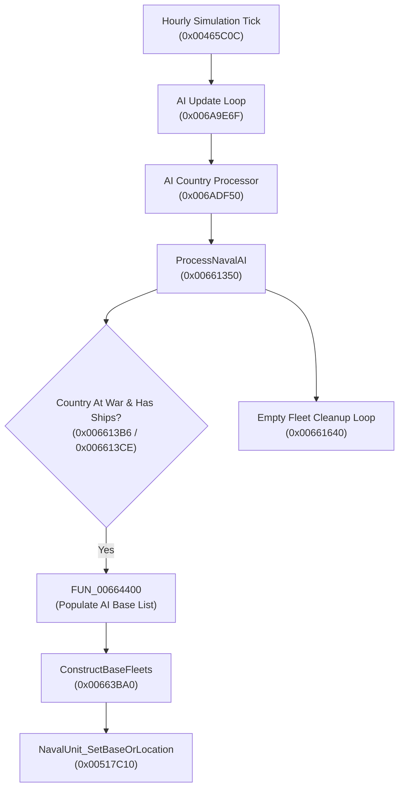

# Naval AI Architecture & Hardcoded Base Fallbacks

**Target Engine**: Darkest Hour / Europa Engine (v1.05.2, 32-bit x86 PE)  
**Binary Executable**: `Darkest Hour.exe` (Image Base: `0x00400000`, Vanilla Checksum: `TENE`)  
**Key Functions**: `ProcessNavalAI` (`0x00661350`), `FUN_00664400` (`0x00664400`), `ConstructBaseFleets` (`0x00663BA0`), `NavalUnit_SetBaseOrLocation` (`0x00517C10`), `NavalUnit_Load` (`0x0055EB80`)

---

## 1. Overview & Problem Definition

In Darkest Hour, AI nations at war automatically construct and maintain dedicated empty "base fleets" (e.g. `USN Task Force 23`) at major naval stations to receive freshly commissioned naval divisions from production queues.

When the United States (`USA`, internal country tag `0x31` / `49`) enters war under AI control, within 1 game hour of war declaration the engine creates a phantom "ghost fleet" characterized in savegames by:

```dhfscript
navalunit = { 
	id = { type = 4712 id = 1104804 } 
	name = "USN Task Force 23" 
	location = 0 
	home = 7139 
	base = 633 
	morale = 0.5000 
}
```

This fleet is based in province `633` with `location = 0`. Upon saving and reloading, the savegame parser (`0x0055EB80`) rejects `location = 0` and halts loading with:
```
ERROR : Invalid or missing location for naval unit (USN Task Force 23) in Mods\E3mapToDHFull\scenarios\save games\autosave2.eug, line ~ 439274!
```

---

## 2. Simulation Execution & Calling Pipeline

The naval AI processing loop executes as part of the hourly simulation tick:



### 2.1 Trigger Conditions in `ProcessNavalAI` (`0x00661350`)
1. `0x006613B6`: Calls `0x006A8720(pCountry)` to check wartime status.
2. `0x006613C6`: Compares `pCountry->m_NumShips` (`*(int*)(pCountry + 0x117E8)`) against 0.
3. If at war and owning ships, calls `FUN_00664400` (`0x006613D6`) with `ECX = pNavalAI`.

---

## 3. Base Selection Architecture (`FUN_00664400`)

`FUN_00664400` populates the dynamic base list (`pNavalAI + 0xDE`) used by the country's naval operational doctrines:

```c
int __fastcall FUN_00664400(CNavalAI* pNavalAI)
{
    CCountry* pCountry = pNavalAI->pCountry; // pNavalAI + 0x0A
    if (pCountry->m_HasPorts < 1) return (int)pCountry;

    // 1. Clear existing dynamic base list
    pNavalAI->m_BasesList.Clear(); // call *(pNavalAI + 0xDE + 0x14)

    // 2. Query scripted base list from AI file: admiral = { base = { ... } }
    CAI* pAI = pCountry->pAI;      // pCountry + 0x120
    int scriptBaseCount = pAI->m_ScriptedBasesList.Size(); // *(pAI + 0x198)

    if (scriptBaseCount == 0) {
        // FALLBACK: Hardcoded Vanilla HoI2 Province Fallbacks
        int tag = pNavalAI->GetCountryTag(); // 0x006A9D50
        
        if (tag == 1) { // GER
            pNavalAI->AddBase(5);    // Kiel
            pNavalAI->AddBase(21);   // Wilhelmshaven
            pNavalAI->AddBase(906);
            pNavalAI->AddBase(1353);
        }
        else if (tag == 2) { // ENG
            pNavalAI->AddBase(32);   // Scapa Flow
            pNavalAI->AddBase(365);  // Portsmouth
        }
        else if (tag == 49) { // 0x31: USA
            pNavalAI->AddBase(633);  // 0x006644CA: push 0x279 (Norfolk in Vanilla HoI2!)
            pNavalAI->AddBase(765);  // 0x006644DE: push 0x2FD (San Francisco)
            pNavalAI->AddBase(663);  // 0x006644F2: push 0x297 (Honolulu / Pearl Harbor)
        }
    }
    else {
        // SCRIPTED: Iterate through admiral = { base = { ... } }
        for (Node* node = pAI->m_ScriptedBasesList.head; node != NULL; node = node->next) {
            Province* pProv = GetProvince(node->province_id); // 0x004E9370
            if (pProv->controller == pCountry) {
                pNavalAI->m_BasesList.Add(pProv->id);
            }
        }
    }

    // Dynamic fallback for minor nations or tags without hardcoded entries
    if (pNavalAI->m_BasesList.Size() < 2) {
        pNavalAI->AutoDetectBestPortBases(); // dynamic port scoring loop
    }
    return 0;
}
```

### 3.1 Hardcoded Machine Code in `Darkest Hour.exe`

At virtual address `0x006644C1` (`0x002644C1` in file):
```x86asm
0x006644B4: mov  ecx, esi
0x006644B6: call 0x006A9D50        ; Returns Country Tag
0x006644BB: dec  eax               ; Tag 1 (GER)?
0x006644BC: jz   0x00664511
0x006644BE: dec  eax               ; Tag 2 (ENG)?
0x006644BF: jz   0x006644F9
0x006644C1: sub  eax, 0x2F         ; 1 + 1 + 0x2F = 0x31 (49 = USA)
0x006644C4: jnz  0x0066455B        ; Any other tag -> skip to dynamic port evaluation
; USA Fallback:
0x006644CA: push 0x279             ; 633 (Norfolk in vanilla HoI2)
0x006644CF: mov  ecx, esi
0x006644D1: call 0x00664320
0x006644D6: push eax
0x006644D7: mov  ecx, ebp
0x006644D9: call 0x0049A100        ; BaseList.Add(633)
0x006644DE: push 0x2FD             ; 765 (San Francisco)
0x006644E3: mov  ecx, esi
0x006644E5: call 0x00664320
0x006644EA: push eax
0x006644EB: mov  ecx, ebp
0x006644ED: call 0x0049A100        ; BaseList.Add(765)
0x006644F2: push 0x297             ; 663 (Honolulu)
0x006644F7: jmp  0x0066454C        ; Common insertion & return
```

---

## 4. Root Cause: E3 Map Remapping Mismatch

The engine's hardcoded fallback values date back to vanilla Hearts of Iron II. In vanilla HoI2, province `633` was Norfolk, Virginia (a major coastal naval base).

On the E3 Map (`map/Map_3/Province.csv`), province numbers were rearranged:

| Province ID | Name in `Province.csv` | Terrain | Port Allowed | Port Seazone | Vanilla HoI2 Identity |
|---|---|---|---|---|---|
| **`632`** | **Norfolk** | Subtropical Plains | `1` | `6575` | *Reassigned in E3Map* |
| **`633`** | **Richmond** | Subtropical Hills | `0` | `0` | **Norfolk** *(Vanilla HoI2)* |
| **`663`** | **Honolulu** | Tropical Mountain | `1` | `1931` | Honolulu |
| **`765`** | **San Francisco** | Mediterranean Urban | `1` | `4265` | San Francisco |

Because Richmond (`633`) is an inland, landlocked province with no port and no adjacent sea zone:
1. `ConstructBaseFleets` (`0x00663BA0`) reads `633` from the base list.
2. It logs `"NAVAL: %s -  Constructing a new BASEFLEET in %s"` (`0x00663C63`).
3. It calls `NavalUnit_SetBaseOrLocation(pUnit, 633)` (`0x00517C10`).
4. `0x00517C10` verifies if the target province is either a sea zone or has `port_capacity > 0`:
   ```c
   if (pProvince->is_sea || pProvince->port_capacity > 0) {
       pUnit->location = pProvince->id;
   }
   // Otherwise, location remains unchanged (default 0)!
   pUnit->base = pProvince->id; // Base IS assigned 633 unconditionally!
   ```
5. `location` is left at `0`.
6. Base Fleet Retention: `ProcessNavalAI` (`0x00661640`) contains an empty-fleet cleanup pass, but base fleets are explicitly exempted:
   ```c
   if (!pUnit->is_base_fleet()) {
       delete_fleet(pUnit);
   }
   ```
   The empty base fleet is deliberately spared so that new ship builds can spawn directly into it.
7. Savegame Serialization: The fleet is saved with `location = 0` and `base = 633`.
8. Savegame Deserialization: `FUN_0055EB80` parses `navalunit` blocks. Line `0x0055F100` checks `if (pUnit->location == 0)` and triggers:
   ```
   ERROR : Invalid or missing location for naval unit (%s) in %s, line ~ %d!
   ```

---

## 5. Resolution & Implementation Status

### 5.1 Mod-Level Solution (Implemented & Verified)
An explicit `admiral` block has been integrated into [`ai/nations/USA.ai`](../../ai/nations/USA.ai) containing major naval bases, core patrol zones, and tactical fleet ratios. When `scriptBaseCount > 0`, the engine completely bypasses the legacy fallback block at `0x006644CA`, preventing any ghost fleet generation:

```dhfscript
admiral = { 
	min_core_attack_fleets  = 1	
	num_attack_fleets		= 3 

	# Which provinces to use as bases (E3Map IDs)
	base = {
		7242	# Pearl Harbor
		765		# San Francisco
		632		# Norfolk
		651		# Miami
		602		# New York
		600		# Boston
		761		# San Diego
		780		# Seattle
		889		# Balboa / Panama
		894		# Guantanamo
		1670	# Rabaul
		1670	# Saigon
		1353	# Singapore
		1613	# Batavia
		1737	# Manila
		1624	# Guam
		939		# Tunis
		932		# Tripoli
		348		# Gibraltar
		12		# Liverpool/Manchester 
		5		# Scapa Flow
		31		# Malta
	}
	target = { } 
	core = {
		4267 
		4266
		4265
		6572
		4248
		6576
		4247
		6575
		4246
		6582
		4245
		4244
		4243
		4242
		4241
		4240
		
		# Panama / Guantanamo
		2521 
		2575
		4116
		# Pearl
		2562
		1931		
	} 
}
```

> [!NOTE]
> The modified file is saved in pure `Latin-1` (`cp1252`) encoding without BOM.

### 5.2 Optional Binary Engine Patch (Reference Only)
If ever needed for standalone vanilla scenarios or mods where custom country AI files lack scripted naval bases, the hardcoded fallback operand in `Darkest Hour.exe` can be patched:

* **Virtual Address**: `0x006644CB`
* **File Offset**: `0x002644CB`
* **Original Bytes**: `79 02 00 00` (`push 0x279` / 633 - Richmond)
* **Patched Bytes**: `78 02 00 00` (`push 0x278` / 632 - Norfolk)

