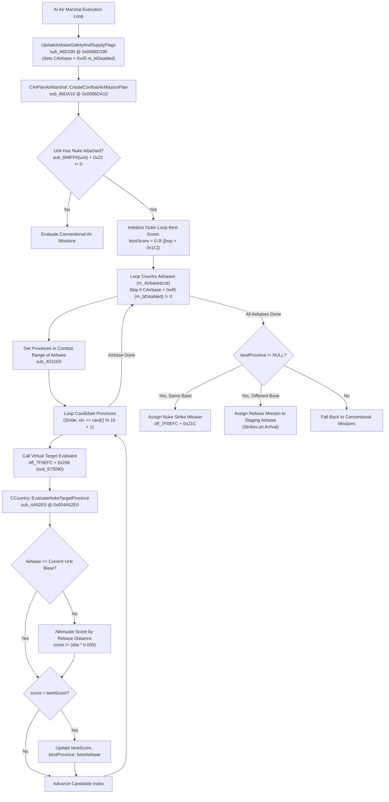

# Nuclear Strike AI Architecture & Targeting Engine

**Target Engine**: Darkest Hour / Europa Engine (v1.05.2, 32-bit x86 PE)  
**Binary Executable**: `Darkest Hour.exe` (Image Base: `0x00400000`, Vanilla Checksum: `TENE`)  
**Key Functions**:
* `CAIPlanAirMarshal::UpdateAirbaseSafetyAndSupplyFlags` (`sub_66D190` @ `0x0066D190`)
* `CAIPlanAirMarshal::CreateCombatAirMissionPlan` (`sub_66DA10` @ `0x0066DA10`)
* `CAIPlanAirMarshal::CreateRebaseAirMissionPlan` (`sub_66E560` @ `0x0066E560`)
* `CAIPlanAirNukeStrike::EvaluateTarget` (`sub_673090` @ `0x00673090`)
* `CCountry::EvaluateNukeTargetProvince` (`sub_4A52E0` @ `0x004A52E0`)
* `CProvince::GetProvCoreScore` (`sub_4EE170` @ `0x004EE170`)
* `CProvince::CountDivisions` (`sub_527B40` @ `0x00527B40`)

---

## 1. Overview & Problem Definition

In Darkest Hour, nations possessing atomic weapons and delivery systems (strategic bombers or missiles) evaluate nuclear strike missions through the AI air marshal mission planner (`sub_66DA10`).

In the unmodified retail binary, AI nuclear strike target selection exhibits severe pathological behavior:
1. **Strikes on Occupied, Colonial, or Empty Non-Core Soil**: Nations frequently detonate atomic bombs on occupied enemy territories, puppet colonies, frontline transit hubs, or even completely empty colonial provinces (e.g., the United States immediately nuking Palembang `1358` in Indonesia or Japanese-occupied French Indochina from Singapore) rather than the enemy national homeland (Tokyo, Osaka, Hiroshima).
2. **Misleading `nukestriketolerance` Baseline (`+1.0` Floor)**: Although named `nukestriketolerance` in `ai\*.ai` files (where it defaults to `1.0000`), the retail engine uses this value as the **starting additive base score** (`score = air->nukestriketolerance = 1.0f`) for every enemy-controlled province. Consequently, even a non-core province with `0` IC, `0` VP, `0` divisions, and `0` reactors starts with `1.0` base point, which is then multiplied by $\sqrt{\text{Controller Total IC}} \times \text{nukestrikedesirability}$ to produce a non-zero target score (`~50-60`).
3. **Tactical Troop Stack Bias**: High troop concentrations (20 to 40 enemy divisions in frontline transit hubs) generate `+10.0` to `+20.0` base points (`0.5` per division), whereas non-core IC and VP contribute `0.0` and lightly garrisoned home cities only score if they are scanned.
4. **Random Candidate Skipping**: The mission generator within `sub_66DA10` randomly skips 1 to 10 provinces per iteration (`idx += rand() % 10 + 1`) while scanning candidate targets in bomber range, bypassing 80% to 90% of viable targets in range.
5. **No Falloff/Threshold Gate**: Because the outer loop initializes `bestScore = 0.0f` and `nukestriketolerance = 1.0f` guarantees every enemy province scores `> 0.0`, the AI will always immediately drop its atomic bomb on whatever province in range scores highest--even if the enemy homeland is out of range and the best reachable province is an empty jungle or colonial island.
6. **No AI Script Exposure**: Apart from `nukestriketolerance` (starting base score) and `nukestrikedesirability` (overall scalar), modders have no configuration modifiers in `ai\*.ai` files to control nuclear target prioritization.

---

## 2. Calling Pipeline & Execution Flow (Retail Engine)

Nuclear strike planning is evaluated inside `CAIPlanAirMarshal::CreateCombatAirMissionPlan` (`sub_66DA10`), which handles both direct strikes from the air wing's current airbase and 2-step **rebase-then-strike** plans across all enabled airbases in `CCountry::m_AirbasesList` (`+0x11848`):



---

## 3. Data Structures & Memory Layout

### 3.1 CCountry (Country Class)
* `+0x0006`: `int m_Tag` (Country TAG identifier; `0x157` = `343` = `REB` / Rebels)
* `+0x0120`: `CAICountry* m_pAI` (Pointer to AI state; embedded `CAirMarshal` at `m_pAI + 0x024C`)
  * `m_pAirMarshal + 0x4C` (offset 76): `float nukestrikedesirability` (from `ai\*.ai`, default `5.0` in 1945 AI files; must be `> 0.0` for nuclear strikes, and multiplies the final score)
  * `m_pAirMarshal + 0x50` (offset 80): `float nukestriketolerance` (from `ai\*.ai`, default `1.0` in vanilla AI files; **used as the initial starting `baseScore` for every candidate province**)
* `+0x12DA` (4826): `CDiplomacyRelations* m_pDiploRelations`
  * `m_pDiploRelations + 0x3B30`: `int m_nMasterTag` (Master Country TAG if this country is a puppet; `<= 0` if independent)
  * `sub_44B280(tag)`: Returns non-zero (`AL != 0`) if at war with `tag`
  * `sub_44B300(tag)`: Returns non-zero (`AL != 0`) if allied with `tag`
* `+0xE8B2` (59570): `CSet<int> m_CoreProvinces` (Container of national core province IDs; vtable `+0x24` / `+0x28` checks membership)
* `+0x117E2` (71650): `int m_nCapital` (National Capital Province ID)
* `+0x11848` (71752): `CPtrList<CAirbase*> m_AirbasesList` (List of country airbases evaluated by `sub_66D190`, `sub_66DA10`, and `sub_66E560`)

### 3.2 CAirbase (Airbase AI Descriptor)
* `+0x0008`: `int m_nProvinceId` (Province ID where the airbase is located)
* `+0x0034`: `short m_nCapacity` (Current airbase level / capacity)
* `+0x0036`: `short m_nUnitsPresent` (Number of air wings currently based here)
* `+0x0044`: `byte m_bUnderAttackOrEnemy` (Set to `1` in `sub_66D190` if enemy land units are present or attacking)
* `+0x0045`: `byte m_bDisabled` (Set to `1` in `sub_66D190` if unsafe or if overseas supply depot has `< 10.0` supplies or `< 10.0` oil; **when `1`, both `sub_66DA10` and `sub_66E560` completely skip the airbase**)

### 3.3 CProvince (Province Class -- Stride `0x4B2` = `1202` bytes in `[*0x00AB27B4]`)
* `+0x0012` (18): `int m_Id` (Province ID)
* `+0x018A` (394): `short m_nSupplyDepotProvinceId` (Supply source depot province ID)
* `+0x01C2` (450): `CProvinceMilitaryData*` (Military unit container; passed to `sub_527B40` to count stationed divisions)

#### Provincial Building Array (Base offset `+ 454`, pointers to building instances):
Each building object stores its current built level as a `float` at `building + 0x14` (20) and max level at `building + 0x10` (16):
* `+0x01CA` (458): Building Type 1: Industry / IC (`HOIPP_INDUSTRY`)
* `+0x01CE` (462): Building Type 2: Coastal Fort (`HOIPP_COASTAL`)
* `+0x01D2` (466): Building Type 3: Land Fort (`HOIPP_LAND`)
* `+0x01D6` (470): Building Type 4: Anti-Air (`HOIPP_AA`)
* `+0x01DA` (474): Building Type 5: Road/Rail Infrastructure (`HOIPP_INFRA`)
* `+0x01DE` (478): Building Type 6: Air Base (`HOIPP_AIR_BASE`)
* `+0x01E2` (482): Building Type 7: Naval Base (`HOIPP_NAVAL_BASE`)
* `+0x01E6` (486): Building Type 8: Radar Station (`HOIPP_RADAR_STAT`)
* `+0x01EA` (490): **Building Type 9: Nuclear Reactor (`HOIPP_NUCLEAR_RE`)**
* `+0x01EE` (494): Building Type 10: Rocket Test Site (`HOIPP_ROCKET_TES`)

#### Provincial Resources & Depot Stockpiles:
* `+0x0270` (624): `float m_Supplies` (Current supply stockpile in province)
* `+0x0274` (628): `float m_RareMaterials` (Provincial rare materials value)
* `+0x0278` (632): `float m_Metal` (Provincial metal value)
* `+0x027C` (636): `float m_Energy` (Provincial energy value)
* `+0x0280` (640): `float m_Oil` (Provincial oil value / stockpile)

#### Ownership & Control:
* `+0x01F2` (498): `int m_VP` (Province Victory Points)
* `+0x03D4` (980): `CCountry* m_pOwner` (Province Legal Owner)
* `+0x03D8` (984): `CCountry* m_pController` (Province Current Controller)
* `+0x04AC` (1196): `void* m_pActiveNukePlan` (Pointer to active plan targeting this province; prevents duplicate simultaneous strikes)

---

## 4. Decompiled Vanilla Engine Implementation

### 4.1 National Core Value Helper (`CProvince::GetProvCoreScore` -- `sub_4EE170`)

```c
// Location: 0x004EE170, File Offset: 0x000EE170
// Calling Convention: __thiscall (ecx = CProvince* this)
double __thiscall CProvince::GetProvCoreScore(CProvince *this)
{
    CCountry *controller = this->m_pController;
    if (!controller->m_CoreProvinces.Contains(this->m_Id))
        return 0.0; // Non-national (non-core) provinces ALWAYS return 0.0!

    float currentIC = this->m_pIndustryBuilding->m_CurrentLevel; // [*(this + 0x1CA) + 0x14]
    return (currentIC * 0.5) + (double)this->m_VP;               // [this + 0x1F2]
}
```
> [!IMPORTANT]
> **Non-National (Non-Core) Owned Provinces Receive Zero IC/VP Score**:
> Even when `m_pController == m_pOwner` (for example, legally owned colonial possessions or annexed non-core territories), if the province is not in `controller->m_CoreProvinces`, `sub_4EE170` returns **`0.0`**. Its IC and Victory Points are completely ignored during nuclear target evaluation.

### 4.2 Target Province Evaluation (`CCountry::EvaluateNukeTargetProvince` -- `sub_4A52E0`)

```c
// Location: 0x004A52E0, File Offset: 0x000A52E0
// Calling Convention: __thiscall (ecx = CCountry* attacker)
double __thiscall CCountry::EvaluateNukeTargetProvince(
    CCountry *this, 
    void *attackerInfo,   // [ebp + 0x08]
    int unusedPlanArg,    // [ebp + 0x0C]
    CProvince *pProv)     // [ebp + 0x10] (esp + 0x1C in vanilla FPO frame)
{
    // Gate 1: Controller existence and belligerency
    CCountry *controller = pProv->m_pController;
    if (!controller)
        return 0.0;

    int attackerTag = sub_6AC760(attackerInfo);
    if (!controller->IsAtWarWith(attackerTag)) // sub_44B280
        return 0.0;

    if (controller->m_Tag == 0x157) // 343 = REB (Rebels)
        return 0.0;

    // Gate 2: Air marshal desirability
    CAirMarshal *air = (CAirMarshal *)((char *)this->m_pAI + 0x24C);
    if (air->nukestrikedesirability <= 0.0f)
        return 0.0;

    // Stage 1: Additive Base Score
    // CRITICAL ENGINE REVELATION:
    // Base score is initialized to air->nukestriketolerance (+0x50), which is 1.0f in all vanilla AI files!
    float score = air->nukestriketolerance;

    // 1A. Controller National Core Check (offset +0xE8B2)
    if (controller->m_CoreProvinces.Contains(pProv->m_Id))
    {
        // sub_4EE170 returns (IC * 0.5 + VP)
        double coreVal = pProv->GetProvCoreScore();
        score += (float)(coreVal * 10.0f); // HARDCODED CORE WEIGHT = 10.0f (@ 0x007E4090)
    }

    // 1B. Stationed Enemy Divisions & Nuclear Reactor
    // Offset +0x1EA (490) is Building Type 9 (Nuclear Reactor)
    float reactorLevel = pProv->m_pNuclearReactor->m_CurrentLevel;
    int divisionCount  = sub_527B40(pProv->m_pMilitaryData);

    // HARDCODED DIVISION WEIGHT = 0.5f (@ 0x007E34C0), NUCLEAR REACTOR WEIGHT = 20.0f (@ 0x007E682C)
    score += ((float)divisionCount * 0.5f) + (reactorLevel * 20.0f);

    if (score <= 0.0f)
        return 0.0;

    // Stage 2: Multiplicative Country & Ownership Scaling
    // 2A. Controller Total IC Scaling
    int controllerIC = controller->GetTotalIC(); // sub_44AB40
    score *= (float)sqrt((double)controllerIC);

    // 2B. Province Legal Owner Multipliers
    CCountry *owner = pProv->m_pOwner;
    if (owner)
    {
        if (!owner->IsAtWarWith(attackerTag)) // sub_44B280
            score *= 0.5f; // HARDCODED NON-BELLIGERENT OWNER MULTIPLIER = 0.5f (@ 0x007E34C0)

        if (owner->IsAlliedWith(attackerTag)) // sub_44B300
            score *= 0.2f; // HARDCODED ALLIED OWNER MULTIPLIER = 0.2f (@ 0x007E6868)
    }

    return score * air->nukestrikedesirability;
}
```

### 4.3 Candidate Province & Airbase Iteration (`sub_66DA10`)

```c
// Location: 0x0066DA10, Loop: 0x0066E270 - 0x0066E435
float bestScore = 0.0f; // [esp + 0x1C]
CProvince *bestProvince = NULL;
CAirbase *bestAirbase = NULL;

for (CAirbase *airbase : this->m_pCountry->m_AirbasesList)
{
    // Skip airbase if marked disabled (+0x45 != 0) by sub_66D190
    if (airbase->m_bDisabled)
        continue;

    GetProvincesInRange(airbase->m_nProvinceId, unitRange, &provinceList);

    for (int idx = 0; idx < provinceList.Count; )
    {
        CProvince *candProv = GetProvinceById(provinceList[idx]);
        double score = plan->EvaluateTarget(attacker, candProv); // calls sub_673090 -> sub_4A52E0

        // If evaluating a staging airbase different from the unit's current base,
        // attenuate score by relocation distance:
        if (airbase->m_nProvinceId != unit->m_nCurrentProvinceId)
        {
            double dist = GetDistance(unit->m_nCurrentProvinceId, airbase->m_nProvinceId);
            if (dist * 0.005 > 1.0)
                score /= (dist * 0.005);
        }

        if (score > bestScore) // Strict '>' comparison: ties do not overwrite bestProvince!
        {
            bestScore = (float)score;
            bestProvince = candProv;
            bestAirbase = airbase;
        }

        // CRITICAL ENGINE DEFECT:
        // Skips 1 to 10 candidate provinces every step
        idx += (rand() % 10) + 1;
    }
}
```

---

## 5. Inventory of Retail Hardcoded Parameters & AI File Settings

### 5.1 AI Script Parameters (`ai\*.ai` -> `air_marshal = { ... }`)
| AI File Key | Offset in `CAirMarshal` | Typical Vanilla Value | Actual Engine Behavior |
|---|---|---|---|
| `nukestriketolerance` | `+0x50` (80) | `1.0000` | **Initial additive starting `baseScore`** (`float score = air->nukestriketolerance`) for every enemy-controlled province |
| `nukestrikedesirability` | `+0x4C` (76) | `5.0000` | Must be `> 0.0` to allow nuclear strikes; multiplies the final score at the end of `sub_4A52E0` |

### 5.2 Retail Hardcoded Constants in Binary (`Darkest Hour.exe`)
| # | Constant Role | Instruction VA | `.rdata` VA / Immediate | Binary Type | Retail Value | Mathematical Operation |
|---|---|---|---|---|---|---|
| 1 | Core Value Weight | `0x004A536C` | `0x007E4090` | `float` | `10.0f` | **Additive weight**: adds `(IC * 0.5 + VP) * 10.0` if province is a controller core |
| 2 | Stationed Division Weight | `0x004A539A` | `0x007E34C0` | `float` | `0.5f` | **Additive weight**: adds `divisionCount * 0.5` |
| 3 | Nuclear Reactor Weight | `0x004A53A4` | `0x007E682C` | `float` | `20.0f` | **Additive weight**: adds `reactorLevel * 20.0` (`pProv + 0x1EA`) |
| 4 | Non-Belligerent Owner Multiplier | `0x004A53FB` | `0x007E34C0` | `float` | `0.5f` | **Total score multiplier**: multiplies `score *= 0.5` when legal owner (`+0x3D4`) is not at war with attacker |
| 5 | Allied Owner Multiplier | `0x004A5420` | `0x007E6868` | `float` | `0.2f` | **Total score multiplier**: multiplies `score *= 0.2` when legal owner (`+0x3D4`) is allied with attacker |
| 6 | Candidate Random Skip Modulo | `0x0066E401` | `imm32 = 10` | `int` | `10` | **Loop stride**: advances candidate index by `(rand() % 10) + 1` per iteration |

---

## 6. Case Studies of Vanilla Retail Failure Modes

### 6.1 The Palembang (`1358`) Immediate Strike Mystery
When a US strategic bomber with a nuclear weapon is stationed at Singapore (`1353`) in 1945 in the retail binary, the AI immediately launches its atomic bomb at **Palembang (`1358`)** in Sumatra, Indonesia--even though Palembang is **not** a Japanese core province (`0.0` core points), has **0** stationed divisions (`0.0` division points), and has **0** nuclear reactors (`0.0` reactor points).

Tracing `sub_4A52E0` and `sub_66DA10` reveals the exact four-part mechanism:
1. **`nukestriketolerance = 1.0` Provides a Non-Zero Floor**:
   At `0x004A5341`, `sub_4A52E0` initializes `score = air->nukestriketolerance`, which is `1.0f` in all vanilla AI files. Thus, Palembang (`1358`) starts with `baseScore = 1.0 + 0.0 + 0.0 + 0.0 = 1.0`.
2. **Controller IC Scaling**:
   Multiplying `1.0` by $\sqrt{\text{JAP Total IC}}$ (e.g., $\sqrt{120} \approx 10.95$) raises every empty Japanese-controlled province to `~10.95`.
3. **Legal Ownership Transfer (`m_pOwner == JAP`) Bypasses Owner Penalties**:
   * Empty provinces in **British Malaya or Burma** are legally owned by `ENG` (an Ally not at war with `USA`), so they are multiplied by both the non-belligerent owner multiplier (`0.5`) and allied owner multiplier (`0.2`), compounding to **`0.1x`**.
   * However, because the Dutch East Indies capitulation event ceded legal ownership (`ownedprovinces`) of Indonesia to Japan, Palembang's legal owner (`m_pOwner`) is **`JAP`**. Since `JAP` is at war with `USA` and not allied with `USA`, Palembang suffers **zero owner penalty (`1.0x`)**--giving every empty province in Indonesia **`10x` the score** of an empty province in Malaya or Burma!
   * After multiplying by `nukestrikedesirability = 5.0`, every empty Indonesian province scores:
     $$\text{Score}_{\text{Indonesia}} = 1.0 \times \sqrt{\text{JAP\_IC}} \times 1.0 \times 5.0 \approx \mathbf{50.0\text{--}60.0}$$
4. **Tie-Breaking + Random Stride Locks In Palembang (`1358`)**:
   Because every empty Indonesian province shares the exact same score (`~50-60`) and `sub_66DA10` uses a strict greater-than check (`if (score > bestScore)`), ties never overwrite the first winner. Sumatra's province IDs (`1354-1359`) sit immediately adjacent to Singapore (`1353`) at the start of the range array, so the very first `idx += (rand() % 10) + 1` jump lands on Palembang (`1358`), sets `bestScore ~ 55`, and locks it in as the target.

### 6.2 The Occupied Indochina Stack Pathology
When Japan stations 20-40 divisions in Saigon (`French Indochina`):
1. **Frontline Troop Density vs. Zero Facility Points**:
   The retail engine only evaluates `pProv + 0x1EA` (Nuclear Reactor) among province installations. Because Indochina, Singapore, and Burma have 0 Nuclear Reactors, they receive `0.0` facility points, whereas 30 divisions contribute `+15.0` base points (`30 * 0.5`).
2. **Controller IC Spillover**:
   The province score is multiplied by $\sqrt{\text{Controller Total IC}}$. If Japan controls Saigon directly, Saigon receives the full benefit of Japan's total IC (`~10x`), inflating the stack score to `(1.0 + 15.0) * 10 = 160.0`.
3. **Owner Reduction Without Veto**:
   Even when France owns Saigon (`0.5 * 0.2 = 0.1x`), `160.0 * 0.1 * 5.0 = 80.0 > 0.0`, leaving Saigon a valid nuclear target. And if a puppet regime (e.g., French Indochina or Manchukuo) controls the province, the retail engine has no puppet controller penalty at all.

### 6.3 The Unoccupied Island Airbase Supply Catch-22 (`sub_66D190` @ `0x0066D430`)
When an air wing with a nuke is based far from the enemy homeland (e.g., Singapore `1353`) and a forward island airbase is within range of the enemy homeland (e.g., Okinawa `1193`), `sub_66DA10` can automatically rebase the bomber to Okinawa **only if** `Okinawa_Airbase->m_bDisabled` (`+0x45`) is `0`.

In `CAIPlanAirMarshal::UpdateAirbaseSafetyAndSupplyFlags` (`0x0066D190` at `0x0066D3F1..0x0066D456`), for any overseas airbase whose supply depot (`pProv + 0x18A`) is not land-connected to the capital, the engine checks the depot's current supply (`+0x270`) and oil (`+0x280`) stockpiles against `10.0f` (`0x007E4090`):
```asm
0x0066D430: fld dword ptr [esi + 0x270]   ; depot m_fSupplies
0x0066D436: fcomp dword ptr [0x7e4090]    ; 10.0f
0x0066D441: jne 0x66d456                  ; if supplies < 10.0f -> m_bDisabled = 1
0x0066D443: fld dword ptr [esi + 0x280]   ; depot m_fOil
0x0066D449: fcomp dword ptr [0x7e4090]    ; 10.0f
0x0066D454: je 0x66d45b
0x0066D456: mov byte ptr [esp + 0x13], 1  ; sets pAirbase->m_bDisabled (+0x45) = 1
```
If an island like Okinawa (`1193`) has **zero** stationed land, naval, or air units and `0.0` supplies/oil, the Convoy AI will not ship supplies or oil there, causing `0x0066D430` to keep `m_bDisabled = 1` until at least `10.0` supplies and `10.0` oil (or a unit drawing convoy supply) are present on the island.

---

## 7. Custom Engine Modifications

For the custom binary modifications that externalize the retail targeting weights and multipliers into `db\mod_settings.ini` (`[NuclearAI]`) and introduce puppet controller penalties, linear/super-linear controller IC scaling, installation and resource weights, and the minimum target score falloff gate (`MinTargetScoreThreshold`), see:
* **[Patch 17: Enhanced AI Nuclear Strike Targeting & Falloff Gate System](../plans/plan_nuclear_strike_targeting.md)**
