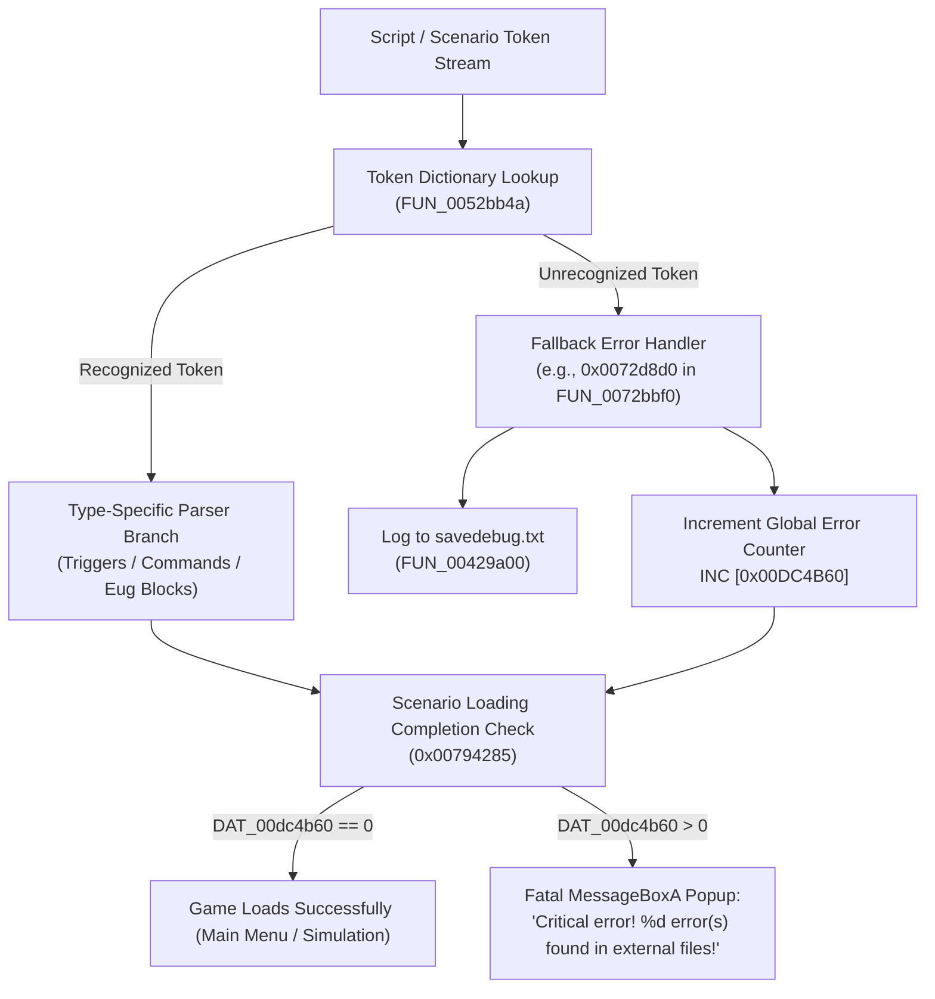
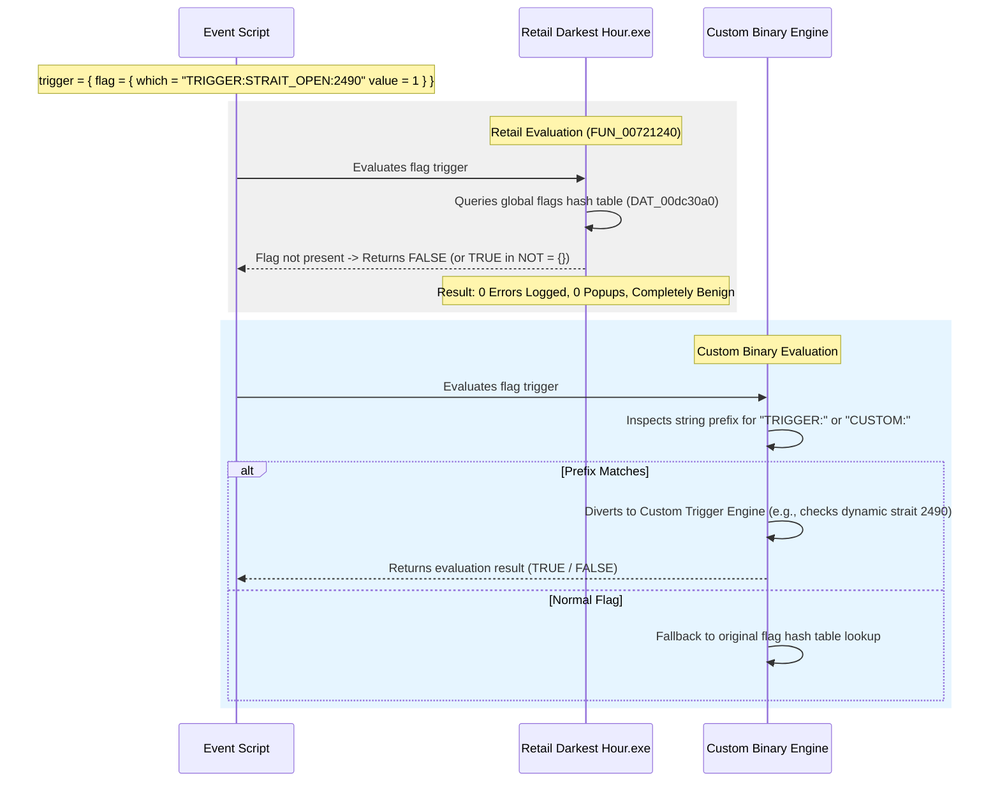

# Darkest Hour Scripting Engine, Parser Internals & Backwards Compatibility

**Target Engine**: Darkest Hour / Europa Engine (v1.05.2, 32-bit x86 PE)  
**Binary Executable**: `Darkest Hour.exe` (Size: `4,730,956` bytes, Image Base: `0x00400000`, Vanilla Checksum: `TENE`)  
**Scope**: In-depth reverse engineering reference for the DHFScript event parser, scenario/savegame (`.eug`) parser, error reporting mechanisms, and verified compatibility design patterns (Proxy Triggers, Carrier Commands, and Payload Carriers).

---

## 1. Parser Architecture & Error Handling Pipeline

When extending Darkest Hour with custom engine binary modifications, modders frequently face the challenge of **dual compatibility**: introducing new script features (such as dynamic strait controls, custom economic modifiers, or specialized AI routines) that the updated custom binary can execute, while ensuring the unmodified retail binary (`Darkest Hour.exe`) can parse the exact same mod files without crashing, throwing warning popups, or corrupting runtime state.

Understanding how the engine parses external scripts and when it triggers fatal errors is the foundation for designing clean, non-intrusive extensions.



### Key Engine Global Variables & Functions

| Symbol / Address | Type / Signature | Description |
|---|---|---|
| `DAT_00dc4b60` (`0x00DC4B60`) | `int32_t` | **External File Parse Error Counter**. Initialized to 0. Incremented whenever an unrecognized trigger keyword, malformed block, or syntax error is encountered during scenario and event parsing. |
| `DAT_00dc4b5f` (`0x00DC4B5F`) | `uint8_t` | **Interactive Prompt Flag**. If non-zero, causes the engine to spawn an immediate interactive dialog box on error instead of deferring. |
| `DAT_00dc4b5e` (`0x00DC4B5E`) | `uint8_t` | **Debug Log Suppression Flag**. Controls whether error strings are mirrored to stdout/console. |
| `FUN_0052bb4a` (`0x0052BB4A`) | `void()` | **Token Dictionary Initializer**. Calls `FUN_005348d0(token_id, token_string)` to register all ~1,700 recognized DHFScript keywords and string tokens. |
| `FUN_00429a00` (`0x00429A00`) | `void(const char* fmt, ...)` | **`savedebug.txt` Logger**. Appends formatted debug and error messages into the active `savedebug.txt` file in the game root. |
| `0x00794285` | Instruction | **Scenario Validation Guard**. Evaluates `CMP DWORD PTR [0x00DC4B60], 0`. If greater than zero, invokes `FUN_00429a50` which calls `MessageBoxA` with `"Critical error! %d error(s) found in external files! Please check savedebug.txt"`. |

---

## 2. Event Triggers: Mechanics & The Proxy Pattern

### 2.1 The Unfamiliar Keyword Trap

In `FUN_0072bbf0` (the event trigger block parser), incoming tokens inside a `trigger = { ... }` block are evaluated against a jump table and lookup comparison. If an author writes an unfamiliar token directly:

```text
# FAILS IN RETAIL:
trigger = {
    unfamiliar_custom_trigger = 42
}
```

The trigger parser falls through to `0x0072d8d0`:
```c
// Decompiled from 0x0072d8d0 in FUN_0072bbf0:
FUN_00429a00(s_ERROR_Unknown_trigger_type_008729c8, token_name, filename, line_num);
DAT_00dc4b60 = DAT_00dc4b60 + 1; // Error count incremented!
```
This logs `ERROR : Unknown trigger type [unfamiliar_custom_trigger] in <file>, line <line>!` to `savedebug.txt` and increments `DAT_00dc4b60`, inevitably causing the scenario load to abort or display the critical error popup.

### 2.2 The Solution: The "Proxy Trigger" Pattern

Because retail rejects unknown token identifiers, all forward-compatible custom triggers must use **pre-existing, valid tokens that accept arbitrary string values**.

The engine's flag triggers are ideally suited for this purpose:
* Global scope: `flag = { which = "<STRING>" value = <INT> }`
* Country scope: `local_flag = { which = "<STRING>" value = <INT> }`

#### Example Syntax:
```text
trigger = {
    flag = { which = "TRIGGER:STRAIT_OPEN:2490" value = 1 }
}
```

#### Dual Engine Execution Behavior:



1. **Retail Engine**: Parses the `flag` token natively. During evaluation in `FUN_00721240`, it hashes `"TRIGGER:STRAIT_OPEN:2490"` and searches `DAT_00dc30a0`. Because the flag has never been set, it returns `0` (false). `DAT_00dc4b60` is not touched, `savedebug.txt` remains clean, and the game proceeds normally.
2. **Custom Binary**: Hooks `FUN_00721240`. If `which` starts with `"TRIGGER:"`, it diverts the call to the custom trigger evaluator, parsing arguments from the string (e.g. action `STRAIT_OPEN`, province ID `2490`) and returning the true dynamic state.

---

## 3. Event Commands: Carrier Command Architecture

### 3.1 Parameter Parsing Mechanics in `FUN_0070c2b0`

The event command block parser (`FUN_0070c2b0`) allocates and initializes an in-memory command structure (size: `0x180` bytes).
When parsing entries within `command = { ... }`, the following offsets are assigned:

| Field Offset | Parameter Token | Token ID | Decompiled Parsing Logic |
|---|---|---|---|
| `+0x00` | `type` | Token `0x0c0` (192) | Resolves command type string to internal command ID (`0x000`–`0x13d`). |
| `+0x28` | `which` (string) | Token `0x14e` (334) | Reads string or integer into string buffer (`FUN_0070b810`). Defaults to `0` / empty string. |
| `+0x30` | `which` (integer) | Token `0x14e` (334) | Reads integer target/value. Defaults to `0` or `-1`. |
| `+0x34` | `value` | Token `0x18c` (396) | Reads numeric value parameter. |
| `+0x172` | `name` | Token `0x233` (563) | Copies string pointer/buffer into `param_1 + 0x172`. **Supported by ALL commands**. |

#### Validation Rules on Closing Brace (`}`)
When the command block terminates, `FUN_0070c2b0` performs validation checks. Crucially, **parameters like `which` and `value` are only mandatory for a small subset of commands**:
* `0x130` (`trade`): Enforces valid trading partner.
* `0x77`–`0x79` (`build_cost`, `build_time`, `manpower`): Enforces unit type specification.
* `0xd8` (`switch`): Checks that the AI file actually exists on disk.
* `0x1b`–`0x1d` (`province`, `area`, `region`): Checks geographical target IDs.

For generic commands (such as `songs`, `protect`, etc.), `which` is **completely optional**. Omitting `which` leaves the struct field initialized to empty and produces **zero validation errors**.

### 3.2 Candidate Carrier Commands

A "carrier command" is a valid command type in retail Darkest Hour that is repurposed to transport arbitrary payload strings (via `name = "..."`) to an updated binary while producing zero unwanted side effects in retail.

| Command Type | Token ID | Engine Cmd ID | Retail Gameplay Behavior | Evaluation as a Carrier |
|---|---|---|---|---|
| **`type = protect`** | `0x066` (102) | `0x029` (41) | **Complete No-Op**. Legacy EU2 mercantilism/protectionism command. Recognized by parser, but `case 0x029:` in execution handlers (`FUN_00713790` and `FUN_0071ebc0`) is an empty stub. | **RECOMMENDED**. Cleanest carrier. Does not touch audio, graphics, or simulation state. |
| **`type = songs`** | `0x24e` (590) | `0x02b` (43) | Enqueues music track. If file not found, fails silently without logging an error. | **VIABLE**. Proven track record in early tests, but interacts with audio subsystem. |
| **`type = population`** | `0x204` (516) | `0x00d` (13) | Legacy EU2 population command. Inert in DH WWII simulation. | **VIABLE**. |
| **`type = mine`** | `0x10f` (271) | `0x00f` (15) | Legacy EU2 mining command. Inert in DH WWII simulation. | **VIABLE**. |
| **`type = flag_ext`** | `0x1fa` (506) | `0x0f2` (242) | Darkest Hour extended flag command. | **VIABLE** for flag-centric logic. |

### 3.3 The Execution Guard: `trigger = { year = 9999 }`

Even when using benign commands like `protect`, Darkest Hour provides a built-in mechanism to guarantee that retail will **never** execute the carrier command at runtime:

```text
command = {
    trigger = { year = 9999 }
    type = protect
    name = "CUSTOM: strait_access id=2490 access=allied"
}
```

* **Retail Execution**: Before executing any command inside an action block (in `FUN_00713790` for AI decisions or `FUN_0071ebc0` for human event windows), the engine evaluates the command's internal `trigger`. Because `year = 9999` evaluates to `false`, the retail engine skips the command entirely.
* **Custom Binary Execution**: The custom engine intercepts action execution or event loading. When it encounters a command with the `"CUSTOM:"` prefix in its `name` attribute, it executes the custom logic regardless of the dummy trigger condition.

---

## 4. Scenario & Savegame (`.eug`) Data Persistence

### 4.1 Allowed Top-Level Tokens in `FUN_00534a40`

Scenario definition files (`.eug`) and runtime savegame files (`.eug`) share an identical parser: `FUN_00534a40`.
Disassembly of `FUN_00534a40` reveals that the top-level parser only accepts **17 specific tokens**:

| Token ID | Keyword String | Handled In | Description / Storage |
|---|---|---|---|
| `0x0e8` (232) | `history` | `FUN_005359b0` | Event history date list (`DAT_00d615b2 + 0x1d4f6`) |
| `0x0e9` (233) | `name` | Direct | Scenario name string |
| `0x0ec` (236) | `country` | `FUN_004f14e0` | Country definition block (`TAG = { ... }`) |
| `0x0f7` (247) | `globaldata` | `FUN_006aef60` | Global world state (wars, alliances, flags, diplomacy) |
| `0x19c` (412) | `header` | `FUN_004bb6b0` | Savegame header (version, date, selectable tags) |
| `0x1f1` (497) | `province` | `FUN_005b68f0` | Province override blocks |
| `0x1f7` (503) | `event` | `FUN_006ffd60` | Event file inclusion path |
| `0x1f8` (504) | `sleepevent` | `FUN_005359b0` | Slept event ID list (`DAT_00d615b2 + 0x1d4e4`) |
| `0x236` (566) | `eyr` | Direct | End year integer |
| `0x246` (582) | `interface` | `FUN_00537bc0` | UI map camera and mouse coordinates |
| `0x249` (585) | `map` | Direct | Map definition |
| `0x24e` (590) | `combat` | Direct | Active tactical combat blocks |
| `0x257` (599) | `saved` | Direct | Saved country tag |
| `0x259` (601) | `panel` | Direct | Active UI panel index |
| `0x294` (660) | `include` | `FUN_00533e40` | File include directive |
| `0x4eb` (1259)| `battlehistory`| `FUN_004b3230`| Historical combat log |
| `0x574` (1396)| **`save_date`** | Inline | Event/Decision ID to timestamp integer linked list |

> [!WARNING]
> Any keyword not in the 17 tokens above (such as placing a naked `decision = { }` or `custom_data = { }` at the top level of a `.eug` file) hits the fallback at `0x00535265`, logging `"ERROR : Illegal top level object"` and incrementing `DAT_00dc4b60`.

### 4.2 Top-Level Integer Storage: `save_date = { ... }`

`save_date` (Token `0x574`) is the only native top-level construct designed to store arbitrary **key-value integer mappings**.

#### Decompiled Parser Loop in `FUN_00534a40`:
```c
// Decompiled from 0x005352b2 in FUN_00534a40:
do {
    while (iVar4 = FUN_00535490(), iVar4 == 1) {
        uVarKey = FUN_007a7b3c(param_1 + 2);     // Parses KEY via atoi (FUN_007a7ab1)
        pNode = operator_new(8);
        *pNode = uVarKey;
        uVarVal = FUN_007a7b3c(param_1 + 0x104); // Parses VALUE via atoi (FUN_007a7ab1)
        pNode[1] = uVarVal;
        
        // Inserts (Key, Value) into linked list at DAT_00d615b2 + 0x1d50c
        InsertSaveDateNode(DAT_00d615b2 + 0x1d50c, pNode);
    }
    if (iVar4 == 2) return 0xfffffffe;
} while (*FUN_00534391() != 4);
```

#### Example Usage:
```text
save_date = {
    9000039 = 19360704
    2490    = 4
}
```

* **Why it is omitted in vanilla saves**: In `FUN_005362c0` (the savegame writer at `0x00536fb7`), the engine checks `count = CountList(DAT_00d615b2 + 0x1d50c)`. If `count == 0`, the entire block is omitted from the saved file.
* **Compatibility**: When written into `.eug` files, retail parses all key-value integer pairs into its internal list without logging errors or warnings.

### 4.3 Arbitrary String & State Storage: `globaldata = { flags = { ... } }`

For arbitrary string identifiers with integer states, the engine's native `flags` dictionary in `globaldata` (parsed by `FUN_006aef60`) is the standard payload carrier:

```text
globaldata = {
    flags = {
        custom_feature_enabled = 1
        ext_strait_2490        = 4
        naval_treaty_active    = 2
    }
}
```

* Parsed dynamically by `FUN_006aef60` into the engine's global flags hash table.
* Supports arbitrary string identifiers and integer values (0 to 32,767).
* Automatically preserved and written out during game saves by `FUN_006b5280`.

---

## 5. Implementation Cheat Sheet

### 5.1 Adding a Custom Trigger (Zero Retail Popups)

```text
# Within any event or decision trigger block:
trigger = {
    # Retail reads this as a missing flag (evaluates FALSE, 0 errors).
    # Custom binary intercepts 'TRIGGER:' and executes custom C++ condition:
    flag = { which = "TRIGGER:STRAIT_ACCESS:2490:GER" value = 1 }
}
```

### 5.2 Adding a Custom Command (Zero Retail Side Effects)

```text
# Within any event or decision action block:
action = {
    name = "ACTION_OK"
    command = {
        trigger = { year = 9999 }  # Neutralizes any potential execution in retail engine
        type = protect              # Inert EU2 legacy no-op command
        name = "CUSTOM: SET_STRAIT_ACCESS ID=2490 ACCESS=ALLIED" # Payload
    }
}
```

### 5.3 Persisting Custom State in Savegames

```text
# For String Keys -> globaldata flags:
globaldata = {
    flags = {
        ext_strait_2490 = 4
    }
}

# For Integer ID Keys -> top-level save_date:
save_date = {
    2490 = 4
}
```

---

## 6. Verification Checklist

Before deploying any new custom script constructs into production mod files, verify:

1. [ ] **External Error Counter Check**: Load scenario with `savedebug = 1` in `settings.cfg`. Verify that `savedebug.txt` contains zero `ERROR : Unknown trigger type` or `ERROR : Illegal top level object` entries.
2. [ ] **Fatal Popup Absence**: Verify the scenario loads to the main menu and in-game UI without prompting `"Critical error! ... found in external files"`.
3. [ ] **Parameter Minimalism**: Confirm that carrier commands omit `which` if unused, relying strictly on `name = "..."`.
4. [ ] **Encoding Integrity**: Verify that all modified `.txt` and `.eug` files are saved in strict **Latin-1 (`cp1252`)** encoding.
