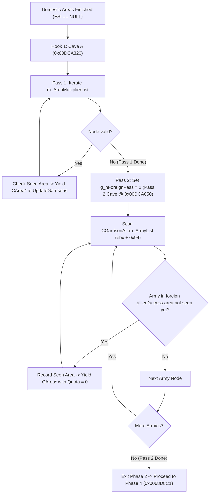
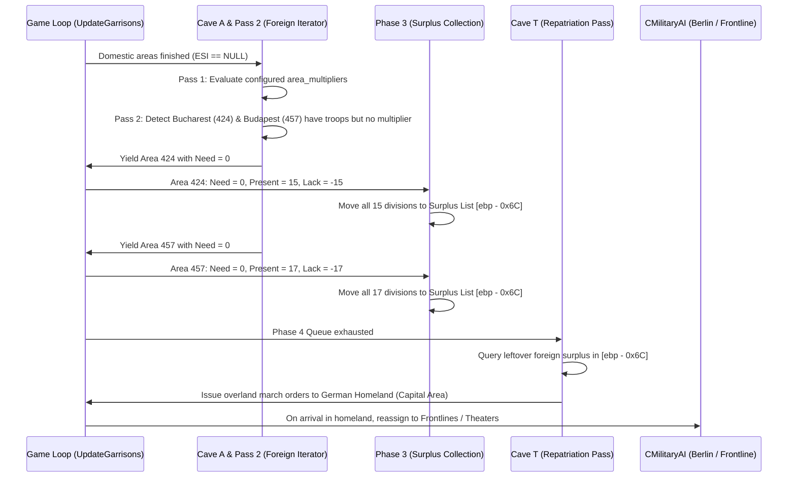
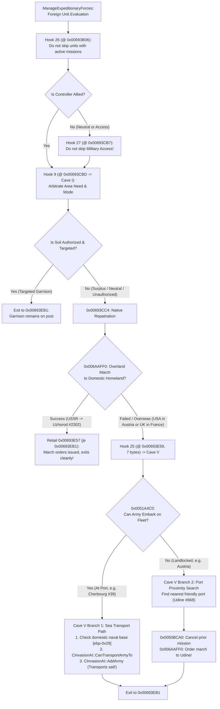

# Patch 11: Allied Territory Garrison AI Architecture & Implementation

**Engine**: Darkest Hour 1.05.2 (checksum TENE)  
**Binary Executable**: `Darkest Hour.exe`  
**Primary Subsystems**: `CGarrisonAI` (`FUN_0068ba50` @ `0x0068BA50`), `CInvasionAI` / `CAITransportMinister` (`0x0069F7F0`), `CAIUnitMinister` (`0x006939F0`), `CMilitaryAI` (`0x00695A00`)  
**Status**: Fully Implemented & Verified in `patch_darkest_hour.bat` (`SHA256 = 5C08FCDEFCF00E4470A9F4B7DB93AAA7C06010670C5513ECE8261BD565043884`)

---

## 1. Overview & Objectives

For the baseline retail engine behavior and limitations, see **[Garrison AI Architecture & Division Quotas (Retail Engine)](../engine/garrison_ai.md)**.

**Patch 11** extends the Darkest Hour Garrison AI, Military AI, Transport/Invasion AI, and Unit Minister subsystems to allow AI nations to station, reinforce, and withdraw divisions in foreign allied and military-access territory based on standard AI script directives (`area_multiplier`, `province_priorities`, `country_priorities`) while respecting global (`db\mod_settings.ini`) and per-country (`no_foreign_garrison`) configuration switches.

Key capabilities introduced by Patch 11:
1. **Dual-Pass Foreign Area Evaluation & Zero-Quota Sweep**:
   - **Pass 1 (`m_AreaMultiplierList`)**: Appends foreign allied/access areas explicitly configured in `area_multiplier` (`[CAI + 0x358]`) to `CGarrisonAI::UpdateGarrisons` (`Cave A`), preserving host-nation `CArea` fields and restoring them on exit (`Cave E`).
   - **Pass 2 (`m_ArmyList` Foreign Army Sweep)**: Once `m_AreaMultiplierList` is exhausted, sweeps `CGarrisonAI::m_ArmyList` (`[ebx + 0x94]`) for any foreign allied/access areas where donor divisions are physically present but which have no entry in `area_multiplier` (`Pass 2 Cave` @ `0x00DCA050`).
2. **Strict Architectural Separation: `area_multiplier` vs `province_priorities`**:
   - `area_multiplier`: Sole gating authority on **whether** any troops stay in or are dispatched to a foreign area. If an area is configured with `multiplier > 0`, it is garrisoned to that quota; if unconfigured or `<= 0`, its quota is strictly **zero**.
   - `province_priorities`: Intra-area weighting only. Determines **where** divisions station within an already-approved area. Never serves as evidence to garrison an unconfigured foreign area.
   - `fn_IsAreaTargeted` (`0x00DCACD5`) checks strictly `area_multiplier > 0`, removing the legacy `province_priorities` fallback to prevent foreign allied capitals (e.g. Bucharest 424, Budapest 457) from becoming accidental garrison sinks.
3. **Foreign Zero-Need & Clamp Bypass (`Cave 2A` & `Cave 2B`)**:
   - Multiplier Gate (`Cave 2A` @ `0x00DCAD58`) preserves `0.0f` for unconfigured foreign areas, preventing retail `is_front_area` overrides from forcing unwanted garrison quotas.
   - Retail Need Clamp Bypass (`Cave 2B` @ `0x00DCAD84`) bypasses the retail `mov [ebp - 0x2C], 1` clamp for foreign areas when calculated need is 0, allowing $nAreaNeed = 0$ and $nAreaLack = -nDivisions$ (100% surplus).
4. **Allied & Access Province Priority & Port Recognition**:
   - Permits `CGarrisonAI` to evaluate priorities (`Cave B`), preserve interior priorities (`Cave K`), inherit border threat from `country_priorities` (`Cave L`), and select destination provinces/ports (`Cave D`) on allied or military-access territory.
5. **Configurable Multipliers & Dynamic Wartime Scaling**:
   - Exposes the land-connected rear multiplier (`GarrisonLandConnectedMultiplier`, Hook 16) and wartime rear/allied multiplier (`GarrisonWartimeMultiplier`, Hook 17 / `Cave N`) in `db\mod_settings.ini`.
   - Ensures foreign allied areas ignore host-nation `CFrontAI` front overrides (`Cave G`) and check `CCountry::IsAtWar()` / `FindAlliedFrontNeedingTroops()` before applying wartime halving (`Cave N`).
6. **Deterministic Overland Dispatch & Foreign Surplus Capital Repatriation**:
   - Retains inter-area overland marching units inside `CGarrisonAI::m_ArmyList` (`Hook 24` at `0x0068DF74`) and counts moving units in their final destination area rather than their origin area (`Hook 20` / `Cave R` calling `0x0051C0C0`).
   - Prevents non-homeland shortage areas from pulling surplus units out of other foreign areas (`Hook 22` / `Cave U`).
   - Orders all leftover foreign surplus units in `[ebp - 0x6C]` at the end of Phase 4 to march overland back to the country's capital area (`Hook 23` / `Cave T` calling `0x0044E1D0`). Upon arrival in the homeland, `CMilitaryAI` automatically reassigns them to active fronts or theater reserves.
   - Restricts `CMilitaryAI::DistributeArmiesToMinisters` registration (`Cave M`) and `ManageExpeditionaryForces` peacetime repatriation immunity (`Cave I`) strictly to areas targeted by `fn_IsAreaTargeted` (`0x00DCACD5`).
7. **Overseas Transport Delivery & `CInvasionAI` Hardening**:
   - Protects peacetime allied/access transport missions and `CGarrisonAI`-owned units from pre-departure threat cancellation (`Cave H`), authorizes military-access port unloading (`Hooks 14 & 15`), and continues scanning surplus candidate armies on transport failure (`0x0068DFCA`).
   - Overrides `CInvasionAI::vtable[0x198/4]` (`0x007F56AC` -> `0x00DCA870`) and sanitizes list traversal (`Hook 21` / `Cave S`) to prevent dangling-pointer crashes when invasion/transport units are destroyed in combat.

---

## 2. Master Hook & Cave Reference Matrix

Patch 11 utilizes code caves in the `.mod` PE section (`0x00DCA050` - `0x00DCAF90`):

| Hook / Patch | Virtual Address | File Offset | Length | Target / Cave | Description |
|---|---|---|---|---|---|
| **Hook 1** | `0x0068D8B9` | `0x0028D8B9` | 8 bytes | `Cave A` (`0x00DCA320`) | Dual-pass foreign iterator (Pass 1 `m_AreaMultiplierList` + Pass 2 `m_ArmyList` sweep) with `seen_areas` de-duplication |
| **Pass 2 Cave** | `0x00DCA050` | `0x00485050` | 170 bytes | `Pass 2 Cave` (`0x00DCA050`) | Sweeps `CGarrisonAI::m_ArmyList` for occupied foreign areas lacking `area_multiplier` to yield with quota 0 |
| **Hook 2A** | `0x0068C680` | `0x0028C680` | 14 bytes | `Cave 2A` (`0x00DCAD58`) | Foreign area multiplier gate (preserves `0.0f` multiplier for unconfigured foreign areas, prevents retail front-override) |
| **Hook 2B** | `0x0068C7ED` | `0x0028C7ED` | 7 bytes | `Cave 2B` (`0x00DCAD84`) | Foreign need >= 1 clamp bypass (allows $nAreaNeed = 0$ when `[0x00DCA310] != 0` and calculated need is 0) |
| **Hook 2** | `0x0068C18E` | `0x0028C18E` | 8 bytes | `Cave B` (`0x00DCA500`) | Non-controlled province filter bypass via `IsAlliedOrAccess_Switchable` |
| **Hook 3** | `0x0068C55A` | `0x0028C55A` | 10 bytes | `Cave C` (`0x00DCA550`) | Allied province counting & area quota calculation |
| **Hook 4** | `0x0068C5B6` | `0x0028C5B6` | 5 bytes | `Cave F` (`0x00DCA650`) | Coastal & border flag calculation for active allied areas |
| **Hook 5** | `0x0068C816` | `0x0028C816` | 7 bytes | `Cave G` (`0x00DCA670`) | Foreign allied area front-override bypass (preserves `area_multiplier` when `[0x00DCA310] != 0`) |
| **Hook 6** | `0x0068DA09` | `0x0028DA09` | 8 bytes | `Cave D` (`0x00DCA5A0`) | Phase 4 foreign allied destination province & debarkation port recognition |
| **Inline Fix** | `0x0068DFCA` | `0x0028DFCA` | 6 bytes | Inline (`0x0068DFCA`) | Phase 4 transport dispatch loop continuation (`jne 0x0068DB06` instead of aborting to `0x0068DB11`) |
| **Hook 7** | `0x0068E291` | `0x0028E291` | 6 bytes | `Cave E` (`0x00DCA5D0`) | Host-nation `CArea` metadata restoration (`+0x56`, `+0x5A`, `+0x5E` from `0x00DCAB20`) & state cleanup |
| **Hook 8** | `0x0069F815` | `0x0029F815` | 12 bytes | `Cave H` (`0x00DCA7E0`) | `CInvasionAI::Update` vtable guard & transport mission threat cancellation gate |
| **Hook 9** | `0x00693CBD` | `0x00293CBD` | 7 bytes | `Cave I` (`0x00DCA820`) | Stage 2 peacetime foreign garrison repatriation bypass (gated strictly by `area_multiplier > 0` via `fn_IsAreaTargeted`) |
| **Hook 10** | `0x0068C742` | `0x0028C742` | 7 bytes | `Cave J` (`0x00DCA690`) | Peacetime overseas area need preservation (`[0x00DCA310] != 0`) |
| **Hook 11** | `0x0068B978` | `0x0028B978` | 12 bytes | `Cave K` (`0x00DCA8F0`) | Interior province priority preservation (bypasses anti-partisan zero-wipe) |
| **Hook 12** | `0x0068B89E` | `0x0028B89E` | 13 bytes | `Cave L` (`0x00DCA920`) | Dynamic border threat inheritance from `country_priorities` |
| **Hook 13** | `0x00696ECD` | `0x00296ECD` | 16 bytes | `Cave M` (`0x00DCAA00`) | Unassigned foreign army distributor pass to `CGarrisonAI` (gated strictly by `area_multiplier > 0` via `fn_IsAreaTargeted`) |
| **Hook 14** | `0x005177C1` | `0x001177C1` | 21 bytes | `0x00DCA700` | `CUnit::CanFleetUnloadAtProvince` military access unload authorization |
| **Hook 15** | `0x00522CFB` | `0x00122CFB` | 21 bytes | `0x00DCA700` | `CUnit::CanMoveToProvince` military access amphibious disembarkation authorization |
| **Hook 16** | `0x0068C7D3` | `0x0028C7D3` | 18 bytes | Inline (`0x0068C7D3`) | Configurable land-connected area multiplier (`GarrisonLandConnectedMultiplier` @ `0x00DCAAE0`) |
| **Hook 17** | `0x0068CAF0` | `0x0028CAF0` | 51 bytes | `Cave N` (`0x00DCA980`) | Configurable wartime rear & allied area multiplier (`GarrisonWartimeMultiplier` @ `0x00DCAAE4`) |
| **Hook 20** | `0x0068BCB1` | `0x0028BCB1` | 20 bytes | `Cave R` (`0x00DCA188`) | Destination-aware en-route unit counting via `0x0051C0C0` (`GetFinalMoveTargetProvince`) |
| **Hook 21** | `0x006A0280` | `0x002A0280` | 8 bytes | `Cave S` (`0x00DCA890`) | `CInvasionAI::Update` linked-list node pointer sanitization |
| **Vtable Fix** | `0x007F56AC` | `0x003F56AC` | 4 bytes | `0x00DCA870` | `CInvasionAI::vtable[0x198/4]` override -> `fn_invasion_remove_unit` |
| **Hook 22** | `0x0068DAAE` | `0x0028DAAE` | 7 bytes | `Cave U` (`0x00DCA1C4`) | Phase 4 foreign surplus candidate filter (prevents cross-foreign-area siphoning) |
| **Hook 23** | `0x0068DB16` | `0x0028DB16` | 6 bytes | `Cave T` (`0x00DCA6B9`) | Phase 4 final capital repatriation pass for leftover foreign surplus in `[ebp - 0x6C]` |
| **Hook 24** | `0x0068DF74` | `0x0028DF74` | 21 bytes | Inline (21 NOPs) | Retains overland inter-area marching units in `CGarrisonAI` instead of transferring to `CTheatreAI` |
| **Hook 25** | `0x00693E59` | `0x00293E59` | 7 bytes | `Cave V` (`0x00DC9C00`) | Unified Foreign Repatriation Fallback (intercepts failed domestic overland march across water/neutral borders) |
| **Hook 26** | `0x00693B06` | `0x00293B06` | 6 bytes | Inline (6 NOPs) | Foreign territory peacetime mission gate bypass (prevents skipping units on anti_partisan_duty) |
| **Hook 27** | `0x00693CB7` | `0x00293CB7` | 6 bytes | Inline (6 NOPs) | Military access peacetime evacuation gate bypass (prevents dropping units on military access territory at retail `jz 0x00693EB1`) |
| **Cave V** | `0x00DC9C00` | `0x00484C00` | 368 bytes | `Cave V` (`0x00DC9C00`) | Unified Foreign Repatriation Pipeline (CanEmbarkOnFleet check -> Branch 1: coastal port sea transport via CInvasionAI bypassing peacetime `m_bEnabled` gate; Branch 2: landlocked proximity march to nearest friendly port e.g. Udine 668) |
| **Helper** | `0x00DCAB60` | `0x00485B60` | 128 bytes | `DetermineGarrisonMode` | Evaluates `EnableAlliedGarrison` (`0x00DCAB00`) and `no_foreign_garrison` (`[pCountry+0x120+0x4C]`) |
| **Helper** | `0x00DCA700` -> `0x00DCAC00` | `0x00485700` / `0x00485C00` | 213 bytes | `IsAlliedOrAccess_Switchable` | Diplomatic alliance & military access validator with Mode 0/1/2 enforcement |
| **Helper** | `0x00DCACD5` | `0x00485CD5` | 120 bytes | `fn_IsAreaTargeted` | Checks strictly whether a `CArea*` has a positive entry (`> 0.0`) in `m_AreaMultiplierList` |

---

## 3. Subsystem Architecture & Implementation Details

### 3.1 Phase 2: Dual-Pass Foreign Area Iterator (`Cave A` @ `0x00DCA320`, `Pass 2 Cave` @ `0x00DCA050`, & `Cave E` @ `0x00DCA5D0`)
When `CGarrisonAI::UpdateGarrisons` finishes iterating the country's domestic `m_AreaList` (`ESI == NULL` at `0x0068D8B9`), **Hook 1** jumps to `Cave A` (`0x00DCA320`).

The foreign evaluation loop operates as a two-pass state machine:
- `g_pCurMultiplierNode` (`[0x00DCA30C]`): Current linked list node for Pass 1.
- `g_bInForeignGarrisonPass` (`[0x00DCA310]`): Set to `1` when evaluating any foreign area (used by caves across `UpdateGarrisons`).
- `g_nForeignPass` (`[0x00DCA314]`): Pass identifier (`0` = Pass 1 `m_AreaMultiplierList`, `1` = Pass 2 `m_ArmyList` sweep).
- `g_pPass2Node` (`[0x00DCA318]`): Current linked list node for Pass 2.



#### Pass 1: Configured Areas (`m_AreaMultiplierList` @ `[pAI + 0x358]`)
1. Walks the nation's `m_AreaMultiplierList`.
2. Entries with `multiplier <= 0.0` are yielded with `area_multiplier = 0.0` so that any troops stationed in deactivated areas are flushed out.
3. Duplicate areas are suppressed via `CheckSeenArea` (`0x00DCA46C`) using the `seen_areas` table (`0x00DCA4B4`, count at `0x00DCA4B0`).
4. Original host metadata `{ CArea*, orig_56, orig_5A, orig_5E }` is backed up to `0x00DCAB20`.
5. When `m_AreaMultiplierList` reaches its end, execution transitions to `Pass 2 Cave` (`0x00DCA050`).

#### Pass 2: Occupied Foreign Areas Sweep (`m_ArmyList` @ `[ebx + 0x94]`)
1. Triggered when Pass 1 completes. Sets `g_nForeignPass = 1` (`[0x00DCA314] = 1`) and initializes `g_pPass2Node` to the head of `CGarrisonAI::m_ArmyList` (`[ebx + 0x94]`).
2. Iterates each army currently assigned to `CGarrisonAI`.
3. Resolves the army's location via `CUnit::GetProvince()` (`0x0051B230`).
4. Checks whether the province is on foreign soil (`pProv->m_pController != pCountry`) and has valid allied or military access via `IsAlliedOrAccess_Switchable` (`0x00DCA700`).
5. Calls `CheckSeenArea(pProv->m_pArea)` (`0x00DCA46C`):
   - If the area was already evaluated in Pass 1 or earlier in Pass 2, it is skipped.
   - If unseen, records the area in `seen_areas`, backs up host metadata to `0x00DCAB20`, loads `0.0f` into the multiplier, and yields to `CAVE_A_YIELD` (`0x00DCA405`).
6. **Result**: Every foreign allied/access area where donor units are stationed is guaranteed to undergo evaluation, even if completely omitted from `area_multiplier`.
7. Once `m_ArmyList` is exhausted, execution exits cleanly to Phase 4 (`0x00DCA43A` -> `0x0068D8C1`).

#### Host Metadata Restoration (`Cave E` @ `0x00DCA5D0`)
Before evaluating a foreign `CArea*`, `Cave A` saves its original `{ CArea*, orig_56, orig_5A, orig_5E }` in the backup table at `0x00DCAB20`. When `UpdateGarrisons` exits at `0x0068E291`, **Hook 7** (`Cave E`) restores those fields so the host nation's own AI state is never polluted.

---

### 3.2 Role Separation: `area_multiplier` vs `province_priorities`

To eliminate ambiguity, unexpected troop accumulation, and erratic AI behavior, the Garrison AI mod architecture enforces a **strict separation of responsibilities**:

```
+-----------------------------------------------------------------------------------+
| 1. AREA SELECTION & QUOTA GATEKEEPER: area_multiplier                             |
|    - Sole authority on WHETHER a foreign area is garrisoned.                      |
|    - If an area is in area_multiplier with value > 0: Garrisoned with that quota. |
|    - If an area is NOT in area_multiplier (or <= 0): Quota is strictly ZERO.     |
|    - ALL troops currently in that area must leave and repatriate to homeland.     |
+-----------------------------------------------------------------------------------+
                                      |
                                      v
+-----------------------------------------------------------------------------------+
| 2. INTRA-AREA PROVINCE WEIGHTING: province_priorities                             |
|    - Only activates AFTER troops are allocated to an area via area_multiplier.    |
|    - Determines WHERE within that specific area divisions should be stationed.    |
|    - NEVER serves as evidence that an area should be garrisoned!                  |
|    - NEVER triggers unit deployment, adoption, or retention in a foreign area.    |
+-----------------------------------------------------------------------------------+
```

#### The Foreign Capital Garrison Sink Problem
Vanilla Darkest Hour AI files assign high static priorities to allied foreign capitals (e.g. `424 = 500` Bucharest, `457 = 500` Budapest, `417 = 500` Sofia, `515 = 500` Rome). 

Previously, when helper functions checked `province_priorities` as evidence for area garrisoning:
1. Foreign allied capitals became **accidental garrison sinks**, even when `area_multiplier` had no entry or was set to `0`.
2. Newly donated expeditionary forces arriving in capitals were falsely conscripted into `CGarrisonAI` by `Cave M`.
3. Vanilla peacetime repatriation was falsely blocked by `Cave I`.
4. `UpdateGarrisons` ignored those areas because it only iterated `area_multiplier`, stranding dozens of divisions in Bucharest and Budapest.

#### The Architecture Fix (`fn_IsAreaTargeted` @ `0x00DCACD5`)
The fallback to `m_ProvincePrioritiesList` in `fn_IsAreaTargeted` was removed (`0x00DCAD34: jmp 0x00DCAD4D`). `fn_IsAreaTargeted` returns `AL = 1` **only if** the area has an explicit entry with `multiplier > 0.0` in `m_AreaMultiplierList`. 

This directly harmonizes all dependent subsystems:
- **`Cave M` (`0x00DCAA00`)**: When new expeditionary divisions appear in an unconfigured capital, `fn_IsAreaTargeted` returns `0`. `Cave M` skips `AddUnit`, leaving them under `CMilitaryAI` control.
- **`Cave I` (`0x00DCA820`)**: `Cave I` no longer blocks vanilla peacetime repatriation for unconfigured foreign capitals.
- **`Cave A` (`0x00DCA320` + `0x00DCA050`)**: Evaluates unconfigured occupied areas with `nAreaNeed = 0`, forcing 100% surplus evacuation.

---

### 3.3 Foreign Zero-Quota Architecture & Clamp Bypass (`Cave 2A`, `Cave 2B`, `Cave G`, `Cave J`)

> **Core Rule**: Every foreign area not configured in `area_multipliers` (or configured with `multiplier <= 0`) must be evaluated with `nAreaNeed = 0`. For foreign areas specifically, all garrison troops present must always be declared surplus and ordered to repatriate to the homeland.

#### Multiplier Gate (`Hook 2A` @ `0x0068C680` -> `Cave 2A` @ `0x00DCAD58`)
In retail `UpdateGarrisons`, if an area is not found in `m_AreaMultiplierList`, or if an unconfigured foreign area is evaluated during Pass 2, the retail engine would default its multiplier or allow retail front-override logic to force `M = 1.0`.
- **`Cave 2A`** intercepts the lookup: when evaluating a foreign area (`[0x00DCA310] != 0`), if the area is not in `m_AreaMultiplierList` or has multiplier `<= 0.0`, `Cave 2A` forces `fldz` (multiplier `0.0f`) and branches directly past the front-override check.

#### Retail Need Clamp Bypass (`Hook 2B` @ `0x0068C7ED` -> `Cave 2B` @ `0x00DCAD84`)
At `0x0068C7ED`, the retail engine enforces a minimum quota clamp on all evaluated areas:
```asm
0x0068C7E5: mov ecx, dword ptr ss:[ebp-0x2C] ; ecx = nAreaNeed
0x0068C7E8: mov eax, 0x01
0x0068C7ED: cmp ecx, eax
0x0068C7EF: jnl 0x0068C7F4
0x0068C7F1: mov dword ptr ss:[ebp-0x2C], eax ; Clamps nAreaNeed to at least 1!
```
For foreign areas with `multiplier == 0.0`, this clamp would leave 1 division behind instead of clearing the area completely.
- **`Cave 2B`** checks `cmp dword ptr [0x00DCA310], 0`. If `!= 0` (foreign area) and `ecx <= 0`, `Cave 2B` **bypasses `0x0068C7F1`**, strictly preserving `nAreaNeed = 0`.

#### Surplus Calculation Outcome:
$$nAreaLack = nAreaNeed - nDivisions = 0 - nDivisions = -nDivisions$$
Because $nAreaLack < 0$, Phase 3 (`0x0068D100` - `0x0068D8A0`) marks **100% of divisions in the area as surplus** and moves them into the surplus collection list `[ebp - 0x6C]`.

#### Foreign Multiplier Preservation (`Cave G` @ `0x00DCA670` & `Cave J` @ `0x00DCA690`)
1. **Peacetime Need Preservation (`Hook 10` @ `0x0068C742` -> `Cave J` @ `0x00DCA690`)**: Bypasses the `mov dword ptr [ebp - 0x2C], 0` peacetime overseas wipe when `[0x00DCA310] != 0` for configured allied areas.
2. **Foreign Front-Override Bypass (`Hook 5` @ `0x0068C816` -> `Cave G` @ `0x00DCA670`)**: Prevents foreign allied areas from having their configured multiplier overwritten by `1.0` due to host-nation `CFrontAI` flags.

---

### 3.4 Configurable Multipliers & Dynamic Wartime Scaling (`Hook 16`, `Hook 17` / `Cave N` @ `0x00DCA980`)

1. **Land-Connected Area Multiplier (`Hook 16` @ `0x0068C7D3`)**:
   - Replaces the hardcoded integer division by 3 with `fild dword ptr [ebp - 0x2C]; fmul dword ptr [0x00DCAAE0]; fistp dword ptr [ebp - 0x2C]`, reading `GarrisonLandConnectedMultiplier` (`0x00DCAAE0`, default `0.333`).
2. **Wartime Rear & Allied Area Multiplier (`Hook 17` @ `0x0068CAF0` -> `Cave N` @ `0x00DCA980`)**:
   - Redirects the 51-byte wartime halving block (`0x0068CAF0` - `0x0068CB22`) to `Cave N`:
     ```asm
     0x00DCA980: cmp dword ptr [0x00DCA310], 0
     0x00DCA987: jne 0x00DCA997                  ; Foreign allied area -> skip domestic front flags, go to war check
     0x00DCA989: mov al, byte ptr [ebp - 0x11]   ; Domestic front check 1
     0x00DCA98C: test al, al
     0x00DCA98E: jne 0x00DCA9C9                  ; Active front -> do not halve
     0x00DCA990: mov al, byte ptr [ebp - 0x1E]   ; Domestic front check 2
     0x00DCA993: test al, al
     0x00DCA995: jne 0x00DCA9C9                  ; Active front -> do not halve
     0x00DCA997: mov eax, dword ptr [ebp - 0xE0] ; FindAlliedFrontNeedingTroops()
     0x00DCA99D: test eax, eax
     0x00DCA99F: jne 0x00DCA9AD                  ; Allied front needs troops -> apply wartime multiplier
     0x00DCA9A1: mov ecx, dword ptr [ebx + 0x0A] ; pCountry
     0x00DCA9A4: call 0x0044BEB0                 ; CCountry::IsAtWar()
     0x00DCA9A9: test al, al
     0x00DCA9AB: je 0x00DCA9C9                   ; At peace -> skip wartime multiplier
     0x00DCA9AD: fild dword ptr [ebp - 0x2C]
     0x00DCA9B0: fmul dword ptr [0x00DCAAE4]     ; * g_fGarrisonWartimeMultiplier (default 0.5)
     0x00DCA9B6: fistp dword ptr [ebp - 0x2C]
     0x00DCA9B9: mov esi, dword ptr [ebp - 0x2C]
     0x00DCA9BC: mov eax, esi
     0x00DCA9BE: sub eax, dword ptr [ebp - 0x44]
     0x00DCA9C1: mov dword ptr [ebp - 0x24], eax
     0x00DCA9C4: jmp 0x0068CB26
     0x00DCA9C9: jmp 0x0068CB23
     ```
   - **Domestic Areas (`[0x00DCA310] == 0`)**: Preserves front-area immunity (`[ebp - 0x11]` and `[ebp - 0x1E]`), and replaces `[ebp - 0x4E]` with `CCountry::IsAtWar()` (`0x0044BEB0`) so maritime/island nations at war also scale their rear areas by `GarrisonWartimeMultiplier`.
   - **Foreign Allied Areas (`[0x00DCA310] != 0`)**: Bypasses `[ebp - 0x11]` / `[ebp - 0x1E]` (which can be non-deterministically set by `CFrontAI` state across reloads) and branches to `0x00DCA997` to check `FindAlliedFrontNeedingTroops()` (`[ebp - 0xE0]`) and `CCountry::IsAtWar()` (`0x0044BEB0`). Thus, foreign allied areas are scaled by `GarrisonWartimeMultiplier` (`0.5x`) when at war and remain unscaled (`1.0x`) during peacetime.

---

### 3.5 En-Route Overland Unit Tracking & Foreign Surplus Repatriation (`Hooks 20, 22, 23, 24`)

To ensure exact division counts without over-dispatch, reload inconsistency, or endless back-and-forth marching between allied areas:
1. **Retaining Overland Marching Units in `CGarrisonAI` (`Hook 24` @ `0x0068DF74`, 21 NOPs)**:
   - When `UpdateGarrisons` dispatches a surplus unit overland to a needy area (`0x0068DE12` - `0x0068DF88`), retail code at `0x0068DF74` called `pDestTheatre->AddUnit(esi)`, removing the marching unit from `CGarrisonAI::m_ArmyList` (`[ebx + 0x94]`) until arrival. While in transit, `UpdateGarrisons` could no longer see the unit and repeatedly dispatched additional replacements every day.
   - **Hook 24** replaces the 21-byte `pDestTheatre->AddUnit(esi)` transfer at `0x0068DF74` - `0x0068DF88` with `NOP`s so overland marching units remain registered in `CGarrisonAI::m_ArmyList` throughout their march.
2. **Destination-Aware Unit Counting (`Hook 20` @ `0x0068BCB1` -> `Cave R` @ `0x00DCA188`)**:
   - When `UpdateGarrisons` counts units in `[ebx + 0x94]` (`0x0068BC91` - `0x0068BD00`), `Cave R` checks `cmp dword ptr [edi + 0x298], 0` (`pUnit->IsMoving()`):
     - If stationary (`<= 0`), it uses the unit's current province `[edi + 0x220]`.
     - If moving (`> 0`), it calls `0x0051C0C0` (`CUnit::GetFinalMoveTargetProvince()`, which traverses the movement path `[edi + 0x170]` to return the final destination province ID) and resolves `GetProvince(id)->m_pArea`.
   - Consequently, the moment a unit is ordered to march from Area A to Area B, it is immediately counted toward Area B's `nDivisions` and deducted from Area A's `nDivisions`.
3. **Phase 4 Foreign Surplus Candidate Filter (`Hook 22` @ `0x0068DAAE` -> `Cave U` @ `0x00DCA1C4`)**:
   - During Phase 4 (`0x0068DA90` - `0x0068DB11`), when a non-homeland shortage area searches `[ebp - 0x6C]` for candidate surplus units, `Cave U` rejects candidate units located on foreign soil (`[pUnitProv + 0x3D8] != pCountry`), preventing foreign allied areas from pulling surplus units out of other foreign allied areas.
4. **Phase 4 Final Capital Repatriation Pass (`Hook 23` @ `0x0068DB16` -> `Cave T` @ `0x00DCA6B9`)**:
   - When the Phase 4 needy-area queue `[ebp - 0x104]` is exhausted (`0x0068DB16`), any surplus units still remaining in `[ebp - 0x6C]` that are sitting on foreign soil would otherwise remain stranded whenever the homeland capital area itself had no deficit (`nAreaLack <= 0`).
   - `Cave T` calls `0x0044E1D0` (`CCountry::GetCapitalArea()`) and, if the capital area is non-null, re-enters the Phase 4 dispatch body (`0x0068D938`) once with the capital area as destination so all remaining foreign surplus units in `[ebp - 0x6C]` are ordered to march overland back to the homeland.
   - Upon arrival in the homeland, `CMilitaryAI::DistributeArmiesToMinisters` (`0x00695A00`) immediately reassigns them to active fronts (e.g. Eastern Front), coastal defenses, or theater reserves.

---

### 3.6 Target-Aware Army Registration & Peacetime Repatriation (`Cave M`, `Cave I`, `fn_IsAreaTargeted`)

1. **`fn_IsAreaTargeted` (`0x00DCACD5`)**:
   - Inspects `m_AreaMultiplierList` (`[pAI + 0x358]`) for the given `CArea*`. Returns `AL = 1` only if an entry in that area has a strictly positive (`> 0`) multiplier.
2. **Unassigned Foreign Army Distributor (`Hook 13` @ `0x00696ECD` -> `Cave M` @ `0x00DCAA00`)**:
   - Sweeps `CMilitaryAI::m_ArmyList` (`[ebx + 0x20C]`) for idle land armies (`[pArmy + 0x1F4] == ebx`, `[pArmy + 0x298] == 0`) located in foreign allied/access provinces where `fn_IsAreaTargeted` returns `1`, and registers them to `CGarrisonAI` (`call dword ptr [edx + 0x1A8]`).
   - Units in unconfigured foreign areas (`fn_IsAreaTargeted == 0`) are left unassigned so `ManageExpeditionaryForces` can repatriate them.
3. **Peacetime Repatriation Filter (`Hook 9` @ `0x00693CBD` -> `Cave I` @ `0x00DCA820`)**:
   - Placed at Stage 2 entry of `CAIUnitMinister::ManageExpeditionaryForces` (`0x00693CBD`), preserving Stage 1 wartime expeditionary transfers (`0x00693A86`).
   - If the unit is on foreign allied/access soil (`IsAlliedOrAccess_Switchable == 1`) and either has an active movement target (`[pArmy + 0x298] != 0`) or is in an area where `fn_IsAreaTargeted == 1`, `Cave I` jumps to `0x00693EB1` (bypassing peacetime evacuation). Otherwise, it falls through to retail repatriation (`0x00693CC4`).

---

### 3.7 Overseas Transport Delivery & `CInvasionAI` Dangling Pointer Fixes (`Cave H`, `Cave S`, Vtable Override)

1. **Transport Mission Threat Gate & Vtable Guard (`Hook 8` @ `0x0069F815` -> `Cave H` @ `0x00DCA7E0`)**:
   - Validates `[ebx] == 0x007E85C0` (living `CArmy` vtable); if invalid/freed, jumps to `0x006A0278` (next unit).
   - **Retail Non-Ally Bypass**: Evaluates `CCountry::IsAlliedWith(dest)` (`0x0044B300`). If `0` (hostile invasion target or non-allied territory), jumps directly to `0x0069F871` (proceeds with mission without threat evaluation, preserving retail invasions such as Norway, UK, USSR).
   - **Mission-Type Aware Allied Transport Bypass (`byte ptr [ebx + 0x29C] == 0`)**: If destination is an ally (`IsAlliedWith == 1`) and the mission is a transport/garrison mission (`m_nMissionType == 0`, dispatched by `CGarrisonAI::UpdateGarrisons` Phase 4 or `Cave V`), jumps directly to `0x0069F871` (proceeds with mission, bypassing pre-departure threat cancellation). This resolves the issue where Germany refused to sea-transport garrisons to allied Finland in late 1940: because Germany was at war with the Allies while Finland had 0 enemy threat on the Soviet border, vanilla `CalculateAreaThreat` returned negative (-41), causing retail line `0x0069F84A` (`RemoveArmyFromMission`) to abort and dump the transport army back to `CMilitaryAI` every hour.
   - **Peacetime Allied Bypass**: If `CCountry::IsAtWar()` (`0x0044BEB0`) returns `0`, jumps to `0x0069F871` (preserves peacetime allied deployments, e.g. UK to France in 1936).
   - **Wartime Combat Assault on Ally (Fallback)**: If `m_nMissionType != 0` and at war, jumps to `0x0069F821` (`CMilitaryAI::CalculateAreaThreat`).
2. **`CInvasionAI` Destroyed Unit Unlinking (`0x007F56AC` -> `fn_invasion_remove_unit` @ `0x00DCA870`)**:
   - Redirects `CInvasionAI::vtable[0x198/4]` from `CMinisterAI::vfn_198` (`0x006709A0`) to `0x00DCA870`, which calls both `CInvasionAI::RemoveArmy` (`0x006A1040`) and `CInvasionAI::RemoveTransport` (`0x006A1220`) when a unit is destroyed.
3. **List Node Sanitization (`Hook 21` @ `0x006A0280` -> `Cave S` @ `0x00DCA890`)**:
   - Validates linked-list node pointers at the end of `CInvasionAI::Update`'s unit loop against null, unmapped (`<= 0x10000`), or freed (`0xDFDFDFDF` / `0xD0D0D0D0`) memory markers.

---

### 3.8 Complete Lifecycle: Foreign Troop Stationing, Zero-Quota Evacuation & Front Reassignment



---

### 3.9 Unified Foreign Peacetime Repatriation & Evacuation Pipeline (`Hook 25` @ `0x00693E59`, `Hook 26` @ `0x00693B06`, `Hook 27` @ `0x00693CB7` -> `Cave V` @ `0x00DC9C00`)

#### Problem Statement (The Dual Dilemma: Landlocked Evacuation & Allied Repatriation)
In retail Darkest Hour, peacetime foreign troop repatriation (`CAIUnitMinister::ManageExpeditionaryForces` @ `0x006939F0`) suffered from multiple architectural bottlenecks that caused troops to either become permanently trapped on foreign soil or fail to repatriate cleanly:

1. **The Landlocked Overseas Power Dilemma (e.g. Austria 1947 after State Treaty)**:
   - When an overseas power without contiguous homeland territory (such as USA or UK following Austrian independence) has divisions stationed in landlocked foreign territory:
     - Retail identifies the unit is on foreign soil and initiates withdrawal (`0x00693CC4`).
     - Scans candidate provinces exclusively in North America or British Isles from `m_controlledAreasList` (`[pCountry + 0xE86E]`).
     - At `0x00693E2C`, `CanStrategicRedeployTo` returns `0` due to neutral territory.
     - At `0x00693E4A`, `call 0x006AAFF0` attempts domestic overland march across the ocean and fails (`EAX == 1`).
     - Execution falls through to `0x00693E59` to attempt sea transport (`0x006A0DE0`). Because landlocked territory has zero ports, naval transport returns `0`, aborting without issuing orders and permanently stranding all overseas divisions forever.
   - Divisions on `anti_partisan_duty` during occupation were completely skipped upfront at `0x00693B06: jne 0x00693EB1`, preventing evacuation from ever considering them.

2. **The Peacetime Invasion AI Gate Limitation & Military Access Abort**:
   - In retail, between `0x00693E59` and `0x00693E7F`, the engine executes several gates:
     - `0x00693E73: mov cl, byte ptr [pInvasionAI + 0x0E]`
     - `0x00693E76: test cl, cl; je 0x00693EB1` (Peacetime Invasion Gate: aborts if `m_bEnabled == 0`).
     - During peacetime, `m_bEnabled` is strictly `0`, causing retail to abort evacuation for any coastal unit that is not in a wartime invasion mission.
   - At `0x00693CB7`, retail tested whether the country held military access through the current province controller (`test al, al; jz 0x00693EB1`); if access existed, retail dropped repatriation completely, abandoning troops on allied or military access soil.

#### The Architectural Solution (`Hook 25`, `Hook 26`, `Hook 27`, & `Cave V`)



1. **Hook 26 (Foreign Peacetime Mission Gate Bypass @ `0x00693B06`, 6 NOPs)**:
   - Eliminates the upfront `m_pMission != NULL` loop abort on foreign soil, allowing divisions on `anti_partisan_duty` in neutral territory (such as Austria) to enter repatriation.

2. **Hook 27 (Military Access Repatriation Gate Bypass @ `0x00693CB7`, 6 NOPs)**:
   - NOPs out retail's military access drop (`test al, al; jz 0x00693EB1`), ensuring units on military access soil are routed into `Cave I` for quota validation and surplus repatriation rather than abandoned.

3. **Pristine Domestic Overland March Preservation (`0x00693E4A` - `0x00693E57`)**:
   - Left 100% intact for continental powers. Soviet divisions in Austria march overland directly to Uzhorod (`#2302`) using native retail code without modded intervention (`0x006AAFF0` returns 0 on success, jumping cleanly to `0x00693EB1`).

4. **Hook 25 (Overseas Repatriation Interceptor @ `0x00693E59`, 7 bytes -> `Cave V` @ `0x00DC9C00`)**:
   - Replaces retail sea transport fallback at `0x00693E59`. Fires **strictly and exclusively** when domestic overland march has failed (`EAX != 0` at `0x00693E55`).

5. **Cave V Unified Two-Branch Dispatch Pipeline (`0x00DC9C00`)**:
   - **Branch 1 (Coastal Unit Sea Transport)**:
     - Evaluates `0x0051A4C0` (`CanEmbarkOnFleet`). If the army is already at a port capable of fleet embarkation (e.g. UK in Cherbourg `#39`), validates domestic naval base pointer `[ebp - 0x28]`.
     - Calls `0x006A0DE0` (`CInvasionAI::CanTransportArmyTo`).
     - Assigns target province (`[pArmy + 0x298]`) and mission type 0 (`[pArmy + 0x29C]`).
     - Invokes `CInvasionAI::AddArmy` (`vtable[0x1A8]`), bypassing `pInvasionAI->m_bEnabled` so transport fleets sail during peacetime.
   - **Branch 2 (Landlocked Unit Port Proximity Search & March)**:
     - If `CanEmbarkOnFleet` returns `0` (e.g. USA / UK in landlocked Austria `#377` / `#3217`), iterates all friendly countries in `g_pCountryTable` (`0x0089CAD8`) via `IsAlliedWith` (`0x0044B300`) and military access (`0x005861A0`).
     - Scans controlled provinces for active naval bases (`[pProv + 0x3DC] > 0`).
     - Calculates distance via `0x0044A9C0`. For USA / UK divisions in Austria, **Udine (`#668`)** in northern Italy (`ITA`) is strictly the closest reachable friendly port (~128-293 px).
     - Cancels prior occupation missions via `0x0050BCA0`.
     - Dispatches multi-waypoint overland marching directly to the friendly port using the native dispatcher `call 0x006AAFF0`. Once in Udine, Italian theater transport and garrison AI handle onward deployment.

---

## 4. Configuration & Control Gates (`db\mod_settings.ini` & `no_foreign_garrison`)

### 4.1 Global Engine Settings (`db\mod_settings.ini`)
```ini
[AI]
; Enable Allied Territory Garrison AI:
; 0 = No foreign garrisons outside directly controlled territory (vanilla DH behavior)
; 1 = Allow garrisons in ally territory only
; 2 = Allow garrisons in ally and military access territory (default)
EnableAlliedGarrison = 2

; Multiplier applied to garrison requirement for areas with direct land connection to homeland (default = 0.333, 1.0 = do nothing / no division)
GarrisonLandConnectedMultiplier = 0.333

; Multiplier applied to garrison requirement during wartime (default = 0.5, 1.0 = do nothing / no halving)
GarrisonWartimeMultiplier = 0.5
```

### 4.2 Country-Specific Override (`no_foreign_garrison` Local Flag)
Evaluated by `DetermineGarrisonMode` (`0x00DCAB60`) from `pCountry->m_pAI->m_flags` (`[pCountry + 0x120 + 0x4C]`):
- **`0` (or unset)**: Inherit global `EnableAlliedGarrison` setting.
- **`1`**: Clamp effective mode to at most `1` (ally territory only; excludes military access).
- **`2`**: Clamp effective mode to `0` (disables all foreign garrisons for this country).

### 4.3 `IsAlliedOrAccess_Switchable` (`0x00DCA700` -> `0x00DCAC00`)
- Returns `1` immediately if `CountryA == CountryB` (domestic territory).
- Queries `DetermineGarrisonMode(CountryA)` (`0x00DCAB60`). Returns `0` if effective mode is `0`.
- **Mode >= 1 (Alliances & Puppet Access Exception)**:
  - Checks major faction membership (`[pCountry + 0x3350]`).
  - Checks bilateral military alliance treaties (`CCountry::IsAlliedWith` @ `0x0044B300`).
  - **Puppet + Military Access Exception**: If `CountryB` is a puppet of `CountryA` (`[CountryB->m_pDiplomacy + 0x3B30] == CountryA->m_nTag`) AND `CountryB` grants military access to `CountryA` (`CDiplomacy::HasAccessTo(CountryA, CountryB) == 1`), `CountryB` is treated as an ally and returns `1`.
  - Non-aggression pacts (`0x005861E0`) and puppets without military access return `0`.
- **Mode == 2 (Military Access)**: Checks `CDiplomacy::HasAccessTo` (`0x005861A0`, relation offset `+0x37`) in both directions.

---

## 5. Binary Signatures & Verification

| File | Status | SHA-256 |
|---|---|---|
| `Darkest Hour_original.exe` | Pristine v1.05.2 (TENE) | `7A1AE8BB802377B6C9EC808F420ACE58475D1816464390422CF97AD450A51EB4` |
| `Darkest Hour_modified.exe` | Patched (`v69` All Fixes + Unified Foreign Repatriation & Port Evacuation) | `5C08FCDEFCF00E4470A9F4B7DB93AAA7C06010670C5513ECE8261BD565043884` |
| `Darkest Hour.exe` | Active Executable (Memory Live-Patched) | `5C08FCDEFCF00E4470A9F4B7DB93AAA7C06010670C5513ECE8261BD565043884` |
