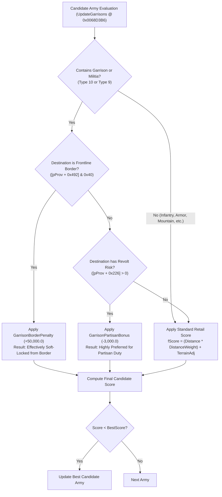

# Implementation Plan: Targeted Garrison Border Discouragement & Config Externalization

## Executive Summary & Scope

In accordance with user requirements, this plan adopts a **minimal surgical approach** to resolve the Garrison AI's distribution deficiencies. Rather than overhauling the scoring of all unit types across a complex precedence hierarchy, we focus on the single highest-impact root failure: **preventing Garrison and Militia divisions from being deployed to frontline and national borders**.

If Garrison and Militia divisions are strongly discouraged from taking frontline border slots, the engine will naturally draw regular combat divisions (Infantry, Mountain, Motorized, Armor) to secure those borders, leaving Garrisons in the rear to perform their intended anti-partisan and security functions.

Additionally, this plan fulfills the requirement to **externalize all formula constants** (both existing retail weights and new garrison modifiers) into `db\mod_settings.ini`, eliminating hardcoded magic numbers from the executable.

All broader redesign concepts (such as dedicated penalties for Armor on anti-partisan duty or complex tiered role resolution) are preserved in a dedicated **Section 5: TBD / Future Scope (Deferred)**.

---

## 1. Root Cause Summary

1. **Unit-Blind Selection dominated by Distance:**
   In retail `CGarrisonAI::UpdateGarrisons` (`0x0068D113`-`0x0068D405`), candidate armies are scored by:
   $$\text{Score} = (\text{Distance} \times 10.0) + \text{SurplusTerm} + \text{TerrainAdjustments}$$
   Lower score wins. Because $\text{Distance} \times 10.0$ dominates, any Garrison division near the border (e.g. in Poland) is chosen over a Panzer division stationed in the interior (e.g. in Berlin or Munich).
2. **Allocation Order Sweeps Rear Units onto Borders:**
   Provinces are evaluated in descending order of priority. Borders with opposing alliances or war targets carry high priority ($100 \sim 250+$) and are evaluated first. They consume any nearby Garrisons. When low-priority partisan provinces (priority $5 \sim 15$) are evaluated later, only combat/mobile units remain available in the theater.
3. **Hardcoded Engine Constants:**
   Retail constants--such as distance multiplier ($10.0$), mobile rough terrain penalty ($100.0$), mobile plains bonus ($25.0$), and mountain bonus ($50.0$)--are hardcoded in `.rdata`.

---

## 2. Active Scope: Minimal Surgical Changes

### Component 1: Config Externalization to `db\mod_settings.ini`
All weights used in the candidate scoring formula will be read from `db\mod_settings.ini` at engine startup:

```ini
[GarrisonAI]
; Enable Discriminative Garrison Assignment:
; 0 = Vanilla retail behavior
; 1 = Discourage Garrisons/Militia on borders (default)
EnableDiscriminativeGarrison = 1

; --- Vanilla Formula Constants (overrides retail engine defaults) ---
; Distance weight multiplier (Retail default = 10.0)
DistanceWeight = 10.0
; Mobile unit rough terrain penalty (mountains, swamps, jungles) (Retail default = 100.0)
MobileRoughPenalty = 100.0
; Mobile unit plains bonus (Retail default = 25.0)
MobilePlainsBonus = 25.0
; Mountain unit mountain bonus (Retail default = 50.0)
MountainBonus = 50.0

; --- Targeted Garrison & Militia Modifiers ---
; Penalty applied to Garrison & Militia divisions for Frontline / Opposing Alliance borders
; (Higher value = stronger discouragement; 50000.0 acts as a soft-lock)
GarrisonBorderPenalty = 50000.0

; Bonus applied to Garrison & Militia divisions for provinces with Partisan Revolt Risk
; (Negative value = preferred; 0.0 = disabled)
GarrisonPartisanBonus = -3000.0
```

### Component 2: Redirecting Retail Float Pointers
Retail scoring instructions in `CGarrisonAI::UpdateGarrisons` reference float addresses in `.rdata`:
- `MobilePlainsBonus`: `0x0068D166`, `0x0068D17B`, `0x0068D1D3`, `0x0068D204` (currently `[0x007E6858]`)
- `MobileRoughPenalty`: `0x0068D186`, `0x0068D209` (currently `[0x007E4088]`)
- `MountainBonus`: `0x0068D226`, `0x0068D242` (currently `[0x007E681C]`)

These memory operands will be redirected to read from the dynamically loaded variables in `.mod`. If a setting is omitted from `db\mod_settings.ini`, the variable defaults to the exact retail value.

### Component 3: Targeted Scoring Cave at `0x0068D3B6`
At `0x0068D3B6`, immediately before the distance calculation:
- `esi` = candidate `CArmy*`
- `[ebp - 0x28]` = destination `CProvince*`
- `[ebp - 0x10]` = score accumulator (lower score wins)

A 5-byte hook redirects to `Cave_TargetedGarrisonFitness`:
1. **Check Master Toggle:** If `EnableDiscriminativeGarrison == 0`, skip directly to distance calculation.
2. **Inspect Candidate Army (`esi`):**
   - Iterate division list at `[esi + 0x26]`.
   - Check if any division is **Garrison** (`m_nType == 10`) or **Militia** (`m_nType == 9`).
3. **If Garrison or Militia:**
   - **Border Check:** If destination province has `[pProv + 0x492] & 0x40` (border with opposing alliance, war target, claim threat, or unstable border):
     - Add `GarrisonBorderPenalty` (default: $+50,000.0$) to `[ebp - 0x10]`.
   - **Partisan Check:** If destination province has `[pProv + 0x226] > 0` (revolt risk $> 0$) and NOT on a border:
     - Add `GarrisonPartisanBonus` (default: $-3,000.0$) to `[ebp - 0x10]`.
4. **Compute Distance:**
   - Call `0x0044A9C0` (Distance).
   - Multiply distance by `DistanceWeight` (from `mod_settings.ini`).
   - Add surplus deficit term and `[ebp - 0x10]`.
   - Jump to `0x0068D3E7` for running minimum comparison.

---

## 3. Operational Mechanics & Expected In-Game Behavior



### Why this minimal change is expected to solve the main problem:
- **Soviet Border (e.g. Eastern Poland):**
  When evaluating border provinces, Garrison divisions receive $+50,000.0$. Combat divisions (Infantry, Armor, Mountain) receive normal distance scores ($20 \sim 150$). Combat divisions win the border slots.
- **Rear Interior (e.g. Balkans, Western Poland, France):**
  Because Garrisons were rejected from the border, they remain free in the pool. When the interior partisan provinces are evaluated, Garrisons receive $-3,000.0$, making them overwhelmingly favored over distant Armor and Infantry.

---

## 4. Implementation Steps

1. **Update `db\mod_settings.ini`:**
   Append the new `[GarrisonAI]` section with descriptive comments and defaults.
2. **INI Parser Extension in `.mod`:**
   Extend the existing initialization block in `.mod` (around `0x00DCAE80`) to read `DistanceWeight`, `MobilePlainsBonus`, `MobileRoughPenalty`, `MountainBonus`, `GarrisonBorderPenalty`, and `GarrisonPartisanBonus`.
3. **Assemble `Cave_TargetedGarrisonFitness`:**
   Write the routine in `.mod` (approx. 70 bytes).
4. **Apply Binary Hook:**
   Install 5-byte hook at `0x0068D3B6` in `Darkest Hour.exe` (and redirect float pointer operands in `0x0068D166`-`0x0068D242`).
5. **Update Patcher Scripts:**
   Update `tools/patch_darkest_hour.bat` and root `../../patch_darkest_hour.bat`.
6. **In-Game Verification:**
   Verify German troop distribution in the late 1940 Barbarossa preparation save.

---

## 5. TBD / Future Scope (Deferred)

The following advanced mechanisms are **NOT to be implemented at this stage**, but are catalogued here for future reference if the minimal change proves insufficient:

### 5.1 Explicit Armor & Mobile Penalties
- If German Panzer divisions continue to wander into the Balkans even after Garrisons are freed from the border, we can add:
  - `ArmorPartisanPenalty` ($+5,000.0$ on revolt risk provinces).
  - `ArmorBeachPenalty` ($+4,000.0$ on coastal beaches).
  - `ArmorCapitalPenalty` ($+3,000.0$ on static capital defense).

### 5.2 Dedicated Combat Infantry Frontline Bonus
- `CombatFrontlineBonus` ($-2,000.0$) to explicitly pull mobile and regular infantry to active borders.

### 5.3 Full Tiered Precedence Resolution
- An exhaustive 5-tier exclusive classifier (Frontline $\to$ Partisan $\to$ Capital $\to$ Beach $\to$ Manual) if multi-flag provinces create unforeseen assignment ambiguities.
