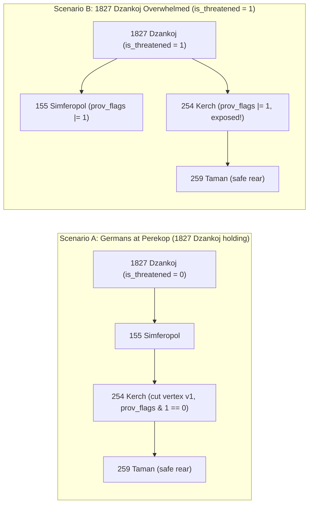

# Implementation Plan: STEM Strategic Defense & Dynamic Encirclement Assessment

## Overview & Objectives

This plan evolves **Patch 18 (STEM)** from a binary topological trigger (`independent_paths < SalientNeckWidthThreshold` $\implies$ evacuate 100%) into an integrated **5-stage strategic encirclement-defense system**.

Each stage is designed to be **implemented independently**, verified with a **basic launch-to-main-menu smoke test** (plus save-triggered CSV telemetry in `stem_debug.csv` during testing), and **stopped after each stage** for your explicit approval before advancing to the next stage.

### The 5 Functional Pillars
1. **Dynamic Strategic Evacuation Assessment (`SalientEvacuationQuota(P)` $\in [0.0, 1.0]$)** & **Natural Geography Detection**: Distinguish between geographically sheltered narrows (e.g., Crimea when only Kerch remains open and borders neither enemies nor threatened provinces $\implies Q = 0.0$) and genuinely threatened bottlenecks.
2. **Front AI Salient De-Prioritization**: Scale down both border deficit requests and interior reserve pushes into evacuating salients using `AdjustedPriority(P) = NormalFrontAIPriority(P) * (1 - Q(P))`.
3. **Bottleneck & Subsequent Line Reinforcement (`BottleneckDefenseBoost`)**: Redirect Front AI troops to threatened bottleneck provinces (both frontline and interior neck nodes) using `AdjustedNeckPriority(B) = NormalFrontAIPriority(B) + BottleneckDefenseBoost * AggregatedQuota(B)`.
4. **Partial Evacuation Relative to Normal Front AI Priority & Division Selection Order**: Withdraw only `StayingDivs(P) - AdjustedPriority(P)` excess divisions (avoiding repeated hourly percentage decay), prioritizing unengaged $\to$ slower $\to$ higher organization $\to$ higher strength divisions.
5. **Bottleneck Defender Retreat Direction**: Ensure any division forced to retreat from a bottleneck or salient retreats toward the safe rear (`parent[B]` / lower `dist`) rather than deeper into the exposed pocket.

---

## Core Design Principles & Retail Integration

### 1. Dimensional Consistency of `NormalFrontAIPriority`
In `CFrontAI::MoveUnitsToFront` (`0x006829B0`), retail computes a normalized share $S(P) \in [0.0, 1.0]$ for each frontline province (`0x006844E0..0x00684551`) and multiplies $S(P)$ by `total_front_divs` ($D_{\text{front}}$ at `[ebp - 0x38]`) at `0x00684579`, `0x00684785`, and `0x006852A0` to obtain the **target division count**:
$$\text{NormalFrontAIPriority}(P) = N(P) = S(P) \times D_{\text{front}} \quad \text{(measured in divisions)}$$

Expressing `NormalFrontAIPriority(P)` in **divisions** makes both formulas work consistently across all 5 `distrib_vs_ai` / `distrib_vs_human` modes (`even`, `reactive`, `defensive`, `offensive`, `op_defensive`) and gives `BottleneckDefenseBoost` (engine default `3.5`, currently `10` in `db/mod_settings.ini`) a direct, intuitive unit (**additional divisions requested at the bottleneck at quota `1.0`**):

* **Salient Province Target**:
  $$\text{AdjustedPriority}(P) = N(P) \times \big(1.0 - Q(P)\big) \iff S_{\text{adj}}(P) = S(P) \times \big(1.0 - Q(P)\big)$$
* **Bottleneck Province Target**:
  $$\text{AdjustedNeckPriority}(B) = N(B) + \text{BottleneckDefenseBoost} \times Q_{\text{agg}}(B) \iff S_{\text{adj}}(B) = S(B) + \frac{\text{BottleneckDefenseBoost} \times Q_{\text{agg}}(B)}{\max(1,\; D_{\text{front}})}$$

---

### 2. Zero-Overhead Min-Cut Extraction (Residual `optc_vis[]` Scan) & Natural Geography

#### Why Residual `optc_vis[]` Beats Walking `next_hop[]`
In `Cave_STEM_UpdateGraphTable`:
* `next_hop[]` (`+0x3C000`) holds only a single `uint16_t` per province, so it does **not** retain all $F(P)$ paths branching out of source $P$, and 1-hop direct edges from $P$ to a `dist == 0` sink mark `in_flow_used[sink] = comp_id` (`+0x2A000`) without populating `prev_in_flow[]` (`+0x18000`) or `next_hop[]` (`+0x3C000`).
* In contrast, scanning the **residual split-node reachability** `optc_vis[]` (`+0x2C000`) from the final failed augmenting BFS pass (`k = F(P)`) is **both mathematically exact and simpler**:
  * In `.optc_bfs_loop`, whenever an even in-node `2*v` (`v_in`) is popped, if `v` is **not** saturated (`in_flow_used[v] != comp_id`), its out-node `2*v + 1` (`v_out`) is immediately enqueued and stamped `optc_vis[2*v + 1] = pass_id`.
  * Thus $\text{optc\_vis}[2v] == \text{pass\_id} \;\land\; \text{optc\_vis}[2v + 1] \ne \text{pass\_id}$ holds **if and only if** $v$ is saturated by the flow (`in_flow_used[v] == comp_id`) and $v_{\text{out}}$ is unreachable in the residual graph — which by the Max-Flow Min-Cut Theorem is the **exact minimum $P$-side vertex cut** $C(P)$ (`|C(P)| == F(P)`).
  * To handle 1-hop saturated sink neighbors $v$ adjacent to source $P$ (`dist[v] == 0 && in_flow_used[v] == comp_id`), we simply stamp `optc_vis[2*v] = pass_id` and push `2*v` onto the BFS queue `+0x26000` (without pushing `2*v + 1` since $v_{\text{in}} \to v_{\text{out}}$ is saturated). Then a single loop over the final failed BFS queue `+0x26000[0 .. q_tail - 1]` (typically only 5–30 entries) checking `(node & 1) == 0 && optc_vis[node + 1] != pass_id` extracts all $F(P)$ min-cut vertices in $O(q_{\text{tail}})$ time with zero extra BFS passes.

#### Downstream Bottleneck Contraction & Corridor Vulnerability Propagation
Forward residual reachability identifies the **source-nearest** minimum cut $C_{\text{raw}}(P)$. When a salient has multiple layers (for example, `505` Bialystok / `1875` Lomza / `6515` Bielsk Podlaski / `6516` Grajewo behind `7335` Augustow, which itself depends on `209` Grodno and `102` Wolkowysk), source-nearest extraction treats intermediate narrow vertices like `7335` Augustow as terminal cuts — hiding critical threats further down the same escape corridor (`209` Grodno, `EnStr = 6.0`).

Rather than introducing explicit operational groups or recursive DFS with cycle hazards, we resolve corridor dependencies in **two linear passes** over the already topologically ordered `bfs_q` (`+0x10000`, populated in non-decreasing `dist = 1, 2, ...` order during Pass 1 Safe BFS) plus any `is_threatened == 1` frontline sources:

* **Step 5A (Once-Per-Province Raw Cut & Flow Cache in `bfs_q` Order)**:
  * Every valid cut vertex in Option C must be a Pass-1 Safe BFS province (`(prov_flags[u] & 2) != 0` and `dist[u] > 0`). Because `bfs_q` already holds all such `dist > 0` frontline and interior corridor provinces sorted by increasing `dist`, running Option C max-flow **once** per province in `bfs_q` (plus `is_threatened == 1` frontline sources) guarantees every candidate cut vertex is evaluated at most once.
  * Store each province $u$'s raw flow count `f_paths_u8[u]`, raw min-cut vertices $C_{\text{raw}}(u)$, and local vertex threat (`exp(u)`, `T_local(u)`, `crit(u)`) in the temporary Stage 1 Step 5A/5B scratch region (`+0x78000..+0x7FFFF`).
* **Step 5B (Bounded Downstream Cut Contraction & Threat Propagation in Increasing `dist` Order)**:
  * Iterate through the evaluated provinces in increasing `dist` order (`dist = 1, 2, ...`, guaranteeing every closer downstream vertex `dist[v] <= dist[P]` is normally already resolved). Any province with $F(u) \ge W$ (e.g., `102` Wolkowysk, `209` Grodno) is a **terminal controlling bottleneck** ($C_{\text{ctrl}}(u) = \{u\}$).
  * For each narrow province $P$ ($1 \le F(P) < W$), initialize $F(P)$ cut slots from $C_{\text{raw}}(P)$, keeping per-slot corridor state (`slot_cut[j]`, `slot_exp[j]`, `slot_crit[j]`, `slot_T[j]`, `slot_vref[j]`) and a small per-$P$ visited array (initialized with $P$ and $C_{\text{raw}}(P)$). Run at most `MAX_CONTRACT_STEPS = 8` iterative contraction steps:
    1. **Series Corridor Contraction** (`|C_ctrl(v) \ (C(P) \ {v})| == 1`): If slot $j$'s current vertex $v$ is itself narrow ($1 \le F(v) < W$, e.g., `7335` Augustow), inspect $v$'s resolved controlling cut $C_{\text{ctrl}}(v)$ (e.g., `{102, 209}`). If $P \notin C_{\text{ctrl}}(v)$ and replacing $v$ introduces **exactly one** new vertex $w$ (`209` Grodno) not already in $P$'s other cut slots (`{102}`) and not in $P$'s visited set, add $w$ to `visited`, replace `slot_cut[j] <- w`, and merge the worst-case vulnerability along corridor $v \to w$:
       $$\text{slot\_exp}[j] \gets \text{slot\_exp}[j] \lor \text{exp}(w), \quad \text{slot\_T}[j] \gets \max(\text{slot\_T}[j],\; T(w)), \quad \text{slot\_crit}[j] \gets \text{slot\_crit}[j] \lor \text{crit}(w) \lor (\text{slot\_T}[j] \ge 1.0)$$
       updating `slot_vref[j]` whenever $w$'s threat meets or exceeds the corridor's current max.
    2. **Parallel Corridor Contraction** (`|U| == F(P)`): If $F(P) \ge 2$ and single-slot replacement stalls while multiple cut slots are narrow, take the union $U = \bigcup_{j=0}^{F(P)-1} C_{\text{ctrl}}(c_j)$ (skipping any vertex where $P \in C_{\text{ctrl}}(c_j)$ or already in `visited` to prevent cycling). If $|U| == F(P)$ (e.g., an inner province whose raw cut `{505, 6516}` jointly maps down to `{102, 209}`), replace $C(P)$ with $U$, add $U$ to `visited`, and propagate the max slot threat onto each vertex in $U$.
    3. **Branching Sub-Neck Threat Propagation** (`|C_ctrl(v) \ (C(P) \ {v})| >= 2`): If a tighter bottleneck $v$ (e.g., $F(P) = 1$) leads into a wider but still narrow sub-salient ($F(v) = 2 < W$), $v$ remains the minimal cut vertex in slot $j$ (preserving width $F(P)$), and $v$'s aggregate downstream neck urgency $T_{\text{neck}}(v)$ / exposure / criticality are propagated into slot $j$:
       $$\text{slot\_T}[j] \gets \max(\text{slot\_T}[j],\; T_{\text{neck}}(v))$$
  * **Cycle & Repeated-Work Guarantees**: Step 5A runs Option C **once per province** (`O(V_strip)` total, zero redundant searches); Step 5B has no recursion, inspects only cached $C_{\text{ctrl}}$ entries ($\le W$ IDs each), skips any expansion containing $P$ or an already-visited ID, and is strictly bounded by `MAX_CONTRACT_STEPS = 8`.
  * **Outcome on Bialystok Example & Per-Province Independence**: `7335` Augustow (`dist = 6`), `505` Bialystok (`dist = 7`), `6515` Bielsk Podlaski (`dist = 7`), `6516` Grajewo (`dist = 7`), and `1875` Lomza (`dist = 8`) all resolve $C_{\text{ctrl}} = \{102 \text{ Wolkowysk}, 209 \text{ Grodno}\}$ with `F_Exp = 1, F_Crit = 1, D_Width = 0.667, T_Neck = 1.50, v_ref = 209 (EnStr = 6.0)`, without artificial operational groups and while still computing each province's own `VP_IC_Val(P)`, `V_Ret(P)`, and `is_threatened[P]` floor independently.

#### Natural Geography Exposure Check (Crimea Case Study)
During Pass 0, `Cave_STEM_UpdateGraphTable` already sets bit `0` of `prov_flags[u]` (`+0x28000`) on every friendly province $u$ that has a passable land connection (`adj->type != 4`) to **either** an enemy-controlled province **or** a friendly province marked `is_threatened == 1` (`+0x24000`).

Let:
* $F_{\text{exp}}(P)$ = count of cut vertices $v_i \in C(P)$ with **land-attack exposure** (`(prov_flags[v_i] & 1) != 0`).
* $F_{\text{shelt}}(P) = F(P) - F_{\text{exp}}(P)$ = count of **sheltered** cut vertices (`(prov_flags[v_i] & 1) == 0`).

* **Scenario A (Germans outside Crimea, `1827 Dzankoj` not threatened)**: Every Crimean province has $F = 1 < W$, with bottleneck `254 Kerch` (which shares no land border with enemy provinces or `is_threatened == 1` provinces $\implies$ `(prov_flags[254] & 1) == 0`). Thus $F_{\text{exp}} = 0$, and **`SalientEvacuationQuota(P)` collapses to `0.0`** across all of Crimea (`1827 Dzankoj`, `155 Simferopol`, `252 Evpatoria`, `253 Sevastopol`).
* **Scenario B (Germans break `1827 Dzankoj` / `is_threatened[1827] == 1`)**: Pass 0 propagates `prov_flags |= 1` to `1827`'s land neighbors (`155 Simferopol`, `252 Evpatoria`, `254 Kerch`). Now `254 Kerch` is exposed ($F_{\text{exp}} = 1$), immediately unlocking Crimean evacuation.

#### Active Evacuation Neck / Cut-Province Holding Lock (Stage 1C)
When a salient's shoulder is attacked (e.g., `209 Grodno` flipping to `IsThreatened = 1`), the forward salient provinces (`505 Bialystok`, `1875 Lomza`, `6515 Bielsk Podlaski`, `6516 Grajewo`, `7335 Augustow` at `Dist = 7..8`) all resolve `CutProv1 = 102` (`Wolkowysk`, `Dist = 6`). Without neck protection, `102 Wolkowysk` simultaneously computes `F_Paths = 2 < W` (`CutProv1 = 210 Slonim`, `CutProv2 = 503 Brest-Litovsk`) and flips to `SalientEvacuationQuota = 1.000`, which both orders `102`'s defenders away prematurely and chains the entire salient's `EvacDestNeck` past `102` to `210 Slonim`.

To guarantee the neck stays held until the upstream salient clears without scanning per-army movement paths ($O(|V_{\text{strip}}|)$ vs. scanning `700+` frontline divisions), Stage 1 adds a **reverse-topological Cut/Neck Holding Lock (Step 5C)** using `prov_flags` bit `0x20` (`HAS_ANY_FRIENDLY_UNIT`):

1. **Inclusive Troop Presence Including Retreating Divisions (`prov_flags |= 0x20`)**:
   * In Pass 0 / Step 3A (`.scan_friendly`), stamp `prov_flags[eax] |= 0x20` for any non-empty friendly/allied land army (`[edi + 0x26] != 0`) located in province `eax` **before** the `cmp byte ptr [edi + 0x17B], 0` combat-retreat skip.
   * Stationary defenders, overland-marching units, **and combat-retreating units** all keep the downstream neck locked until they physically exit into the neck province, while combat-retreating divisions remain excluded from `fr_eff_str_f32` (`FrStr`).
2. **Descending-`Dist` Topological Scan & Strict DAG Cycle Guard (`Dist[N] < Dist[P]`)**:
   * After Step 5B computes contracted controlling cuts (`CutProv1`, `CutProv2`) and `quota_q8`, and **before** `.chain_necks_start`, iterate the evaluated strip queue `+0x1C000[0 .. count - 1]` in **reverse (descending `Dist`) order** (deepest salient tips inward).
   * Whenever province $P$ is evacuating (`quota_q8[P] > 0`) and has friendly/allied units present (`(prov_flags[P] & 0x20) != 0`), inspect each bottleneck $N \in \{\text{CutProv1}[P], \text{CutProv2}[P]\}$ (and for Pass-2 `F_Paths == 0` bridge provinces, their landing neck $B$):
     * Enforce **`Dist[N] < Dist[P]`** so mutual cut cycles and same-depth deadlocks are strictly impossible.
     * Apply a **flat-out evacuation block** on $N$: set `quota_q8[N] = 0`, `neck[N] = 0` (`EvacDestNeck[N] = 0`), and update `debug_telemetry[N]` (`SalientEvacuationQuota = 0.000`, `EvacDestNeck = 0`).
3. **Automatic Intermediate `EvacDestNeck` Resolution (No Extra Chaining Logic)**:
   * Because `neck[102]` is cleared to `0` prior to `.chain_necks_start`, `.chain_walk_loop` naturally terminates at `102 Wolkowysk`, leaving `EvacDestNeck = 102` on `505`, `1875`, `6515`, `6516`, and `7335` instead of chaining onward to `210 Slonim`.
   * Divisions escaping the Bialystok salient rally at `102 Wolkowysk` and defend the corridor; as soon as all friendly units (including combat-retreating divisions) have exited `Dist 7..8` into `102`, `(prov_flags[P] & 0x20)` clears upstream, unlocking `102 Wolkowysk` on the next hourly tick to withdraw together toward `210 Slonim`.

---

### 3. Dynamic `SalientEvacuationQuota(P)` Formula (Complete Closed Form)

All `SalientEvacuationQuota(P)` factor weights, thresholds, and bounds are configurable under `[FrontAI]` in `db/mod_settings.ini` (`tbl_FrontAIFloatConfigs` @ `0x00DCC1A9`, string/float slots `0x00DCBFE8..0x00DCC24B`, loaded at startup via `Cave_LoadEngineSettings` @ `0x00DCFA0E` / `0x00DCBCE2`).

#### Hard Overrides
* $F(P) \ge W \implies Q(P) = 0.0$ (sufficient independent escape corridors).
* $F(P) == 0 \implies Q(P) = 1.0$ (zero safe paths remain).
* $F_{\text{exp}}(P) == 0 \;\land\; \text{is\_threatened}[P] == 0 \implies Q(P) = 0.0$ (**Natural Geography Gate**: bottleneck cannot be attacked by land, and $P$ is not collapsing).

#### Continuous Assessment ($1 \le F(P) < W$ and ($F_{\text{exp}}(P) > 0$ or $\text{is\_threatened}[P] == 1$))

1. **Per-Cut-Vertex Combat Ratio $R(v_i)$ & Threat Translation $T(v_i) \in [\text{NeckThreatMinFloor}, \text{NeckThreatMaxCap}]$ (`[0.00, 1.50]`)**:
   For each cut vertex $v_i \in C(P)$, `EnemyStr` separates idle adjacent armies (`IdleEnemyPresenceWeight = 0.25`) from active attacking/advancing enemy armies (`ActiveEnemyAttackWeight = 1.0`) and adjacent `IsThreatened` friendly propagation (`ThreatenedNeighborStrWeight = 1.0`):
   $$R(v_i) = \frac{\text{EnemyStr}(v_i)}{\max\!\big(1.0,\; \text{FriendlyDefenderStr}(v_i) + \text{InboundFriendlyStrWeight} \cdot \text{InboundFriendlyStr}(v_i)\big)}$$
   where $\text{InboundFriendlyStr}(v_i)$ (`0.50` default weight) and hostile move threat scanning resolve the **immediate next hop** (`movement` list head `[pArmy + 0x232]` when `[pArmy + 0x27E] == 1`) rather than falling back to the final destination `[pArmy + 0x13A]`.
   * **Strength-Ratio Threat Component**:
     Ramps linearly from `0.0` at `NeckThreatMinRatio` ($R_{\min} = 1.0$) to `1.0` at `NeckThreatRatio` ($R_{\text{thr}} = 1.5$):
     $$T_{\text{str}}(v_i) = \frac{\max\!\big(0.0,\; R(v_i) - R_{\min}\big)}{\max\!\big(0.05,\; R_{\text{thr}} - R_{\min}\big)}$$
   * **Organization-Collapse Threat Component**:
     If $v_i$ is in active defensive combat with lowest defender organization $O(v_i) < 2 \cdot O_{\text{crit}}$ (where $O_{\text{crit}}$ is `NeckCollapsingOrgThreshold` at `0x00DCBAC4`, default `10.0` in `db/mod_settings.ini`):
     $$T_{\text{org}}(v_i) = \text{clamp}_{[0.0,\; \text{NeckThreatMaxCap}]}\!\left(\frac{2 \cdot O_{\text{crit}} - O(v_i)}{O_{\text{crit}}}\right)$$
     *(Else $T_{\text{org}}(v_i) = 0.0$.)*
   * **Uncontested / Exposed Cut Vertex Threat $T(v_i)$**:
     * If $v_i$ is sheltered (`(prov_flags[v_i] & 1) == 0`): $T(v_i) = 0.0$ (sheltered cuts are intact).
     * Else if $v_i$ is exposed (`(prov_flags[v_i] & 1) != 0`) and $\text{FriendlyDefenderStr}(v_i) + \text{InboundFriendlyStrWeight} \cdot \text{InboundFriendlyStr}(v_i) < 1.0$ while $\text{EnemyStr}(v_i) > 0$: $T(v_i) = \text{NeckThreatMaxCap}$ (`1.50`).
     * Else:
       $$T(v_i) = \text{clamp}_{[\text{NeckThreatMinFloor},\; \text{NeckThreatMaxCap}]}\!\big(\max(T_{\text{str}}(v_i),\; T_{\text{org}}(v_i))\big)$$

2. **Bottleneck Threat Urgency ($T_{\text{neck}}(P)$)**:
   Let $T_{\text{max}}(P) = \max_{v_i \in C_{\text{exp}}(P)} T(v_i)$ (or $1.0$ if $F_{\text{exp}}(P) == 0$ while $\text{is\_threatened}[P] == 1$). Apply `MultiExposedCutBonus` ($0.25$ default) and overall `NeckThreatWeight` ($1.0$ default):
   $$T_{\text{neck}}(P) = \text{NeckThreatWeight} \times \text{clamp}_{[\text{NeckThreatMinFloor},\; \text{NeckThreatMaxCap}]}\!\Big( T_{\text{max}}(P) \times \big(1.0 + \text{MultiExposedCutBonus} \cdot \max(0,\; F_{\text{exp}}(P) - 1)\big) \Big)$$

3. **Topological Width & Intact-Defense Factor ($D_{\text{width}}(P)$)**:
   Classify each exposed cut vertex $v_i \in C_{\text{exp}}(P)$ as:
   * **Critically stressed** ($v_i \in C_{\text{crit}}(P)$, counting as **`0.0`** effective paths) iff $\text{is\_threatened}[v_i] == 1 \;\lor\; T(v_i) \ge 1.0$.
   * **Exposed-but-intact** ($v_i \in C_{\text{intact\_exp}}(P)$, counting as **`ExposedIntactPathCredit = 0.5`** effective paths) otherwise.
   * Each **sheltered** cut vertex ($v_i \in C_{\text{shelt}}(P)$) counts as **`1.0`** effective path.
   $$D_{\text{width}}(P) = \text{WidthDeficitWeight} \times \text{clamp}_{[0.0,\; 1.0]}\!\left(\frac{W - \big(F_{\text{shelt}}(P) + \text{ExposedIntactPathCredit} \cdot F_{\text{intact\_exp}}(P)\big)}{W}\right)$$

4. **Local + Neighbor Strategic Value Retention ($V_{\text{ret}}(P)$)**:
   Compute combined VP/IC of $P$ and all friendly-controlled adjacent provinces $N_{\text{fr}}(P)$ using `CProvince + 0x19E` (`VP`) and `[*(prov + 0x1CA) + 0x14]` (`IC`) with `ValueRetentionVPWeight` (`1.0`) and `ValueRetentionICWeight` (`0.5`):
   $$\text{Val}(P) = \sum_{u \in \{P\} \cup N_{\text{fr}}(P)} \big(\text{VPWeight} \cdot \text{VP}(u) + \text{ICWeight} \cdot \text{IC}(u)\big)$$
   $$V_{\text{ret}}(P) = \max\!\left(\text{ValueRetentionMinFloor},\; \min\!\left(1.0,\; \frac{1.0}{1.0 + \text{ValueRetentionScale} \cdot \text{Val}(P)}\right)\right)$$
   *(Defaults: `Scale = 0.02`, `MinFloor = 0.50`. Bypassed to `1.0` when $F_{\text{crit}}(P) == F(P)$ or $\text{is\_threatened}[P] == 1$ so high-value pockets still break out before complete encirclement/collapse.)*

5. **Final Quota Combining, Threatened Floor & Minimum Cutoff**:
   $$Q_{\text{raw}}(P) = D_{\text{width}}(P) \times T_{\text{neck}}(P) \times V_{\text{ret}}(P)$$
   * If $\text{is\_threatened}[P] == 1$:
     $$Q(P) = \begin{cases} 1.0 & \text{if } F_{\text{crit}}(P) \ge 1, \\ \text{clamp}_{[\text{ThreatenedSourceQuotaFloor},\; 1.0]}\!\big(\max(\text{ThreatenedSourceQuotaFloor},\; Q_{\text{raw}}(P))\big) & \text{otherwise.} \end{cases}$$
   * Else:
     $$Q(P) = \text{clamp}_{[0.0,\; 1.0]}\!\big(Q_{\text{raw}}(P)\big), \qquad Q(P) < \text{MinEvacuationQuotaThreshold} \implies Q(P) = 0.0$$
     *(Defaults: `ThreatenedSourceQuotaFloor = 0.85`, `MinEvacuationQuotaThreshold = 0.05`.)*

---

## Memory & Code-Cave Architecture

Across Stages 1–5, `.mod` is expanded to **`32 KB`** (`0x00DC9000..0x00DD1000`), with Patch 18 occupying `0x00DCBAB0..0x00DD0C6A` (`752`-byte header `0x00DCBAB0..0x00DCBDA0` + `20,170`-byte code across `6,548` instructions, leaving `918` bytes free at `0x00DD0C6A..0x00DD1000`).

* **`g_pGraphTable` (`VirtualAlloc` = `0xEC000` / `944 KB`, pointer stored at `0x00DCBAD4`)** (drops by `256 KB` once temporary save-triggered debug telemetry is removed):
  * `+0x00000..+0x3FFFF` (`256 KB`): Core graph & Option C flow buffers (`GraphNode[8192]`, `bfs_q` `@ +0x10000`, `fdist_plus_1` `@ +0x14000`, `flow_prev` `@ +0x18000`, `fdist_q`/`eval_q` `@ +0x1C000`, `bpar_in` `@ +0x20000`, `is_threatened` `@ +0x24000`, `optc_queue` `@ +0x26000`, `prov_flags` `@ +0x28000` with bit `0x20` = `HAS_ANY_FRIENDLY_UNIT`, `in_flow_used` `@ +0x2A000`, `optc_vis` `@ +0x2C000`, `stem_evac_active` `@ +0x30000`, persistent unit evac registry `@ +0x34000..+0x3BFFF`, `flow_next`/`next_hop` `@ +0x3C000`).
  * **Permanent Stage 1–4 Buffers (`+0x40000..+0x7FFFF`, `256 KB`, zero-overflow widths)**:
    * `+0x40000..+0x41FFF` (`8 KB`): `quota_q8[8192]` (`uint8_t`, $Q(P) \times 255$, `0..255` $\equiv$ `0.0..1.0`)
    * `+0x42000..+0x43FFF` (`8 KB`): `neck_agg_q8[8192]` (`uint8_t`, aggregated $Q_{\text{agg}}(B) \times 255$)
    * `+0x44000..+0x45FFF` (`8 KB`): `cut_min_q8[8192]` (`uint8_t`, minimum contributing quota for $B$)
    * `+0x46000..+0x47FFF` (`8 KB`): `min_org_q8[8192]` (`uint8_t`, province-wide weighted average defender org quantized `0..255`)
    * `+0x48000..+0x4BFFF` (`16 KB`): `cut_count_u16[8192]` (**`uint16_t`**, number of salients referencing cut $B$, max `65,535`; phase-reused inside `Cave_STEM_UpdateAndEvacuate_Internal` as the Stage 4 candidate table)
    * `+0x4C000..+0x4FFFF` (`16 KB`): `prov_country_tag[8192]` (`uint16_t`, owner country index stamped per province so combat retreats read valid graph state anytime)
    * `+0x50000..+0x57FFF` (`32 KB`): `cut_sum_u32[8192]` (**`uint32_t`**, sum of `quota_q8` values for `AVERAGE`, max `4.29e9`; also holds temporary combat org sum during Pass 0)
    * `+0x58000..+0x5FFFF` (`32 KB`): `norm_prio_f32[8192]` (**32-bit `float`**, preserved across hourly resets; cached $N(P) = S(P) \times D_{\text{front}}$ in divisions, no 256-division limit)
    * `+0x60000..+0x67FFF` (`32 KB`): `fr_eff_str_f32[8192]` (`float`, friendly land defender strength in province)
    * `+0x68000..+0x6FFFF` (`32 KB`): `en_eff_str_f32[8192]` (`float`, adjacent/attacking enemy land strength threatening province)
    * `+0x70000..+0x77FFF` (`32 KB`): `inbound_fr_str_f32[8192]` (`float`, adjacent safe friendly divisions marching into province)
    * `+0x78000..+0x7FFFF` (`32 KB`): phase-shared scratch — holds `raw_hostile_str_f32[8192]` during Pass 0 / Pre-Pass A, then reused in Step 5A/5B for `f_paths_u8[8192]` (`+0x78000..+0x79FFF`) and compact per-province raw/controlling cut & corridor-threat records (`+0x7A000..+0x7FFFF`), and in Stage 4 for `staying_divs` (`+0x78000`), `total_divs` (`+0x7A000`), and `evac_q` (`+0x7C000`).
  * **Temporary Debug Telemetry Buffer (`+0x80000..+0xBFFFF`, `256 KB`)**:
    * `debug_telemetry[8192]` (`32` bytes per province, $O(1)$ indexed by `prov_id`): stores persisted per-country evaluation metrics (`eval_valid` byte, `is_threatened`, `f_paths`, `f_exp`, `f_crit`, `is_cut`, `dist`, `neck`, `cut0`, `cut1`, `d_width_q8`, `t_neck_q8`, `v_ret_q8`, `vp_ic_val`, `adj_prio_f32`, `target_stay_divs_u16`, `staying_divs_u16`, `evac_budget_u16`, `agg_neck_q8`, `adj_neck_prio_f32`) for `stem_debug.csv`. Easily removed later once save telemetry is retired.
  * **Stage 4–5 Permanent & Telemetry Extensions (`+0xC0000..+0xEBFFF`, `176 KB`)**:
    * `+0xC0000..+0xC7FFF` (`32 KB`): Stage 4 hourly telemetry (`4` bytes/prov: `+0 TargetStayDivs`, `+1 StayingDivs`, `+2 EvacDivBudget`, `+3 valid`).
    * `+0xC8000..+0xCBFFF` (`16 KB`): `v_ref_u16[8192]` (`uint16_t` reference vertex ID written for `stem_debug.csv`).
    * `+0xCC000..+0xD3FFF` (`32 KB`): `raw_cut[8192]` (`2 × uint16_t` pre-contraction Step 5A min-cut vertices).
    * `+0xD4000..+0xD5FFF` (`8 KB`): Front-basin membership (`1` = outside/frontline, `2` = corridor/exposed).
    * `+0xD6000..+0xD63FF` (`1 KB`): Per-country analyzed flags (`+0xD6000..+0xD61FF`) and persistent front-basin flags (`+0xD6200..+0xD63FF`, preserved across hourly/save clears).
    * `+0xD8000..+0xE7FFF` (`64 KB`): Stage 5 persistent multi-country `retreat_snap[8192]` (`8` bytes/prov: `+0 dist`, `+2 parent`, `+4 neck`, `+6 quota_q8`, `+7 flags`).
    * `+0xE8000..+0xEBFFF` (`16 KB`): Stage 5 `retreat_div_load[8192]` (`uint16_t` incoming/present/retreating division load stamped in `.ugt_stamp_div_load` and live-incremented by Hook 12C).
* **Settings Header Slots**: `0x00DCBADC` holds `BottleneckQuotaAggregation` (`0 = MAX` [default], `1 = AVERAGE`, `2 = MIN`), `0x00DCBACC` (`SalientEvacuationQuota` scalar in `.ini`) is superseded by runtime calculation, and all 17 quota tuning floats are loaded via `tbl_FrontAIFloatConfigs` (`0x00DCC1A9`).

---

## Phased Implementation Stages

> **Strict Execution Gate**: Every stage below is implemented and smoke-tested independently (main menu load / zero exceptions, plus checking `stem_debug.csv` on save where noted). **Execution MUST STOP after each stage** and wait for explicit approval before moving to the next stage.

### Stage 1: Min-Cut Extraction, Natural Geography Gate, Dynamic `SalientEvacuationQuota(P)`, Active Neck Holding Lock & Save Debug Dump *(Completed & Validated)*
**Goal**: Replace the binary `< SalientNeckWidthThreshold` trigger with exact residual `optc_vis[]` min-cut extraction $C(P)$, Step 5A/5B downstream bottleneck contraction, the Natural Geography Gate ($F_{\text{exp}} == 0 \implies Q(P) = 0.0$), dynamic `quota_q8[P]`, the Step 5C Active Evacuation Neck Holding Lock (`Dist[N] < Dist[P]`), and a temporary save-triggered CSV telemetry dump (`stem_debug.csv`).

* **Binary / Script Changes (`build_and_apply_all.py`)**:
  1. Extend `.mod` PE section (`0x00DC9000..0x00DD1000`) and update `VirtualAlloc` in `Cave_STEM_HourlyTick` from `0x40000` to `0xC0000`.
  2. Extend Pass 0 (`Cave_STEM_UpdateGraphTable` army & combat scan) to populate `fr_eff_str_f32[u]`, `en_eff_str_f32[u]`, `inbound_fr_str_f32[u]`, and `min_org_q8[u]`, and stamp `prov_flags[eax] |= 0x20` (`HAS_ANY_FRIENDLY_UNIT`) **before** the `[edi + 0x17B] != 0` combat-retreat skip so retreating divisions are still counted for neck-holding dependencies without inflating `FrStr`.
  3. Update Option C in `Cave_STEM_UpdateGraphTable` (**Step 5A + Step 5B + Step 5C + Step 5D**):
     * When pushing a saturated 1-hop sink neighbor of $P$ (`dist[v] == 0 && in_flow_used[v] == comp_id`) into `.optc_bfs_loop`, push `2*v` onto `+0x26000` (`optc_vis[2*v] = pass_id`).
     * In **Step 5A**, evaluate Option C once per `dist > 0` province in `bfs_q` (`+0x10000`, sorted by `dist`) plus any `is_threatened == 1` frontline source; after `.optc_no_more_paths`, scan `+0x26000[0 .. q_tail - 1]` for `(node & 1) == 0 && optc_vis[node + 1] != pass_id` to cache $F(P)$, $C_{\text{raw}}(P)$, and local cut-vertex threat in `+0x78000..+0x7FFFF`.
     * In **Step 5B**, iterate narrow provinces in increasing `dist` order, contract intermediate corridor cuts via series/parallel replacement (`MAX_CONTRACT_STEPS = 8` with per-$P$ `visited` cycle guard) and branching sub-neck propagation into controlling bottlenecks $C_{\text{ctrl}}(P)$, apply the **Natural Geography Gate** ($F_{\text{exp}} == 0 \land \text{is\_threatened}[P] == 0 \implies Q(P) = 0.0$), and compute $Q(P)$ via $D_{\text{width}}(P) \times T_{\text{neck}}(P) \times V_{\text{ret}}(P)$ (reading real VP at `[CProvince + 0x19E]`) into `quota_q8[P]`. Clear `neck[P] = 0` whenever `quota_q8[P] == 0`.
     * In **Step 5C (Active Evacuation Neck Holding Lock, pre-chaining)**: Iterate the evaluated strip queue `+0x1C000` in **reverse (descending `Dist`) order** prior to `.chain_necks_start`. For every evacuating province $P$ (`quota_q8[P] > 0`) with any friendly/allied units present (`(prov_flags[P] & 0x20) != 0`, including combat-retreating units), lock each bottleneck $N \in \{\text{CutProv1}[P], \text{CutProv2}[P]\}$ that satisfies `Dist[N] < Dist[P]` by setting `quota_q8[N] = 0`, `neck[N] = 0`, and syncing `debug_telemetry[N]` so `.chain_walk_loop` naturally routes $P$ into $N$ (`EvacDestNeck = 102`) until upstream units finish withdrawing.
     * In **Step 5D (Post-Pass-2 Bridge Check & Validation)**: Apply the same `Dist[N] < Dist[P]` lock check for any Pass-2 `F_Paths == 0` bridge landing neck if units (`prov_flags & 0x20`) remain in the stranded cluster, and validate in `stem_debug.csv` that under initial Grodno pressure `102 Wolkowysk` holds at `Quota = 0.000` with Bialystok provinces targeting `EvacDestNeck = 102`, then flips toward `210 Slonim` once upstream units arrive in `102`.
  4. **Temporary Save-Triggered Debug Output (`stem_debug.csv`)**:
     * In `Cave_STEM_HourlyTick`, clear `+0x80000..+0xBFFFF` once before looping over all countries; during `Cave_STEM_UpdateGraphTable`, record each evaluated active frontline province's telemetry (`CountryTag`, `ProvID`, `ProvName`, `Dist`, `IsThreatened`, `F_Paths`, `F_Exp`, `F_Crit`, `CutProv1`, `CutProv2`, `EvacDestNeck`, `FrStr`, `EnStr`, `InbStr`, `MinOrg`, `VP_IC_Val`, `D_Width`, `T_Neck`, `V_Ret`, `SalientEvacuationQuota`, plus placeholder columns for Stages 2–4) keyed by `prov_id` (stamped with `prov_country_tag[P]`).
     * Hook `0x004301D7` (`call 0x0042CC70` at the tail of save execution `0x0043015D..0x004301DC`, after `CSaveGame::WriteSave` completes on manual save or autosave) to call `Cave_STEM_DumpDebugCSV`, which runs a fresh read-only country-loop refresh across active AI countries and uses the binary's built-in CRT `fopen` (`0x007A6615`), `fprintf` (`0x007A6628`), and `fclose` (`0x007A6429`) to write semicolon-delimited `stem_debug.csv` in the game root directory.
* **Verification & Stop**: Smoke test (launch modified executable to main menu, verify zero exceptions); user tests in-game by saving to inspect `stem_debug.csv` (e.g., Crimea vs. Bialystok & Wolkowysk staged withdrawal). **STOP and wait for approval before Stage 2.**

---

### Stage 2: Front AI Salient De-Prioritization (`AdjustedPriority = Normal * (1 - Quota)`) *(Completed & Validated)*
**Goal**: Prevent `CFrontAI::MoveUnitsToFront` (`0x006829B0`) from reinforcing evacuating salient provinces in both of its movement loops (Loop A interior-to-border push and Loop B border-to-border quota rebalancing).

* **Binary Changes (`build_and_apply_all.py`)**:
  1. **Loop B — Border Quota Adjustment (`0x00684551`, `0x0068470D`, and `0x0068526A` in `0x006851D0`)**:
     * Cache unadjusted `norm_prio_f32[u] = S(u) * D_front` directly as a 32-bit float (`g_pGraphTable + 0x58000`, preserved across hourly resets).
     * Replace `S(u)` on the x87 FPU stack / stack frame with `S(u) * (1.0 - Q(u))` (forcing `S(u) = 0.0` when `Q == 1.0` or when `Q > 0 && S_adj * D_front < 1.0` so `even`-mode's empty-province `deficit = 1` floor at `0x0068459A` is also suppressed).
  2. **Loop A — Interior Push Gate, Candidate Scoring & Fallback (`0x00683EB6`, `0x00684088`, `0x006840F6`, `0x00684131`)**:
     * In retail `CFrontAI::MoveUnitsToFront`, Loop A (`0x00683C1D..0x00684207`) executes **before** Loop B on non-reserve armies sitting in non-border interior provinces (including divisions rallied at a locked neck such as `102 Wolkowysk`). Loop A does **not** consult Loop B's `NormalFrontAIPriority(P)` quotas—it pushes interior armies forward into adjacent border provinces based solely on `en_str - fr_str` (`0x00684088`), with an `edi == 0` fallback to `[CFrontAI + 0x04]` head at `0x00684117`.
     * Exclude adjacent candidates when `Q == 1.0` or `0 < Q < 1.0 && divs >= AdjustedPriority`, reject or scale `(en_str - fr_str)` candidate scoring toward `(1.0 - Q(cand))` (dividing negative scores by `(1 - Q)` so evacuating provinces rank below non-evacuating ones), and block the `0x00684117` fallback if the head province has `quota_q8 > 0`.
  3. **Update `stem_debug.csv` Telemetry**: Populate `NormAIPrio` (`NormalFrontAIPriority`, `+26`) and `AdjAIPrio` (`AdjustedPriority`, `+28`) in `debug_telemetry[P]` via `Cave_STEM_SyncTelemetryPrio` (`0x00DCE23B`), synced during both `.hlp_write_telemetry` and `Cave_FrontAI_ScaleReceiverShare`, plus Step 5C neck lock / Pass-2 updates.
* **Verification & Stop**: Verified binary patch signatures (`tools/patch_darkest_hour.bat -Verify`), end-to-end batch patch reproducibility (`patch_darkest_hour.bat -Auto`), in-game telemetry validation, and exclusion of active STEM evacuees (`[slot + 6] != 0`) from `InbStr`.

---

### Stage 3: Bottleneck Reinforcement & Interior Neck Garrison Hold (`BottleneckDefenseBoost`) *(Completed & Validated)*
**Goal**: Redirect Front AI reserves to reinforce exposed bottlenecks $B$ (whether $B$ sits on the frontline or 1 hop behind it as a fallback line) using `BottleneckDefenseBoost` and configurable quota aggregation.

* **Config & Loader Changes (`db/mod_settings.ini`, `build_and_apply_all.py`)**:
  1. Added `BottleneckQuotaAggregation` under `[FrontAI]` in `db/mod_settings.ini` (`0 = MAX` [confirmed default], `1 = AVERAGE`, `2 = MIN`), parsed in `Cave_LoadEngineSettings` (`0x00DCE711`) into `[0x00DCBADC]`.
* **Graph & Front AI Changes (`build_and_apply_all.py`, `Hook 4 / 7 / 8 / 9A / 9B / 10`, current patched `SHA256 = 99AFAB223C117211D3135195432B7988CAAAF4DF771064BD78C44385F9C9F2BD`)**:
  1. During `.step5e_accum_necks` / `.step5e_finalize_necks` in `Cave_STEM_UpdateGraphTable` (`0x00DCC1E9`), whenever $Q(P) > 0$, accumulate `cut_count_u16[v]`, `cut_sum_u32[v]`, `cut_min_q8[v]`, and max `neck_agg_q8[v]` onto each cut vertex $v_i \in \{C_{\text{ctrl}}(P), \text{neck}[P]\}$ (`prov_flags` bit `0x80` de-duplicates provinces across strip and Pass-2 lists). Finalize `neck_agg_q8[v]` over Pass-1 Safe BFS provinces according to `BottleneckQuotaAggregation` (`MAX`, `AVERAGE`, or `MIN`), clearing `neck_agg_q8[v] = 0` whenever `quota_q8[v] != 0` (Active Evacuation Guard).
  2. **Loop B Border Neck Boost & Interior Injection (`Hook 4` `0x00682A58 -> 0x00DCE8D9`, `Hook 9B` `0x006836D5 -> 0x00DCEC7D`, `Hook 8A–8C` `0x00DCF01B / 0x00DCF103 / 0x00DCF1A8`)**:
     * `Hook 4` injects adjacent interior bottleneck provinces (`neck_agg_q8 > 0`, `quota_q8 == 0`, `[CProvince + 0x4A8] == 0` or `== esi`, tagged at `[CFrontProvince + 0x42] = 0x5B`) into `[CFrontAI + 0x04]` and prunes/untags promoted nodes (`+0x42 = 0`), while `Hook 9B` keeps `[+0x8D]` cleared on injected interior bottlenecks so Loop B treats them as active redistribution receivers.
     * Add $\frac{\text{BottleneckDefenseBoost} \times Q_{\text{agg}}(B)}{\max(1,\; D_{\text{front}})}$ to $S(B)$ for both exposed and injected interior bottlenecks $B$.
  3. **Pre-`UpdateFronts` Injected-Node Cleanup (`Hook 10` `0x00693EE0 -> 0x00DCECC1` `Cave_FrontAI_PreUpdateFrontsCleanInjected`)**:
     * Before vanilla `CAI::UpdateFronts` (`0x00693EE0`) reconciles sectors, verify no front has `[pFront + 0x9E] != 0`, then remove any `[CFrontProvince + 0x42] == 0x5B` injected nodes, clear `[CProvince + 0x4A8] = 0`, and destroy those descriptors so vanilla `0x0068A2B0` merges adjacent fronts cleanly once an injected bottleneck becomes exposed (live-verified on `1941-09-14`: Northern and Southern fronts merged into a single `12`-province front after the Bialystok salient cleared).
  4. **Loop A Interior Neck Hold (`0x00683C9D -> 0x00DCED64` `Cave_FrontAI_LoopAIsFrontOrHeldNeck`) & Candidate Attraction (`0x00684088 -> 0x00DCEEBC`)**:
     * When a stationary non-retreating army sits inside an **interior bottleneck** $B$ (`IsFrontProvince(B) == 0`, `quota_q8[B] == 0`, and `neck_agg_q8[B] > 0`), hold the army in $B$ (`al = 1`) whenever `(fr_eff_str_f32[B] - army_str) < BottleneckDefenseBoost * Q_agg(B)`; otherwise deduct `army_str` from `fr_eff_str_f32[B]` and release the surplus army forward.
     * Add `BottleneckDefenseBoost * Q_agg(cand)` to Loop A's candidate attractiveness score (`en_str - fr_str`) for under-strength frontline bottlenecks (`divs < NormAIPrio + Boost`).
  5. **Update `stem_debug.csv` Telemetry**: Sync interior bottlenecks in `.step5e_finalize_necks` and push `IsBottleneck`, `AggNeckQuota`, and `FinalAIPrio` in `Cave_STEM_SaveGameHook`.
* **Verification & Stop**: Verified binary patch signatures (`Hook4`/`Hook7A–D`/`Hook8A–C`/`Hook9A–B`/`Hook10`), `Darkest Hour_modified.exe` / `Darkest Hour.exe` `SHA256 = 99AFAB223C117211D3135195432B7988CAAAF4DF771064BD78C44385F9C9F2BD`, and live multi-day soak tests (`1941-08-21` → `1941-09-02` `4/4` stabilization and `1941-09-14` pocket collapse → single unified front merge). **STOP and wait for user validation/approval before Stage 4.**

---

### Stage 4: Partial Withdrawal Budget & 4-Tier Division Selection Priority *(Completed & Validated)*
**Goal**: Support partial evacuations ($0 < Q(P) < 1$) without continuous hourly shrinkage, withdrawing the slowest unengaged units with highest org and strength first.

* **Binary Changes (`build_and_apply_all.py`, `.mod` Cave `5017` instructions / `15516` bytes, `SHA256 = 080E4DAA4915D34FFEF7BB6A627FC81D7FCCE64B95D134165ACF4AD4FCCE9007`)**:
  1. **Expanded `g_pGraphTable` (`0xC0000` → `0xC8000`)**: Added `32 KB` Stage 4 hourly telemetry table at `+0xC0000 + prov * 4` (`[+0] = TargetStayDivs`, `[+1] = StayingDivs`, `[+2] = EvacDivBudget`, `[+3] = valid`), cleared on scenario load (`Cave_PostLoadInit` `0x26000` dwords) and once per hourly sweep in `Cave_STEM_HourlyAllCountries` (`0x00DCECAE`, preserved across `Cave_STEM_SaveGameHook` `0x00DCF749` read-only refreshes).
  2. **Loop A Synchronization (`Hook 7A` `0x00683EB6 -> 0x00DCF2F6` & `Hook 7B` `0x00684088 -> 0x00DCF390`)**: Synchronized `Loop A` candidate blocking (`divs >= round(AdjPrio)` when `AdjPrio >= 1.0`, or flat block when `AdjPrio < 1.0`) with Stage 4 `TargetStayDivs` to eliminate fractional threshold oscillation.
  3. **Division Withdrawal Budget (`Cave_STEM_UpdateAndEvacuate_Internal`)**:
     * Pass 1 walks `[pCountry + 0x4508]`, maintains existing `[slot + 6] != 0` evacuation locks, tallies `total_divs` (`+0x7A000`) and non-evacuating `staying_divs` (`+0x78000`, excluding armies already matching `neck[P]` at `[+0x27E]/[+0x236]` or `[+0x264]/[+0x268]`), and enqueues evacuating provinces into `+0x7C000`.
     * Pass 2 sets `TargetStayDivs = 0` when `quota_q8[P] >= 255` or `AdjPrio < 1.0`, else `clamp(round(base * (1.0 - Q(P))), 0, 255)` where `base` is `norm_prio_f32[P]` (or `total_divs[P]` fallback), and computes `EvacDivBudget(P) = max(0, StayingDivs(P) - TargetStayDivs(P))`.
     * Sets `g_pGraphTable + P + 0x30000 = 1` **only** when full evacuation applies (`quota_q8[P] >= 255` or `TargetStayDivs == 0`); during partial evacuation, `[+0x30000]` stays `0` so staying defenders remain active Front AI units while evacuating corps are exempted individually via `[slot + 6] != 0` in `Hook 4`.
  4. **4-Tier Candidate Selector & Guards**:
     * Builds a per-province candidate table (`+0x48000`, up to `64` × `24`-byte entries) excluding immobile non-combat garrisons (`in_combat == 0 && min_speed < 0.01f`).
     * Uses verified `CDivision` fields (`+0xEC` Strength, `+0xF4` Organization, `vtbl[+0x28]` @ `0x00500950` brigade-capped speed), selecting repeatedly while `EvacDivBudget > 0` with a **no-overshoot fit guard** (`num_divs <= EvacDivBudget`):
       1. **Not currently in combat**: `[pArmy + 0x128] == 0` preferred over `[pArmy + 0x128] != 0`.
       2. **Slower speed first**: minimum army max speed via `CDivision::vtbl[+0x28]()`.
       3. **Higher organization first**: maximum average division org (`[pDiv + 0xF4]`).
       4. **Higher strength first**: maximum average division strength (`[pDiv + 0xEC]`).
  5. **Update `stem_debug.csv` Telemetry**: Appended `TargetStayDivs`, `StayingDivs`, and `EvacDivBudget` columns (`add esp, 168`).
  6. **Post-Implementation Stage 4 Refinements (`build_and_apply_all.py`, `Cave = 6089 instructions / 18743 bytes`, `Darkest Hour_modified.exe SHA256 = 86939CC9D890474D7C467136823DA49345EE479E1B6E77068136C3974571EA07`)**:
     * Added front-basin tracking (`+0xD4000`, `+0xD6200`) and raw combat-strength parity hooks (`Hook 11A–11F`, disabling province terrain modifiers inside `CFrontAI::MoveUnitsToFront`).
     * Replaced corps-based `min_org` / `cmb + 0x04` threshold with UI-matching `0x004BEBE0` combat progress and province-wide weighted average defender org across holding divisions.
     * Added Pass 2 `.raw_rst_loop` distance reset, Step 5B non-evacuating `F >= 1` overwrite guard, contracted-cut Step 5E/5C propagation, Pass 2 threatened `F >= 1` bridgehead locking in `.raw_lock_loop` (`102 Wolkowysk`), `.uae_is_valid_transit_army` transit exemption (`Grajewo ↔ Bialystok ↔ Wolkowysk`), and oversized-corps splitting (`.uae_split_try`: splits exact `EvacDivBudget` divisions out of an eligible non-combat corps when `EvacDivBudget > 0` and no whole stack fits).
     * Added pre-Stage-5 bottleneck stability fixes: **Threat-Sustaining Neck Floor** (`.s5e_fin_threat_floor`, flooring active bottleneck `neck_agg_q8` to sustain $\text{EnStr} / (\max(0.05,\; \text{NeckThreatMinRatio}) \times \text{DefMult})$ capped at `NormAIPrio + BottleneckDefenseBoost`) and **Step 5E Threatened-Shoulder Boost** (`.s5ea_chk_thrt_nbs`, preserving bottleneck boost onto adjacent `IsThreatened == 1, quota_q8 == 0, fr_eff_str > 0, dist[S] < dist[P]` shoulders).
* **Verification & Validation**: Rebuilt EXEs (`SHA256 = 080E4DAA4915D34FFEF7BB6A627FC81D7FCCE64B95D134165ACF4AD4FCCE9007` across initial Stage 4 build; post-refinement `SHA256 = 86939CC9D890474D7C467136823DA49345EE479E1B6E77068136C3974571EA07`), updated both ASCII `.bat` patchers (`tools/patch_darkest_hour.bat -Verify` pass), audited Capstone disassembly of `PostLoadInit`/`HourlyAllCountries`/`Hook 7A-7B`/`SaveGameHook`/`.raw_lock_loop`, passed live launch-to-main-menu smoke test (`21/21` hooks verified), and **validated in-game by the user** before proceeding to Stage 5.

---

### Stage 5: Bottleneck & Salient Defender Combat Retreat Direction (`0x00508E10`) *(Completed & Validated)*
**Goal**: Guarantee that defenders forced to retreat from a bottleneck province (or inside a salient) retreat outward toward the safe rear rather than deeper into the salient, while load-balancing across multiple safe exits so retreating armies do not dogpile into a single province.

* **Technical Basis**: Disassembly confirmed `0x00508E10` (`CLandArmy::SelectRetreatProvince`, `CLandArmy` vtable `+0x40` at `0x007E85C0`) is the single universal destination selector called by both `CFrontAI::ExecuteTactical` (`0x00686010`) and 0-org combat defeat handling in `CLandCombat` (`0x004BE322`, `0x004BE3C7`, `0x004BE65D`, `0x004BE6DF`). At `0x00508FBB`/`0x0050908C`/`0x005090E2`, `[edi + 0x0C]` is `curr_prov_id` (`[edi + 0x2E]` is army division count, `[edi + 0x240]` is `m_LastProvince`), `[esi + 0x12]` is `cand_prov_id`, `[esp + 0x10]` is candidate float `score`, and `[esp + 0x18]` is `army_country_tag` (`[[edi + 0x248] + 6]`).
* **Binary Changes (`build_and_apply_all.py`, `.mod` Cave `6548` instructions / `20170` bytes, `Darkest Hour_modified.exe SHA256 = 76E7AA63FA4758313297239E866CCFAA00AF2B0CA19A5CB6F7ABFC7E371D1E27`)**:
  1. **Expanded `g_pGraphTable` (`0xE8000` → `0xEC000`), Retreat Snapshot (`+0xD8000..+0xE7FFF`), & Division Load Table (`+0xE8000..+0xEBFFF`)**:
     * Added a `64 KB` Stage 5 retreat snapshot array (`+0xD8000..+0xE7FFF`, `8192 × 8` bytes: `+0 u16 dist`, `+2 u16 parent`, `+4 u16 neck`, `+6 u8 quota_q8`, `+7 u8 flags` where `bit 0 = is_threatened & 1`, `bit 1 = flags28 & 2`, `bit 2 = valid`) and a `16 KB` `uint16_t retreat_div_load[8192]` array (`+0xE8000..+0xEBFFF`), cleared in `Cave_PostLoadInit` (`0x00DCF974`, `0x2F000` dwords), `Cave_STEM_HourlyAllCountries` (`0x00DCFB07`, `0x5000` dwords), and `Cave_STEM_SaveGameHook` (`0x00DD0932`, `0x5000` dwords), with `VirtualAlloc` expanded to `0xEC000` bytes across all four allocation sites.
     * `.ugt_stamp_retreat_snap` scans province IDs `1..0x1F54` directly (instead of `+0x1C000`, which Step 5A's `.eval_q_loop` overwrites for Pass-2 salient provinces), stamping `+0x4C000` (`prov_country_tag`) and `+0xD8000` (`retreat_snap`) for every active province controlled by `[ebp - 8]`.
     * `.ugt_stamp_div_load` (`0x00DCE0C4`) walks each country's land armies (`[pCountry + 0x4508]`, `[edi] == 0x007E85C0`) and saturating-adds `[edi + 0x2E]` divisions into `retreat_div_load` on the army's final destination (`[[edi + 0x236]]`) or current province (`[edi + 0x0C]`).
  2. **Hook 12B (`0x00508FBB` → `0x00DD07F9` `Cave_STEM_RetreatAllowSafeExit`, 15 bytes = `call 0x00DD07F9` + 10 `nop`s)**:
     * Runs vanilla `[edi + 0x22E]->vtbl[+8]()` (`PathList::IsEmpty()`) first; when non-empty (e.g., an actively evacuating corps), bypasses retail's `m_LastProvince` adjacency hard-filter (`0x00508FCC`) whenever `cand` is a valid STEM Band A1 safe exit or Band A2 `parent`/`neck` escape route.
  3. **Hook 12C (`0x005090E2` → `0x00DD08CF` `Cave_STEM_RecordRetreatLoad`, 8 bytes = `call 0x00DD08CF` + 3 `nop`s)**:
     * Immediately saturating-adds the retreating army's division count (`[edi + 0x2E]`) into `retreat_div_load[chosen]` (`+0xE8000`) when a retreat destination is selected (`chosen != curr`), so subsequent corps defeated in the same tick/combat spread into alternative exits.
  4. **Hook 12A (`0x0050908C` → `0x00DD0639` `Cave_STEM_ScoreRetreatProvince`, 10 bytes = `call 0x00DD0639` + 5 `nop`s)** inside `0x00508E10`, checking retail `score > (double)0.1` (`[0x007E3428]`) first, then verifying `curr = [edi + 0x0C]`, `cand = [esi + 0x12]`, `cand != curr`, `prov_country_tag[curr] == army_country_tag`, and `(retreat_snap[curr].flags & 4) != 0`:
     * **Band A1 — Load-Balanced Safe Outward Exit** *(evaluated BEFORE `parent`/`neck` to remove arbitrary lowest-ID BFS parent bias)*: If `prov_country_tag[cand] == army_tag`, `(flags & 7) == 6` (`!is_threatened && in_safe_bfs`), and `dist[cand] < dist[curr]`, compute `score = 50000.0 + 100000.0 / (1 + Load(cand)) + 0.25 * score` (`50,000..154,000`).
     * **Band A2 — Forced Neck / Parent Escape**: Else if `cand == parent[curr]` or `cand == neck[curr]` (e.g., escaping a salient through a threatened neck or allied border), compute `score = 25000.0 + score` (`25,000..40,500`).
     * **Band C — Anti-Pocket Penalty**: Else if `cand` has a valid same-country snapshot and (`is_threatened[cand] == 1` OR `in_safe_bfs[cand] == 0` OR `dist[cand] > dist[curr]` OR `quota_q8[cand] > quota_q8[curr]`), multiply `score` by **`0.0005f`** clamped at **`>= 0.25f`** (`flt_025`), suppressing pocket traps while staying `> 0.1` so encircled units with no safe exit still retreat rather than vanishing.
     * **Band B — Neutral Load-Balanced Fallback**: Otherwise (safe lateral or deep rear / allied non-parent): if `Load(cand) > 0`, scale `score = max(0.25f, score / (1.0 + 0.5 * Load(cand)))`; if `Load == 0`, keep **`1.0x`**.
* **Verification & Validation**: Rebuilt `Darkest Hour_modified.exe` (`SHA256 = 76E7AA63FA4758313297239E866CCFAA00AF2B0CA19A5CB6F7ABFC7E371D1E27`), verified both `.bat` patchers (`tools\patch_darkest_hour.bat -Verify` and `..\..\patch_darkest_hour.bat -Verify` exit `0`), audited Capstone disassembly of Hook 12A/12B/12C call sites, `.ugt_stamp_div_load`, `Cave_STEM_ScoreRetreatProvince` (`DE F9` `fdivp st(1)` + decoded floats), `Cave_STEM_RecordRetreatLoad`, and `0xEC000` / `0x2F000` / `0x5000` clears, passed live launch-to-main-menu smoke test (`24/24` live memory hooks verified), and **validated in-game by the user** (verified outward retreat away from full-evacuation pockets such as Bialystok after defeating Wolkowysk, and load-balanced multi-exit spreading on Soviet retreats from Brody instead of dogpiling into Ternopol). Temporary `stem_debug.csv` telemetry remains active for ongoing tuning/remaining issues.

---

## Future Considerations & Post-Validation Notes
1. **Straggler Hostage / Pin-the-Tip Edge Case (Stage 1C)**:
   * For simplicity during Stage 1 validation, Step 5C applies a flat-out evacuation block whenever any non-empty friendly/allied division (including combat-retreating units) remains in a dependent upstream province. If live testing later shows an enemy pinning a single slow straggler at the tip to freeze a large garrison in the neck while the neck itself comes under overwhelming direct attack, revisit adding either a direct-collapse override (`IsThreatened[N] == 1` or `F_Paths[N] == 0` breaks the lock) or a partial holding-screen cap on `quota_q8[N]`.
2. **Enemy-Presence Weighting on Borders & Factor Tuning *(Implemented & Configurable in `[FrontAI]`)***:
   * Separated `IdleEnemyPresenceWeight` (`0.25`) from `ActiveEnemyAttackWeight` (`1.0`) and `ThreatenedNeighborStrWeight` (`1.0`), added `NeckThreatMinRatio` (`1.0`, so `<= 1:1` produces `0.0` threat) and `NeckThreatMinFloor` (`0.0`), and exposed all 17 quota weights/bounds in `db/mod_settings.ini`.
3. **Integrate Organization Weighting Directly into `EnStr` & `FrStr` (Idle, Active, and Inbound)**:
   * Move average division organization directly into the effective combat strength calculation for both `EnStr` and `FrStr` (applying to idle stacks, actively attacking/moving stacks, and inbound friendly divisions alongside their existing modifiers), rather than only checking `MinOrg` during active defensive combat at a cut vertex.
   * For example, if 6 fresh full-organization German divisions sit across from 6 battered, near-zero-organization Soviet divisions at Grodno, equal division counts (`1:1`) should not register as safe — the moment an attack begins, a de-organized neck will collapse almost immediately and could otherwise be exploited.
4. **Division Hardness / Unit-Type Weighting (Inverse Softness Factor)**:
   * Factor unit composition and hardness into `EnStr` and `FrStr` on both sides so small armored and mechanized spearheads are not underestimated relative to infantry or militia.
   * Compute average division softness across the stack (armored/mechanized divisions have the lowest softness values, while militia/infantry have the highest) and scale strength using the inverse of average softness (or an equivalent configurable hardness bonus).
5. **Post-Arrival Neck-to-Salient "Revolving Door" & Residual Troop Shuffling *(Mitigated by Threat-Sustaining Neck Floor — Watchpoint)***:
   * *(Both the mid-march `InbStr` feedback bug and the primary `501 Lvov ↔ 1884 Przemysl` post-arrival collapse have been fixed: `[slot + 6] != 0` is excluded from `.friendly_check_inbound`, and `.s5e_fin_threat_floor` keeps an active bottleneck's `AggNeckQuota` / `FinalAIPrio` high enough to cover $\text{EnStr} / (\max(0.05,\; \text{NeckThreatMinRatio}) \times \text{DefMult})$ instead of collapsing `10.0 -> 2.5` upon evacuee arrival.)*
   * However, minor residual troop shuffling can still occur between adjacent interior/frontline provinces under shifting `Loop A` / `Loop B` strength balances (especially when divisions are mid-march across sectors). Observe in ongoing testing whether outbound-army accounting (`FrStr`), hysteresis, or salient re-entry cooldown is needed before adding mitigation.
6. **Width-3 Escape Cutoff (`F_Paths == 3`) & Temporary `IsThreatened` Clearance on Heavily Attacked Exits**:
   * Provinces with `3` open exits (e.g., `1884` Przemysl via `501`, `500`, and `7979` Belz) exit Option C early with `Quota = 0.0` without running `T(v)` on those exits, so heavy active attacker pressure on a guarded exit (`EnStr = 6.0` vs `FrStr = 2.0` in Belz) only narrows `F_Paths` to `2` while `IsThreatened == 1`. If fresh defenders briefly clear `IsThreatened` between battles, `Przemysl` snaps back to `Quota = 0.0` and Loop A can march units back in (without cancelling in-progress marches if `Quota` later returns to `1.0`).
   * *Remediation path (minimal, architecture-preserving)*: Keep `IsThreatened = 1` in Pass 0 when active attacking `EnStr / FrEff >= NeckThreatRatio` (instead of waiting solely for combat progress `<= 0.40` or low org once guarded), and optionally add a `quota_q8[dest]` cancellation check in Loop A (`0x00683D15`) for obsolete in-progress interior marches.
7. **Multiplicative vs. Additive/Hybrid `SalientEvacuationQuota` Formulation**:
   * Because the current `D_Width * T_Neck * V_Ret` formula multiplies all three terms, `T_Neck == 0.0` zeroes out even a `1`-path bottleneck (`F_Paths = 1`, `D_Width = 0.831`) unless `NeckThreatMinFloor > 0` is raised globally (which also leaks small quotas onto quiet `2`-path salients).
   * Consider migrating to a **hybrid core** keeping `V_Ret` multiplicative — e.g., `clamp((w_D * max(0, D_Width - D_safe) + w_T * T_Neck) * V_Ret, 0.0, 1.0)` (or an independent `F_Paths == 1` baseline contribution) — so severe topological exposure triggers baseline partial panic on its own merit while quiet `2`-path bends stay `0.000`.
8. **Multi-Front Separation & Shared-Seam Interior Bottleneck Ownership (`Hook 4` / `0x00694BE0`)**:
   * Retail keeps separate `CFrontAI` pools isolated unless merged across an exposed border province (`0x00693EE0` → `0x0068A2B0`); cross-front transfers (`CAI::RequestFrontDivisions` @ `0x00694BE0`) only trigger when a front drops below `1` division per province **and** reaches `enemy_divs / our_divs >= panic_ratio` (`3.5`), while the donor front has `>= 120` hours age, `1.25×` strength margin, `>= 1` div/prov floor, and better post-donation odds.
   * Before fronts merge, an initially empty interior bottleneck bordering two separate fronts (`102 Wolkowysk` between Southern `503` and Northern `209`/`7980`) is claimed first-come-first-served by whichever front ticks `Hook 4` first (`[CProvince + 0x4A8]`). If the other front owns the garrison arriving there, `Hook 9A` still holds existing defenders (`2 < 3.92`), while `Loop B` only balances upward once the garrison-owning front claims `[+0x4A8]` (giving `4/4` vs `2/6` depending on front tick order and `209` Grodno's combined `6.76` demand vs `102`'s `3.92`). Keep current behavior since fronts unite cleanly under `Hook 10` once the seam province becomes exposed; revisit only if multi-front long-stall scenarios need garrison-owner tie-breaking in `Hook 4`.
9. **Hard Exclusion of `IsThreatened == 1` Vertices from Pass 1 / Option C *(Addressed — Threatened-Shoulder Boost & Threat-Sustaining Neck Floor Implemented)***:
   * *Original issue*: Excluding `IsThreatened == 1` vertices `S` from Pass 1 BFS and Option C caused two coupled side effects whenever `S` still held (`quota_q8[S] == 0` or `F_Paths >= W`):
     1. **Lost Step 5E Bottleneck Boost (`209 Grodno`, `7979 Belz`)** — **Fixed**: Implemented `.s5ea_chk_thrt_nbs` inside `.hlp_s5e_accum_for_esi`, which preserves Step 5E bottleneck boost accumulation onto adjacent `IsThreatened == 1`, non-evacuating (`quota_q8 == 0`), actively held (`fr_eff_str > 0`) shoulders strictly closer to safety (`Dist[S] < Dist[P]`).
     2. **Replacement-Cut Trap Re-Entry (`7979 Belz` → `1884 Przemysl` ↔ `501 Lvov`)** — **Fixed**: Live simulation of `PID 68160` confirmed `Przemysl`'s oscillation was driven by `501 Lvov`'s Step 5E target collapsing from `10.0 -> 2.5` as soon as `uid=110` arrived and lowered `T(501)`. Implemented `.s5e_fin_threat_floor` in `.s5e_fin_loop` so active bottlenecks hold at least $\text{EnStr} / (\max(0.05,\; \text{NeckThreatMinRatio}) \times \text{DefMult})$ (capped at `NormAIPrio + BottleneckDefenseBoost`).
   * *Deferred minor sub-item*: Optional transitive Step 5E boost propagation from Step 5C-locked bottlenecks (`102 Wolkowysk`) onto their own rear cuts (`210 Slonim` / `503 Brest-Litovsk`) remains unimplemented and can be revisited only if live campaigns show deep multi-layer corridor necks under-reinforced while locked.

---

## Confirmed Decisions Summary
1. **Baseline `SalientEvacuationQuota(P)` Formula (Stage 1)**: Approved as a starting baseline ($D_{\text{width}} \times T_{\text{neck}} \times V_{\text{ret}}$ with $F_{\text{exp}} == 0 \implies Q = 0.0$ natural geography gate). All 17 quota weights, thresholds, and bounds have since been exposed in `db/mod_settings.ini`.
2. **Default Aggregation Mode (Stage 3)**: Confirmed `0 = MAX` default in `db/mod_settings.ini` (alongside `1 = AVERAGE`, `2 = MIN`).
3. **Execution Cadence**: Strict stage-by-stage workflow — execute + smoke test one stage at a time, then **STOP** and wait for explicit approval before starting the next stage.
4. **Active Evacuation Neck Holding Lock (Stage 1C)**:
   * Confirmed $O(|V_{\text{strip}}|)$ topological cut/neck dependency lock in Step 5C using **reverse-topological (descending `Dist`) scan** with strict DAG cycle prevention (`Dist[N] < Dist[P]`).
   * **Flat-out block** (`quota_q8[N] = 0`, `neck[N] = 0`) whenever any non-empty friendly/allied units—**including combat-retreating divisions** (`prov_flags |= 0x20` stamped before the `[edi + 0x17B] != 0` check in Step 3A)—remain inside a dependent upstream evacuating province $P$. (Straggler-pinning / direct-collapse override noted as a future consideration.)
   * Clearing `neck[N] = 0` before `.chain_necks_start` automatically makes the locked neck province (e.g., `102 Wolkowysk`) the intermediate `EvacDestNeck` rally point until upstream troops finish withdrawing into it, with no extra chaining logic required.
