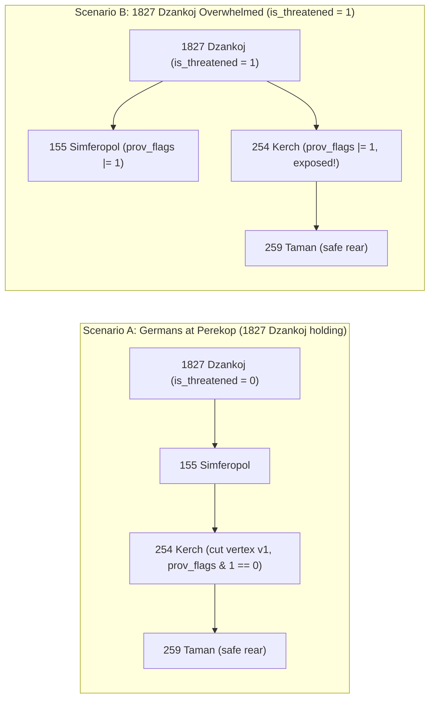

# Implementation Plan: STEM Strategic Defense & Dynamic Encirclement Assessment

## Overview & Objectives

This plan evolves **Patch 18 (STEM)** from a binary topological trigger (`independent_paths < SalientNeckWidthThreshold` $\implies$ evacuate 100%) into an integrated **5-stage strategic encirclement-defense system**.

Each stage is designed to be **implemented independently**, verified with a **basic launch-to-main-menu smoke test** (plus save-triggered CSV telemetry in `stem_debug.csv` during testing), and **stopped after each stage** for your explicit approval before advancing to the next stage.

### The 5 Functional Pillars
1. **Dynamic Strategic Evacuation Assessment (`SalientEvacuationQuota(P)` $\in [0.0, 1.0]$)** & **Natural Geography Detection**: Distinguish between geographically sheltered narrows (e.g., Crimea when only Kerch remains open and borders neither enemies nor threatened provinces $\implies Q = 0.0$) and genuinely threatened bottlenecks.
2. **Front AI Salient De-Prioritization**: Scale down both border deficit requests and interior reserve pushes into evacuating salients using `AdjustedPriority(P) = NormalFrontAIPriority(P) * (1 - Q(P))`.
3. **Bottleneck & Subsequent Line Reinforcement (`BottleneckDefenseBoost`)**: Redirect Front AI troops to threatened bottleneck provinces (both frontline and interior neck nodes) using `AdjustedNeckPriority(B) = NormalFrontAIPriority(B) + BottleneckDefenseBoost * AggregatedQuota(B)`.
4. **Partial Evacuation Relative to Normal Front AI Priority & Division Selection Order**: Withdraw only `StayingDivs(P) - AdjustedPriority(P)` excess divisions (avoiding repeated hourly percentage decay), prioritizing unengaged $\to$ slower $\to$ higher organization $\to$ higher strength divisions.
5. **Bottleneck Defender Retreat Direction**: Ensure any division forced to retreat from a bottleneck or salient retreats toward the safe rear (`parent[B]` / lower `dist`) rather than deeper into the exposed pocket.

---

## Core Design Principles & Retail Integration

### 1. Dimensional Consistency of `NormalFrontAIPriority`
In `CFrontAI::MoveUnitsToFront` (`0x006829B0`), retail computes a normalized share $S(P) \in [0.0, 1.0]$ for each frontline province (`0x006844E0..0x00684551`) and multiplies $S(P)$ by `total_front_divs` ($D_{\text{front}}$ at `[ebp - 0x38]`) at `0x00684579`, `0x00684785`, and `0x006852A0` to obtain the **target division count**:
$$\text{NormalFrontAIPriority}(P) = N(P) = S(P) \times D_{\text{front}} \quad \text{(measured in divisions)}$$

Expressing `NormalFrontAIPriority(P)` in **divisions** makes both formulas work consistently across all 5 `distrib_vs_ai` / `distrib_vs_human` modes (`even`, `reactive`, `defensive`, `offensive`, `op_defensive`) and gives `BottleneckDefenseBoost` (currently `3.5` in `db/mod_settings.ini`) a direct, intuitive unit (**additional divisions requested at the bottleneck at quota `1.0`**):

* **Salient Province Target**:
  $$\text{AdjustedPriority}(P) = N(P) \times \big(1.0 - Q(P)\big) \iff S_{\text{adj}}(P) = S(P) \times \big(1.0 - Q(P)\big)$$
* **Bottleneck Province Target**:
  $$\text{AdjustedNeckPriority}(B) = N(B) + \text{BottleneckDefenseBoost} \times Q_{\text{agg}}(B) \iff S_{\text{adj}}(B) = S(B) + \frac{\text{BottleneckDefenseBoost} \times Q_{\text{agg}}(B)}{\max(1,\; D_{\text{front}})}$$

---

### 2. Zero-Overhead Min-Cut Extraction (Residual `optc_vis[]` Scan) & Natural Geography

#### Why Residual `optc_vis[]` Beats Walking `next_hop[]`
In `Cave_STEM_UpdateGraphTable`:
* `next_hop[]` (`+0x3C000`) holds only a single `uint16_t` per province, so it does **not** retain all $F(P)$ paths branching out of source $P$, and 1-hop direct edges from $P$ to a `dist == 0` sink mark `in_flow_used[sink] = comp_id` (`+0x2A000`) without populating `prev_in_flow[]` (`+0x18000`) or `next_hop[]` (`+0x3C000`).
* In contrast, scanning the **residual split-node reachability** `optc_vis[]` (`+0x2C000`) from the final failed augmenting BFS pass (`k = F(P)`) is **both mathematically exact and simpler**:
  * In `.optc_bfs_loop`, whenever an even in-node `2*v` (`v_in`) is popped, if `v` is **not** saturated (`in_flow_used[v] != comp_id`), its out-node `2*v + 1` (`v_out`) is immediately enqueued and stamped `optc_vis[2*v + 1] = pass_id`.
  * Thus $\text{optc\_vis}[2v] == \text{pass\_id} \;\land\; \text{optc\_vis}[2v + 1] \ne \text{pass\_id}$ holds **if and only if** $v$ is saturated by the flow (`in_flow_used[v] == comp_id`) and $v_{\text{out}}$ is unreachable in the residual graph — which by the Max-Flow Min-Cut Theorem is the **exact minimum $P$-side vertex cut** $C(P)$ (`|C(P)| == F(P)`).
  * To handle 1-hop saturated sink neighbors $v$ adjacent to source $P$ (`dist[v] == 0 && in_flow_used[v] == comp_id`), we simply stamp `optc_vis[2*v] = pass_id` and push `2*v` onto the BFS queue `+0x26000` (without pushing `2*v + 1` since $v_{\text{in}} \to v_{\text{out}}$ is saturated). Then a single loop over the final failed BFS queue `+0x26000[0 .. q_tail - 1]` (typically only 5–30 entries) checking `(node & 1) == 0 && optc_vis[node + 1] != pass_id` extracts all $F(P)$ min-cut vertices in $O(q_{\text{tail}})$ time with zero extra BFS passes.

#### Downstream Bottleneck Contraction & Corridor Vulnerability Propagation
Forward residual reachability identifies the **source-nearest** minimum cut $C_{\text{raw}}(P)$. When a salient has multiple layers (for example, `505` Bialystok / `1875` Lomza / `6515` Bielsk Podlaski / `6516` Grajewo behind `7335` Augustow, which itself depends on `209` Grodno and `102` Wolkowysk), source-nearest extraction treats intermediate narrow vertices like `7335` Augustow as terminal cuts — hiding critical threats further down the same escape corridor (`209` Grodno, `EnStr = 6.0`).

Rather than introducing explicit operational groups or recursive DFS with cycle hazards, we resolve corridor dependencies in **two linear passes** over the already topologically ordered `bfs_q` (`+0x10000`, populated in non-decreasing `dist = 1, 2, ...` order during Pass 1 Safe BFS) plus any `is_threatened == 1` frontline sources:

* **Step 5A (Once-Per-Province Raw Cut & Flow Cache in `bfs_q` Order)**:
  * Every valid cut vertex in Option C must be a Pass-1 Safe BFS province (`(prov_flags[u] & 2) != 0` and `dist[u] > 0`). Because `bfs_q` already holds all such `dist > 0` frontline and interior corridor provinces sorted by increasing `dist`, running Option C max-flow **once** per province in `bfs_q` (plus `is_threatened == 1` frontline sources) guarantees every candidate cut vertex is evaluated at most once.
  * Store each province $u$'s raw flow count `f_paths_u8[u]`, raw min-cut vertices $C_{\text{raw}}(u)$, and local vertex threat (`exp(u)`, `T_local(u)`, `crit(u)`) in the temporary Stage 1 Step 5A/5B scratch region (`+0x78000..+0x7FFFF`).
* **Step 5B (Bounded Downstream Cut Contraction & Threat Propagation in Increasing `dist` Order)**:
  * Iterate through the evaluated provinces in increasing `dist` order (`dist = 1, 2, ...`, guaranteeing every closer downstream vertex `dist[v] <= dist[P]` is normally already resolved). Any province with $F(u) \ge W$ (e.g., `102` Wolkowysk, `209` Grodno) is a **terminal controlling bottleneck** ($C_{\text{ctrl}}(u) = \{u\}$).
  * For each narrow province $P$ ($1 \le F(P) < W$), initialize $F(P)$ cut slots from $C_{\text{raw}}(P)$, keeping per-slot corridor state (`slot_cut[j]`, `slot_exp[j]`, `slot_crit[j]`, `slot_T[j]`, `slot_vref[j]`) and a small per-$P$ visited array (initialized with $P$ and $C_{\text{raw}}(P)$). Run at most `MAX_CONTRACT_STEPS = 8` iterative contraction steps:
    1. **Series Corridor Contraction** (`|C_ctrl(v) \ (C(P) \ {v})| == 1`): If slot $j$'s current vertex $v$ is itself narrow ($1 \le F(v) < W$, e.g., `7335` Augustow), inspect $v$'s resolved controlling cut $C_{\text{ctrl}}(v)$ (e.g., `{102, 209}`). If $P \notin C_{\text{ctrl}}(v)$ and replacing $v$ introduces **exactly one** new vertex $w$ (`209` Grodno) not already in $P$'s other cut slots (`{102}`) and not in $P$'s visited set, add $w$ to `visited`, replace `slot_cut[j] <- w`, and merge the worst-case vulnerability along corridor $v \to w$:
       $$\text{slot\_exp}[j] \gets \text{slot\_exp}[j] \lor \text{exp}(w), \quad \text{slot\_T}[j] \gets \max(\text{slot\_T}[j],\; T(w)), \quad \text{slot\_crit}[j] \gets \text{slot\_crit}[j] \lor \text{crit}(w) \lor (\text{slot\_T}[j] \ge 1.0)$$
       updating `slot_vref[j]` whenever $w$'s threat meets or exceeds the corridor's current max.
    2. **Parallel Corridor Contraction** (`|U| == F(P)`): If $F(P) \ge 2$ and single-slot replacement stalls while multiple cut slots are narrow, take the union $U = \bigcup_{j=0}^{F(P)-1} C_{\text{ctrl}}(c_j)$ (skipping any vertex where $P \in C_{\text{ctrl}}(c_j)$ or already in `visited` to prevent cycling). If $|U| == F(P)$ (e.g., an inner province whose raw cut `{505, 6516}` jointly maps down to `{102, 209}`), replace $C(P)$ with $U$, add $U$ to `visited`, and propagate the max slot threat onto each vertex in $U$.
    3. **Branching Sub-Neck Threat Propagation** (`|C_ctrl(v) \ (C(P) \ {v})| >= 2`): If a tighter bottleneck $v$ (e.g., $F(P) = 1$) leads into a wider but still narrow sub-salient ($F(v) = 2 < W$), $v$ remains the minimal cut vertex in slot $j$ (preserving width $F(P)$), and $v$'s aggregate downstream neck urgency $T_{\text{neck}}(v)$ / exposure / criticality are propagated into slot $j$:
       $$\text{slot\_T}[j] \gets \max(\text{slot\_T}[j],\; T_{\text{neck}}(v))$$
  * **Cycle & Repeated-Work Guarantees**: Step 5A runs Option C **once per province** (`O(V_strip)` total, zero redundant searches); Step 5B has no recursion, inspects only cached $C_{\text{ctrl}}$ entries ($\le W$ IDs each), skips any expansion containing $P$ or an already-visited ID, and is strictly bounded by `MAX_CONTRACT_STEPS = 8`.
  * **Outcome on Bialystok Example & Per-Province Independence**: `7335` Augustow (`dist = 6`), `505` Bialystok (`dist = 7`), `6515` Bielsk Podlaski (`dist = 7`), `6516` Grajewo (`dist = 7`), and `1875` Lomza (`dist = 8`) all resolve $C_{\text{ctrl}} = \{102 \text{ Wolkowysk}, 209 \text{ Grodno}\}$ with `F_Exp = 1, F_Crit = 1, D_Width = 0.667, T_Neck = 1.50, v_ref = 209 (EnStr = 6.0)`, without artificial operational groups and while still computing each province's own `VP_IC_Val(P)`, `V_Ret(P)`, and `is_threatened[P]` floor independently.

#### Natural Geography Exposure Check (Crimea Case Study)
During Pass 0, `Cave_STEM_UpdateGraphTable` already sets bit `0` of `prov_flags[u]` (`+0x28000`) on every friendly province $u$ that has a passable land connection (`adj->type != 4`) to **either** an enemy-controlled province **or** a friendly province marked `is_threatened == 1` (`+0x24000`).

Let:
* $F_{\text{exp}}(P)$ = count of cut vertices $v_i \in C(P)$ with **land-attack exposure** (`(prov_flags[v_i] & 1) != 0`).
* $F_{\text{shelt}}(P) = F(P) - F_{\text{exp}}(P)$ = count of **sheltered** cut vertices (`(prov_flags[v_i] & 1) == 0`).

* **Scenario A (Germans outside Crimea, `1827 Dzankoj` not threatened)**: Every Crimean province has $F = 1 < W$, with bottleneck `254 Kerch` (which shares no land border with enemy provinces or `is_threatened == 1` provinces $\implies$ `(prov_flags[254] & 1) == 0`). Thus $F_{\text{exp}} = 0$, and **`SalientEvacuationQuota(P)` collapses to `0.0`** across all of Crimea (`1827 Dzankoj`, `155 Simferopol`, `252 Evpatoria`, `253 Sevastopol`).
* **Scenario B (Germans break `1827 Dzankoj` / `is_threatened[1827] == 1`)**: Pass 0 propagates `prov_flags |= 1` to `1827`'s land neighbors (`155 Simferopol`, `252 Evpatoria`, `254 Kerch`). Now `254 Kerch` is exposed ($F_{\text{exp}} = 1$), immediately unlocking Crimean evacuation.

#### Active Evacuation Neck / Cut-Province Holding Lock (Stage 1C)
When a salient's shoulder is attacked (e.g., `209 Grodno` flipping to `IsThreatened = 1`), the forward salient provinces (`505 Bialystok`, `1875 Lomza`, `6515 Bielsk Podlaski`, `6516 Grajewo`, `7335 Augustow` at `Dist = 7..8`) all resolve `CutProv1 = 102` (`Wolkowysk`, `Dist = 6`). Without neck protection, `102 Wolkowysk` simultaneously computes `F_Paths = 2 < W` (`CutProv1 = 210 Slonim`, `CutProv2 = 503 Brest-Litovsk`) and flips to `SalientEvacuationQuota = 1.000`, which both orders `102`'s defenders away prematurely and chains the entire salient's `EvacDestNeck` past `102` to `210 Slonim`.

To guarantee the neck stays held until the upstream salient clears without scanning per-army movement paths ($O(|V_{\text{strip}}|)$ vs. scanning `700+` frontline divisions), Stage 1 adds a **reverse-topological Cut/Neck Holding Lock (Step 5C)** using `prov_flags` bit `0x20` (`HAS_ANY_FRIENDLY_UNIT`):

1. **Inclusive Troop Presence Including Retreating Divisions (`prov_flags |= 0x20`)**:
   * In Pass 0 / Step 3A (`.scan_friendly`), stamp `prov_flags[eax] |= 0x20` for any non-empty friendly/allied land army (`[edi + 0x26] != 0`) located in province `eax` **before** the `cmp byte ptr [edi + 0x17B], 0` combat-retreat skip.
   * Stationary defenders, overland-marching units, **and combat-retreating units** all keep the downstream neck locked until they physically exit into the neck province, while combat-retreating divisions remain excluded from `fr_eff_str_f32` (`FrStr`).
2. **Descending-`Dist` Topological Scan & Strict DAG Cycle Guard (`Dist[N] < Dist[P]`)**:
   * After Step 5B computes contracted controlling cuts (`CutProv1`, `CutProv2`) and `quota_q8`, and **before** `.chain_necks_start`, iterate the evaluated strip queue `+0x1C000[0 .. count - 1]` in **reverse (descending `Dist`) order** (deepest salient tips inward).
   * Whenever province $P$ is evacuating (`quota_q8[P] > 0`) and has friendly/allied units present (`(prov_flags[P] & 0x20) != 0`), inspect each bottleneck $N \in \{\text{CutProv1}[P], \text{CutProv2}[P]\}$ (and for Pass-2 `F_Paths == 0` bridge provinces, their landing neck $B$):
     * Enforce **`Dist[N] < Dist[P]`** so mutual cut cycles and same-depth deadlocks are strictly impossible.
     * Apply a **flat-out evacuation block** on $N$: set `quota_q8[N] = 0`, `neck[N] = 0` (`EvacDestNeck[N] = 0`), and update `debug_telemetry[N]` (`SalientEvacuationQuota = 0.000`, `EvacDestNeck = 0`).
3. **Automatic Intermediate `EvacDestNeck` Resolution (No Extra Chaining Logic)**:
   * Because `neck[102]` is cleared to `0` prior to `.chain_necks_start`, `.chain_walk_loop` naturally terminates at `102 Wolkowysk`, leaving `EvacDestNeck = 102` on `505`, `1875`, `6515`, `6516`, and `7335` instead of chaining onward to `210 Slonim`.
   * Divisions escaping the Bialystok salient rally at `102 Wolkowysk` and defend the corridor; as soon as all friendly units (including combat-retreating divisions) have exited `Dist 7..8` into `102`, `(prov_flags[P] & 0x20)` clears upstream, unlocking `102 Wolkowysk` on the next hourly tick to withdraw together toward `210 Slonim`.

> [!NOTE]
> **Future Consideration — Straggler Hostage / Pin-the-Tip Edge Case**: For simplicity during Stage 1 validation, Step 5C applies a flat-out evacuation block whenever any non-empty friendly/allied division (including retreating units) remains in a dependent upstream province. If live testing later shows an enemy pinning a single slow straggler at the tip to freeze a large garrison in the neck while the neck itself comes under overwhelming direct attack, revisit adding either a direct-collapse override (`IsThreatened[N] == 1` or `F_Paths[N] == 0` breaks the lock) or a partial holding-screen cap on `quota_q8[N]`.

---

### 3. Dynamic `SalientEvacuationQuota(P)` Formula (Complete Closed Form)

Weights below will initially be fixed constants; once tested in practice, they can be externalized to `db/mod_settings.ini` in a later follow-up.

#### Hard Overrides
* $F(P) \ge W \implies Q(P) = 0.0$ (sufficient independent escape corridors).
* $F(P) == 0 \implies Q(P) = 1.0$ (zero safe paths remain).
* $F_{\text{exp}}(P) == 0 \;\land\; \text{is\_threatened}[P] == 0 \implies Q(P) = 0.0$ (**Natural Geography Gate**: bottleneck cannot be attacked by land, and $P$ is not collapsing).

#### Continuous Assessment ($1 \le F(P) < W$ and ($F_{\text{exp}}(P) > 0$ or $\text{is\_threatened}[P] == 1$))

1. **Per-Cut-Vertex Combat Ratio $R(v_i)$ & Threat Translation $T(v_i) \in [0.25, 1.50]$**:
   For each cut vertex $v_i \in C(P)$, using Pass-0 cached province combat totals (`fr_eff_str_f32`, `en_eff_str_f32`, `inbound_fr_str_f32`, and `min_org_q8`):
   $$R(v_i) = \frac{\text{EnemyStr}(v_i)}{\max\!\big(1.0,\; \text{FriendlyDefenderStr}(v_i) + 0.5 \cdot \text{InboundFriendlyStr}(v_i)\big)}$$
   where $\text{InboundFriendlyStr}(v_i)$ and hostile move threat scanning resolve the **immediate next hop** (`movement` list head `[pArmy + 0x232]` when `[pArmy + 0x27E] == 1`) rather than falling back to the final destination `[pArmy + 0x13A]`.
   > [!NOTE]
   > **Future Enemy-Presence Weighting (To Revisit)**:
   > 1. Make adjacent/border enemy threat weights configurable in `db/mod_settings.ini` so nearby enemy divisions do not over-trigger panic.
   > 2. Distinguish between enemy divisions **merely present** on an adjacent border (which may be idle, pinned down, retreating, or unable to attack) and enemy divisions **actively attacking or moving** into the bottleneck, weighting merely-present divisions lower.
   * **Strength-Ratio Threat Component**:
     Normalize by `NeckThreatRatio` ($R_{\text{thr}}$ at `0x00DCBAC0`, default `1.5`):
     $$T_{\text{str}}(v_i) = \frac{R(v_i)}{R_{\text{thr}}}$$
   * **Organization-Collapse Threat Component**:
     If $v_i$ is in active defensive combat with lowest defender organization $O(v_i) < 2 \cdot O_{\text{crit}}$ (where $O_{\text{crit}}$ is `NeckCollapsingOrgThreshold` at `0x00DCBAC4`, default `10.0` in `db/mod_settings.ini`):
     $$T_{\text{org}}(v_i) = \text{clamp}_{[0.0,\; 1.50]}\!\left(\frac{2 \cdot O_{\text{crit}} - O(v_i)}{O_{\text{crit}}}\right)$$
     *(Else $T_{\text{org}}(v_i) = 0.0$.)*
   * **Uncontested / Exposed Cut Vertex Threat $T(v_i)$**:
     * If $v_i$ is sheltered (`(prov_flags[v_i] & 1) == 0`): $T(v_i) = 0.0$ (sheltered cuts are intact).
     * Else if $v_i$ is exposed (`(prov_flags[v_i] & 1) != 0`) and $\text{FriendlyDefenderStr}(v_i) + 0.5 \cdot \text{InboundFriendlyStr}(v_i) < 1.0$ while $\text{EnemyStr}(v_i) > 0$: $T(v_i) = 1.50$.
     * Else:
       $$T(v_i) = \text{clamp}_{[0.25,\; 1.50]}\!\big(\max(T_{\text{str}}(v_i),\; T_{\text{org}}(v_i))\big)$$

2. **Bottleneck Threat Urgency ($T_{\text{neck}}(P) \in [0.25, 1.50]$)**:
   Let $T_{\text{max}}(P) = \max_{v_i \in C_{\text{exp}}(P)} T(v_i)$ (or $1.0$ if $F_{\text{exp}}(P) == 0$ while $\text{is\_threatened}[P] == 1$). Apply the multi-pronged vulnerability multiplier when multiple bottleneck vertices are simultaneously exposed ($F_{\text{exp}}(P) \ge 2$):
   $$T_{\text{neck}}(P) = \text{clamp}_{[0.25,\; 1.50]}\!\Big( T_{\text{max}}(P) \times \big(1.0 + 0.25 \cdot \max(0,\; F_{\text{exp}}(P) - 1)\big) \Big)$$

3. **Topological Width & Intact-Defense Factor ($D_{\text{width}}(P) \in [0.0, 1.0]$)**:
   Classify each exposed cut vertex $v_i \in C_{\text{exp}}(P)$ as:
   * **Critically stressed** ($v_i \in C_{\text{crit}}(P)$, counting as **`0.0`** effective paths) iff $\text{is\_threatened}[v_i] == 1 \;\lor\; T(v_i) \ge 1.0$.
   * **Exposed-but-intact** ($v_i \in C_{\text{intact\_exp}}(P)$, counting as **`0.5`** effective paths) otherwise.
   * Each **sheltered** cut vertex ($v_i \in C_{\text{shelt}}(P)$) counts as **`1.0`** effective path.
   $$D_{\text{width}}(P) = \max\!\left(0.0,\; \frac{W - \big(F_{\text{shelt}}(P) + 0.5 \cdot F_{\text{intact\_exp}}(P)\big)}{W}\right)$$

4. **Local + Neighbor Strategic Value Retention ($V_{\text{ret}}(P) \in [0.50, 1.00]$)**:
   Compute combined VP/IC of $P$ and all friendly-controlled adjacent provinces $N_{\text{fr}}(P)$ using verified `CProvince` offsets **`+0x19E`** (`points` / VP parsed in `FUN_00561d19` at `0x0056230D`, rather than `+0x1F2` which is `Manpower`) and `[*(prov + 0x1CA) + 0x14]` (current `IC`):
   $$\text{Val}(P) = \sum_{u \in \{P\} \cup N_{\text{fr}}(P)} \big(\text{VP}(u) + 0.5 \cdot \text{IC}(u)\big)$$
   $$V_{\text{ret}}(P) = \max\!\left(0.50,\; \frac{1.0}{1.0 + 0.02 \cdot \text{Val}(P)}\right)$$
   *(Bypassed to `1.0` when $F_{\text{crit}}(P) == F(P)$ or $\text{is\_threatened}[P] == 1$ so high-value pockets such as Leningrad, Sevastopol, or Kiev still break out before complete encirclement/collapse.)*

5. **Final Quota Combining & Threatened Source Floor**:
   $$Q_{\text{raw}}(P) = D_{\text{width}}(P) \times T_{\text{neck}}(P) \times V_{\text{ret}}(P)$$
   * If $\text{is\_threatened}[P] == 1$:
     $$Q(P) = \begin{cases} 1.0 & \text{if } F_{\text{crit}}(P) \ge 1, \\ \text{clamp}_{[0.85,\; 1.0]}\!\big(\max(0.85,\; Q_{\text{raw}}(P))\big) & \text{otherwise.} \end{cases}$$
   * Else:
     $$Q(P) = \text{clamp}_{[0.0,\; 1.0]}\!\big(Q_{\text{raw}}(P)\big)$$

---

## Memory & Code-Cave Architecture

Currently, `VirtualAlloc` (`build_and_apply_all.py`) allocates `0x40000` (`256 KB`) for `g_pGraphTable` (province capacity `8192 = 0x2000`), spanning `0x00000..0x3FFFF`. The `.mod` PE section spans `0x00DC9000..0x00DCD000` (`16 KB`), leaving `332` bytes free at `0x00DCCEB4..0x00DCD000`.

* **Expand `g_pGraphTable` (`VirtualAlloc` in Stage 1)** from `0x40000` (`256 KB`) to **`0xC0000` (`768 KB`)** while the temporary save-triggered debug telemetry is active (dropping to `0x80000` / `512 KB` once debug telemetry is removed):
  * `+0x00000..+0x3FFFF` (`256 KB`): existing buffers unchanged (`GraphNode`, `bfs_q`, `fdist_plus_1`, `optb_prev`, `fdist_q`, `optb_prev_snap`, `is_threatened`, `optc_queue` `@ +0x26000`, `prov_flags` `@ +0x28000` with bit `0x20` = `HAS_ANY_FRIENDLY_UNIT`, `in_flow_used` `@ +0x2A000`, `optc_vis` `@ +0x2C000`, `stem_evac_active` `@ +0x30000`, `next_hop` `@ +0x3C000`).
  * **Permanent Stage 1–5 Buffers (`+0x40000..+0x7FFFF`, `256 KB`, zero-overflow widths)**:
    * `+0x40000..+0x41FFF` (`8 KB`): `quota_q8[8192]` (`uint8_t`, $Q(P) \times 255$, `0..255` $\equiv$ `0.0..1.0`)
    * `+0x42000..+0x43FFF` (`8 KB`): `neck_agg_q8[8192]` (`uint8_t`, aggregated $Q_{\text{agg}}(B) \times 255$)
    * `+0x44000..+0x45FFF` (`8 KB`): `cut_min_q8[8192]` (`uint8_t`, minimum contributing quota for $B$)
    * `+0x46000..+0x47FFF` (`8 KB`): `min_org_q8[8192]` (`uint8_t`, lowest defender org quantized `0..255`)
    * `+0x48000..+0x4BFFF` (`16 KB`): `cut_count_u16[8192]` (**`uint16_t`**, number of salients referencing cut $B$, max `65,535`)
    * `+0x4C000..+0x4FFFF` (`16 KB`): `prov_country_tag[8192]` (`uint16_t`, owner country index stamped per province so combat retreats read valid graph state anytime)
    * `+0x50000..+0x57FFF` (`32 KB`): `cut_sum_u32[8192]` (**`uint32_t`**, sum of `quota_q8` values for `AVERAGE`, max `4.29e9`)
    * `+0x58000..+0x5FFFF` (`32 KB`): `norm_prio_f32[8192]` (**32-bit `float`**, cached $N(P) = S(P) \times D_{\text{front}}$ in divisions, no 256-division limit)
    * `+0x60000..+0x67FFF` (`32 KB`): `fr_eff_str_f32[8192]` (`float`, friendly land defender strength in province)
    * `+0x68000..+0x6FFFF` (`32 KB`): `en_eff_str_f32[8192]` (`float`, adjacent/attacking enemy land strength threatening province)
    * `+0x70000..+0x77FFF` (`32 KB`): `inbound_fr_str_f32[8192]` (`float`, adjacent safe friendly divisions marching into province)
    * `+0x78000..+0x7FFFF` (`32 KB`): phase-shared Stage 1 scratch — holds `raw_hostile_str_f32[8192]` during Pass 0 / Pre-Pass A, then reused in Step 5A/5B for `f_paths_u8[8192]` (`+0x78000..+0x79FFF`, `8 KB`) and compact per-province raw/controlling cut & corridor-threat records (`+0x7A000..+0x7FFFF`, `24 KB`).
  * **Temporary Debug Telemetry Buffer (`+0x80000..+0xBFFFF`, `256 KB`)**:
    * `debug_telemetry[8192]` (`32` bytes per province, $O(1)$ indexed by `prov_id`): stores persisted per-country evaluation metrics (`eval_valid` byte, `is_threatened`, `f_paths`, `f_exp`, `f_crit`, `is_cut`, `dist`, `neck`, `cut0`, `cut1`, `d_width_q8`, `t_neck_q8`, `v_ret_q8`, `vp_ic_val`, `adj_prio_f32`, `target_stay_divs_u16`, `staying_divs_u16`, `evac_budget_u16`, `agg_neck_q8`, `adj_neck_prio_f32`) for `stem_debug.csv`. Easily removed later by shrinking `VirtualAlloc` back to `0x80000`.
* **Expand `.mod` PE section (Stage 1)** by `+0x4000` bytes (`0x00DCD000..0x00DD1000`), providing **`16 KB` of contiguous code-cave room** for Stages 1–5.
* **Settings Header Slots**: Repurpose freed slot `0x00DCBADC` for `BottleneckQuotaAggregation` (`0 = MAX` [default], `1 = AVERAGE`, `2 = MIN`), while `0x00DCBACC` (`SalientEvacuationQuota` scalar in `.ini`) is superseded by runtime calculation.

---

## Phased Implementation Stages

> **Strict Execution Gate**: Every stage below is implemented and smoke-tested independently (main menu load / zero exceptions, plus checking `stem_debug.csv` on save where noted). **Execution MUST STOP after each stage** and wait for explicit approval before moving to the next stage.

### Stage 1: Min-Cut Extraction, Natural Geography Gate, Dynamic `SalientEvacuationQuota(P)`, Active Neck Holding Lock & Save Debug Dump
**Goal**: Replace the binary `< SalientNeckWidthThreshold` trigger with exact residual `optc_vis[]` min-cut extraction $C(P)$, Step 5A/5B downstream bottleneck contraction, the Natural Geography Gate ($F_{\text{exp}} == 0 \implies Q(P) = 0.0$), dynamic `quota_q8[P]`, the Step 5C Active Evacuation Neck Holding Lock (`Dist[N] < Dist[P]`), and a temporary save-triggered CSV telemetry dump (`stem_debug.csv`).

* **Binary / Script Changes (`build_and_apply_all.py`)**:
  1. Extend `.mod` PE section (`0x00DC9000..0x00DD1000`) and update `VirtualAlloc` in `Cave_STEM_HourlyTick` from `0x40000` to `0xC0000`.
  2. Extend Pass 0 (`Cave_STEM_UpdateGraphTable` army & combat scan) to populate `fr_eff_str_f32[u]`, `en_eff_str_f32[u]`, `inbound_fr_str_f32[u]`, and `min_org_q8[u]`, and stamp `prov_flags[eax] |= 0x20` (`HAS_ANY_FRIENDLY_UNIT`) **before** the `[edi + 0x17B] != 0` combat-retreat skip so retreating divisions are still counted for neck-holding dependencies without inflating `FrStr`.
  3. Update Option C in `Cave_STEM_UpdateGraphTable` (**Step 5A + Step 5B + Step 5C + Step 5D**):
     * When pushing a saturated 1-hop sink neighbor of $P$ (`dist[v] == 0 && in_flow_used[v] == comp_id`) into `.optc_bfs_loop`, push `2*v` onto `+0x26000` (`optc_vis[2*v] = pass_id`).
     * In **Step 5A**, evaluate Option C once per `dist > 0` province in `bfs_q` (`+0x10000`, sorted by `dist`) plus any `is_threatened == 1` frontline source; after `.optc_no_more_paths`, scan `+0x26000[0 .. q_tail - 1]` for `(node & 1) == 0 && optc_vis[node + 1] != pass_id` to cache $F(P)$, $C_{\text{raw}}(P)$, and local cut-vertex threat in `+0x78000..+0x7FFFF`.
     * In **Step 5B**, iterate narrow provinces in increasing `dist` order, contract intermediate corridor cuts via series/parallel replacement (`MAX_CONTRACT_STEPS = 8` with per-$P$ `visited` cycle guard) and branching sub-neck propagation into controlling bottlenecks $C_{\text{ctrl}}(P)$, apply the **Natural Geography Gate** ($F_{\text{exp}} == 0 \land \text{is\_threatened}[P] == 0 \implies Q(P) = 0.0$), and compute $Q(P)$ via $D_{\text{width}}(P) \times T_{\text{neck}}(P) \times V_{\text{ret}}(P)$ (reading real VP at `[CProvince + 0x19E]`) into `quota_q8[P]`. Clear `neck[P] = 0` whenever `quota_q8[P] == 0`.
     * In **Step 5C (Active Evacuation Neck Holding Lock, pre-chaining)**: Iterate the evaluated strip queue `+0x1C000` in **reverse (descending `Dist`) order** prior to `.chain_necks_start`. For every evacuating province $P$ (`quota_q8[P] > 0`) with any friendly/allied units present (`(prov_flags[P] & 0x20) != 0`, including combat-retreating units), lock each bottleneck $N \in \{\text{CutProv1}[P], \text{CutProv2}[P]\}$ that satisfies `Dist[N] < Dist[P]` by setting `quota_q8[N] = 0`, `neck[N] = 0`, and syncing `debug_telemetry[N]` so `.chain_walk_loop` naturally routes $P$ into $N$ (`EvacDestNeck = 102`) until upstream units finish withdrawing.
     * In **Step 5D (Post-Pass-2 Bridge Check & Validation)**: Apply the same `Dist[N] < Dist[P]` lock check for any Pass-2 `F_Paths == 0` bridge landing neck if units (`prov_flags & 0x20`) remain in the stranded cluster, and validate in `stem_debug.csv` that under initial Grodno pressure `102 Wolkowysk` holds at `Quota = 0.000` with Bialystok provinces targeting `EvacDestNeck = 102`, then flips toward `210 Slonim` once upstream units arrive in `102`.
  4. **Temporary Save-Triggered Debug Output (`stem_debug.csv`)**:
     * In `Cave_STEM_HourlyTick`, clear `+0x80000..+0xBFFFF` once before looping over all countries; during `Cave_STEM_UpdateGraphTable`, record each evaluated active frontline province's telemetry (`CountryTag`, `ProvID`, `ProvName`, `Dist`, `IsThreatened`, `F_Paths`, `F_Exp`, `F_Crit`, `CutProv1`, `CutProv2`, `EvacDestNeck`, `FrStr`, `EnStr`, `InbStr`, `MinOrg`, `VP_IC_Val`, `D_Width`, `T_Neck`, `V_Ret`, `SalientEvacuationQuota`, plus placeholder columns for Stages 2–4) keyed by `prov_id` (stamped with `prov_country_tag[P]`).
     * Hook `0x004301D7` (`call 0x0042CC70` at the tail of save execution `0x0043015D..0x004301DC`, after `CSaveGame::WriteSave` completes on manual save or autosave) to call `Cave_STEM_DumpDebugCSV`, which runs a fresh read-only country-loop refresh across active AI countries and uses the binary's built-in CRT `fopen` (`0x007A6615`), `fprintf` (`0x007A6628`), and `fclose` (`0x007A6429`) to write semicolon-delimited `stem_debug.csv` in the game root directory.
* **Verification & Stop**: Smoke test (launch modified executable to main menu, verify zero exceptions); user tests in-game by saving to inspect `stem_debug.csv` (e.g., Crimea vs. Bialystok & Wolkowysk staged withdrawal). **STOP and wait for approval before Stage 2.**

---

### Stage 2: Front AI Salient De-Prioritization (`AdjustedPriority = Normal * (1 - Quota)`)
**Goal**: Prevent `CFrontAI::MoveUnitsToFront` (`0x006829B0`) from reinforcing evacuating salient provinces in both of its movement loops (Loop A interior-to-border push and Loop B border-to-border quota rebalancing).

* **Binary Changes (`build_and_apply_all.py`)**:
  1. **Loop B — Border Quota Adjustment (`0x00684551`, `0x0068470D`, and `0x0068526A` in `0x006851D0`)**:
     * Cache unadjusted `norm_prio_f32[u] = S(u) * D_front` directly as a 32-bit float.
     * Replace `S(u)` on the x87 FPU stack with `S(u) * (1.0 - Q(u))`. When $Q(P) = 1.0$, `AdjustedPriority(P) == 0.0`, eliminating reinforcement deficits in exposed salients and allowing non-evacuating surplus to donate outward.
  2. **Loop A — Interior Push Candidate Scoring (`0x00684088`)**:
     * When Loop A evaluates an adjacent border province candidate `esi` using `en_str - fr_str`, scale candidate attractiveness by `(1.0 - Q(cand))` so interior armies never advance into an evacuating salient tip.
  3. **Update `stem_debug.csv` Telemetry**: Populate `NormalFrontAIPriority` and `AdjustedPriority` in `debug_telemetry[P]` during `CFrontAI::MoveUnitsToFront`.
* **Verification & Stop**: Smoke test (launch to main menu, zero exceptions). **STOP and wait for approval before Stage 3.**

---

### Stage 3: Bottleneck Reinforcement & Interior Neck Garrison Hold (`BottleneckDefenseBoost`)
**Goal**: Redirect Front AI reserves to reinforce exposed bottlenecks $B$ (whether $B$ sits on the frontline or 1 hop behind it as a fallback line) using `BottleneckDefenseBoost` and configurable quota aggregation.

* **Config & Loader Changes (`db/mod_settings.ini`, `build_and_apply_all.py`)**:
  1. Add `BottleneckQuotaAggregation` under `[FrontAI]` in `db/mod_settings.ini` (`0 = MAX` [confirmed default], `1 = AVERAGE`, `2 = MIN`), parsed in `Cave_ReadModSettings` into `[0x00DCBADC]`.
* **Graph & Front AI Changes (`build_and_apply_all.py`)**:
  1. During Step 5 in `Cave_STEM_UpdateGraphTable`, whenever $Q(P) > 0$, accumulate `cut_count_u16[v]`, `cut_sum_u32[v]`, `cut_min_q8[v]`, and max `neck_agg_q8[v]` onto each cut vertex $v_i \in C(P)$ (and `neck[P]`). At the end of `Cave_STEM_UpdateGraphTable`, finalize `neck_agg_q8[v]` according to `BottleneckQuotaAggregation` (`MAX`, `AVERAGE`, or `MIN`).
  2. **Loop B Border Neck Boost (`0x00684551`, `0x0068470D`, `0x0068526A`)**:
     * Add $\frac{\text{BottleneckDefenseBoost} \times Q_{\text{agg}}(B)}{\max(1,\; D_{\text{front}})}$ to $S(B)$ for frontline bottlenecks $B$.
  3. **Loop A Interior Neck Hold (`0x00683CA2`) & Candidate Attraction (`0x00684088`)**:
     * If an army sits inside an **interior bottleneck** $B$ (`IsFrontProvince(B) == 0` and `neck_agg_q8[B] > 0`), compute required interior neck garrison $G(B) = \lceil \text{BottleneckDefenseBoost} \times Q_{\text{agg}}(B) \rceil$ divisions. While friendly divisions in $B$ are $\le G(B)$, hold armies in $B$ instead of pushing them forward in Loop A.
     * Boost adjacent frontline bottlenecks in Loop A's candidate scoring (`0x00684088`) so interior reserves march toward the threatened neck rather than quiet shoulders.
  4. **Update `stem_debug.csv` Telemetry**: Populate `IsCut`, `AggNeckQuota`, and `AdjustedNeckPriority`.
* **Verification & Stop**: Smoke test (launch to main menu, zero exceptions). **STOP and wait for approval before Stage 4.**

---

### Stage 4: Partial Withdrawal Budget & 4-Tier Division Selection Priority
**Goal**: Support partial evacuations ($0 < Q(P) < 1$) without continuous hourly shrinkage, withdrawing the slowest unengaged units with highest org and strength first.

* **Binary Changes (`build_and_apply_all.py`)**:
  1. **Division Withdrawal Budget (`Cave_STEM_UpdateAndEvacuate`)**:
     * When `quota_q8[P] >= 255`: `TargetStayDivs = 0` (full evacuation, matching current behavior).
     * When `0 < quota_q8[P] < 255`: read cached `NormalFrontAIPriority(P)` from `norm_prio_f32[P]` (falling back to current province division count if `CFrontAI` hasn't refreshed $P$), and set:
       $$\text{TargetStayDivs}(P) = \left\lfloor \text{norm\_prio\_f32}[P] \times \big(1.0 - Q(P)\big) + 0.5 \right\rfloor$$
     * Count `StayingDivs(P)` across friendly land divisions currently in $P$ whose army is **not** already marching to `neck[P]` (`[pArmy + 0x146] != neck[P]`) and not already STEM-locked. Set `EvacDivBudget(P) = max(0, StayingDivs(P) - TargetStayDivs(P))`.
     * Stop issuing withdrawals in $P$ once `EvacDivBudget(P) <= 0`.
  2. **4-Tier Candidate Selector (`Cave_STEM_SelectNextEvacArmy`)**:
     * When partial evacuation applies (`EvacDivBudget(P) > 0` and `< StayingDivs(P)`), scan candidate friendly armies at `[prov + 0x160]` iteratively, selecting the best remaining eligible army before deducting its divisions (`num_divs`) from `EvacDivBudget(P)`:
       1. **Not currently in combat**: `[pArmy + 0x128] == 0` preferred over `[pArmy + 0x128] != 0`.
       2. **Slower speed first**: minimum army max speed (`pDiv->vtbl[+0x28]()` via `[pArmy + 0x26]` division list, matching `0x0050840D`).
       3. **Higher organization first**: maximum average division org (`[pDiv + 0xF4]`).
       4. **Higher strength first**: maximum average division strength (`[pDiv + 0x100]`).
  3. **Update `stem_debug.csv` Telemetry**: Populate `TargetStayDivs`, `StayingDivs`, and `EvacDivBudget`.
* **Verification & Stop**: Smoke test (launch to main menu, zero exceptions). **STOP and wait for approval before Stage 5.**

---

### Stage 5: Bottleneck & Salient Defender Combat Retreat Direction (`0x00508E10`)
**Goal**: Guarantee that defenders forced to retreat from a bottleneck province (or inside a salient) retreat outward toward the safe rear rather than deeper into the salient.

* **Technical Basis**: Disassembly confirmed `0x00508E10` (`CLandArmy::SelectRetreatProvince`, `CLandArmy` vtable `+0x40` at `0x007E85C0`) is the single universal destination selector called by both `CFrontAI::ExecuteTactical` (`0x00686010`) and 0-org combat defeat handling in `CLandCombat` (`0x004BE322`, `0x004BE3C7`, `0x004BE65D`, `0x004BE6DF`).
* **Binary Changes (`build_and_apply_all.py`)**:
  1. Ensure `prov_country_tag[u]` (`+0x4C000`) is stamped during Pass 1 / Step 5 of `Cave_STEM_UpdateGraphTable` so every friendly frontline and corridor province retains its last evaluated STEM topology (`dist`, `parent`, `neck`, `quota_q8`, `is_threatened`) with country ownership verification.
  2. Hook `0x0050908C` inside `0x00508E10` (immediately after retail finishes scoring candidate adjacent province `esi` into `[esp + 0x10]`):
     * Verify `prov_country_tag[curr] == [edi + 0x240]` (retreating army's country tag matches cached graph state).
     * **Direct Escape Bonus**: If `esi == parent[curr]` or `esi == neck[curr]`, multiply `[esp + 0x10]` by **`8.0f`**.
     * **Safe Gradient Bonus**: Else if `in_safe_bfs[esi] == 1` and `dist[esi] < dist[curr]`, multiply `[esp + 0x10]` by **`4.0f`**.
     * **Anti-Pocket Penalty**: Else if `dist[esi] > dist[curr]`, or `quota_q8[esi] > quota_q8[curr]`, or `is_threatened[esi] == 1` / `in_safe_bfs[esi] == 0`, multiply `[esp + 0x10]` by **`0.03125f`** (`1/32` — keeps score $> 0$ so an encircled unit whose *only* legal retreat tile is inward still retreats rather than vanishing).
* **Verification & Stop**: Smoke test (launch to main menu, zero exceptions). Final approval check before removing/disabling temporary `stem_debug.csv` dump if desired.

---

## Confirmed Decisions Summary
1. **Baseline `SalientEvacuationQuota(P)` Formula (Stage 1)**: Approved as a starting baseline ($D_{\text{width}} \times T_{\text{neck}} \times V_{\text{ret}}$ with $F_{\text{exp}} == 0 \implies Q = 0.0$ natural geography gate). Factor weights stay internal initially and can be exposed to `db/mod_settings.ini` later after practical observation.
2. **Default Aggregation Mode (Stage 3)**: Confirmed `0 = MAX` default in `db/mod_settings.ini` (alongside `1 = AVERAGE`, `2 = MIN`).
3. **Execution Cadence**: Strict stage-by-stage workflow — execute + smoke test one stage at a time, then **STOP** and wait for explicit approval before starting the next stage.
4. **Active Evacuation Neck Holding Lock (Stage 1C)**:
   * Confirmed $O(|V_{\text{strip}}|)$ topological cut/neck dependency lock in Step 5C using **reverse-topological (descending `Dist`) scan** with strict DAG cycle prevention (`Dist[N] < Dist[P]`).
   * **Flat-out block** (`quota_q8[N] = 0`, `neck[N] = 0`) whenever any non-empty friendly/allied units—**including combat-retreating divisions** (`prov_flags |= 0x20` stamped before the `[edi + 0x17B] != 0` check in Step 3A)—remain inside a dependent upstream evacuating province $P$. (Straggler-pinning / direct-collapse override noted as a future consideration.)
   * Clearing `neck[N] = 0` before `.chain_necks_start` automatically makes the locked neck province (e.g., `102 Wolkowysk`) the intermediate `EvacDestNeck` rally point until upstream troops finish withdrawing into it, with no extra chaining logic required.
